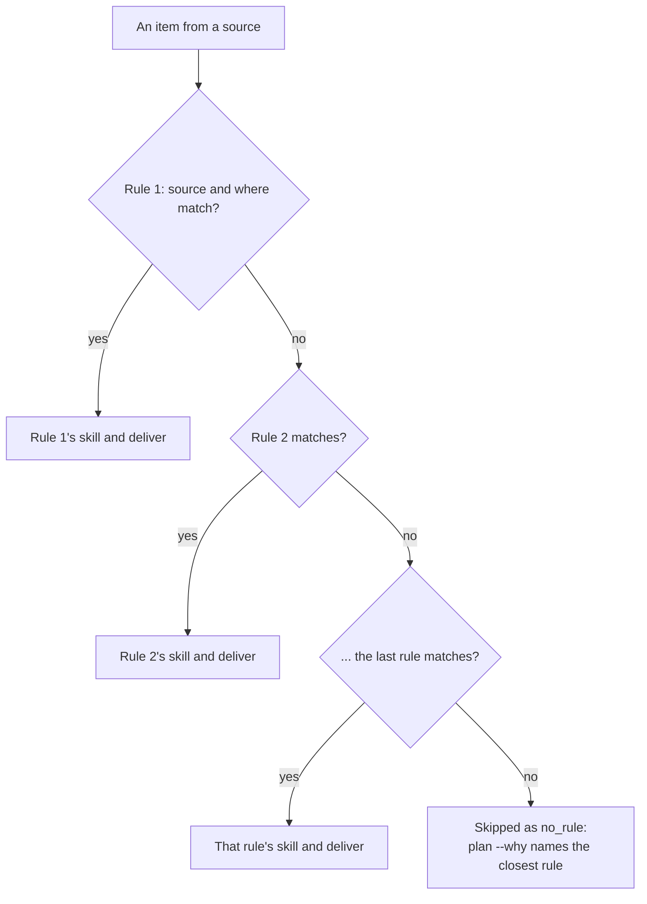

# Queue rules

A rule maps items to a skill; the first match wins, top first. Only `skill` is required:

```yaml
queue:
  - skill: fix
    where: { type: pr, mine: true, checks: failing }
  - skill: implement
    source: jira
    where: { status: Ready }
    deliver: pr
```

| Key | Does |
| --- | --- |
| `skill`, `source`, `where` | What runs, on which items: [`where`](#where) |
| `provider`, `model` | Overrides routing for this rule; two models [retry](#retry-on-the-next-model) |
| `skills`, `mcp`, `instructions`, `with` | Extra skills, [MCP servers](./mcp.md), instruction files, [parameters](../skills.md#write-your-own) |
| `deliver` | `draft_pr` (default), `pr`, [`push`](./chains.md#push), `report`, `pending_review` or [`plan`](../workflows/plans.md); see [Delivery](../how-it-works.md#delivery) |
| `branch`, `order`, `units` | [Branch template](./repos.md#branch-names), [item order](#order), units per run |
| `then`, `quota` | [More steps](./chains.md#then), [quota checks](./chains.md#quota) |
| `plan_tasks` | On a `deliver: plan` rule, the most tasks its [plan](../workflows/plans.md) holds; 8 by default |
| `on_done` | [Comment and move](#on-done) your items |
| `gates` | The rule's [own gates](../workflows/gates.md#gates-of-a-rule-s-own), on top of the top-level and repo ones |
| `wait`, `post`, `thread` | Plan and report posts: [waiting](../workflows/posts.md#posts-that-wait), [lean or full](../workflows/store.md#files-that-come-back), [where they go](../workflows/posts.md#threads) |
| `run` | `window` (default) or [`soon`](#run-soon) |

Types, defaults and full meanings are in the [reference](../../reference/config.md#queue).

An item goes down the list and stops at the first rule whose `source` and `where` it matches. One that matches none is skipped as `no_rule`, and `plan --why <key>` names the closest rule and the conditions it failed:



Four kinds of item go their own way: awaywork's own PRs reach only [`ours` rules](#your-reviewed-awaywork-prs), a plan's tasks only the first [`planned` rule](#a-plan-s-tasks) for their skill, a card carrying awaywork's plan [stays on its plan rule](../workflows/tasks.md#the-plan-sticks-to-the-card), and an item whose report you approved [goes on to the next rule](../workflows/posts.md#posts-that-wait).

## `where`

```yaml
where:
  type: pr                          # equals
  checks: [failing, pending]        # any of
  review_requested: { not: true }   # not
  unresolved_threads: { gte: 2 }    # on a number field: gt, gte, lt, lte; combine for a range
  updated: { older_than: 3d }       # on a date field: older_than, newer_than; m, h, d or w
  title: { matches: '^\[bug\]' }    # on title, description or a text field: case-insensitive regex
  label: awaywork                # on a list field: contains; GitHub issues must also be assigned to you
  behind: { gt: 0 }                 # GitHub: your PR's base has commits its branch lacks; see sync
  conflicts: false                  # GitHub: it merges cleanly into its base
  "fields.Priority": High           # an Asana custom field
  blocked: false                    # Linear, Jira, Asana: no open blocker
  any:                              # at least one entry holds; each is a where, ANDed with the keys above
    - { label: urgent }
    - { checks: failing }
```

Strings compare ignoring case (`section: In progress` matches `In Progress`); numbers and booleans exactly; fixed values like `type` are lowercase. Every source has `title`, `description`, `approved`, `state`, `closed` and `planned`; the [field table](../how-it-works.md#items) lists the rest.

Details:

- A missing field equals nothing and is neither older nor newer than anything. Spans count back from when the plan runs.
- Config errors: an unknown key (the error lists each source's keys), an invalid regex, an empty `any` entry.
- `plan` names the match an item failed, for `any` each entry's.
- `approved` is the skill of the newest result of awaywork's on the item that you approved or that went ahead ([Posts that wait](../workflows/posts.md#posts-that-wait)); `approved: true` is an error that says so.

### Your reviewed awaywork PRs

awaywork's own PRs match only rules whose top-level `where` names `ours` (in `any` it's an error), so they wait for your review. After it:

```yaml
- skill: fix
  where: { type: pr, mine: true, ours: true, my_unresolved_threads: { not: 0 } }
```

- The new PR stacks on awaywork's, on a branch named after it (`away/acme-api-9` for #9).
- Merge it, and the next pickup takes `-2`. While it's open or closed unmerged, #9 is skipped as `awaywork tried this in <PR>; delete away/acme-api-9 to run it again`.
- Resolve the threads it answered, or the rule takes #9 up again for them.
- The rule runs on threads you started, but the agent reads every unresolved one.
- `ours` is the GitHub source's: a custom source's `ours` field holds nothing back.

### A plan's tasks

A [task](../workflows/tasks.md) matches only rules whose top-level `where` names `planned: true`, the first whose `skill` is the task's (`implement` by default), and those rules take only tasks. Tasks carry their card's fields:

```yaml
- skill: implement
  where: { planned: true }
  deliver: pr
- skill: fix
  where: { planned: true, labels: bug }   # a plan's `skill: fix` tasks, on bug cards only
```

- A plan naming a skill no `planned` rule takes isn't posted.
- A `planned` rule delivers `draft_pr`, `pr` or `report`. A task is done when its PR merges, or, under a rule that reports, once its result is on the card: a [report task](../workflows/tasks.md#report-tasks), which nothing can wait on.
- Config errors: `planned: false`, `planned` inside `any`, and a `deliver: plan` rule with no `planned` rule.

## Finished items

Rules see open items until one names `state`: `open`, `merged` or `closed` (closed unmerged, done, canceled). `closed` is when it finished, a date field:

```yaml
- skill: review
  where: { type: pr, mine: true, state: merged, closed: { newer_than: 14d } }
  deliver: report
```

<!-- Generated by `pnpm docs:gen` from scripts/screens.ts. Do not edit. -->

```text config-plan-rules-merged
$ awaywork plan --rules
Queue
  #1  review  type=pr mine=true state=merged closed:newer_than=14d deliver=report
       85 taken: acme/api#329, acme/api#328, acme/api#327, …
```

Details:

- A `where`, or an `any` entry under one, that never names `state` matches open items only: `any: [{ state: merged, label: release }, { label: hotfix }]` takes merged `release` PRs and open `hotfix` ones.
- `closed` without a `state` that can be `merged` or `closed` is an error; so is `closed: { older_than }` without a `newer_than`.
- Only when a rule can match finished items (in `any` and `not` too) does its source read them: back to the widest `closed: { newer_than }`, or 7 days.
- GitHub reads your merged or closed PRs and closed assigned issues, plus your `search` ANDed with `is:closed`; search stops at 1,000 results, and `plan` warns near it. Jira reads resolved issues, Linear completed or canceled ones (archived too), Asana completed tasks; [custom sources](./custom-sources.md#finished-items) print their own.
- A finished item links no PR: its unit branches from the default branch. So `push` and `pending_review` are errors on a rule matching only finished items, and a rule matching both skips them.
- Attempts work as for open items; a PR merged since its last unit counts as changed.

## `order`

Units run in the source's order, newest first for GitHub, so with little quota the oldest can wait. `order: oldest`, `newest` or `updated` sorts them; items without the time go last. A card's [tasks](../workflows/tasks.md#the-feature-block) run back to back where the first ranks, in dependency order.

## Retry on the next model

```yaml
- skill: fix
  where: { type: pr, mine: true, checks: failing }
  model: { claude: [sonnet, opus] }
```

A step that fails on `sonnet` (a failed turn or the turn cap) runs once more, right away, on `opus`: in a one-step rule and in each step of a [chain](./chains.md#then), where a step can bring its own pair. Details:

- The retry starts from the clone as the failed step found it, its commits, edits and `.away/out/` changes dropped (gitignored files stay), on the same provider, without rechecking [`when`](./chains.md#when) or [`quota`](./chains.md#quota).
- Only a failure retries: not a quota stop, the time limit or Ctrl-C. No budget left, and the failure stands.
- Both attempts show in the report and cost budget. For [giving up](../how-it-works.md#units) on an item the retry counts, unless a quota, session or window stop cut it short. `notify` hears only the retry.

## `on_done`

Moving the card tells the next person it's their turn; a comment tells them what happened:

```yaml
- skill: implement
  source: jira
  where: { status: Ready }
  on_done: { comment: result, move: In Review }
```

`comment: result` posts, before the move, the result headed with the rule's skill: a report rule's report, else what it published (`Opened <PR>`, `Opened <PR> as a draft`, `Pushed 2 commits onto <PR>`, `Left your pending review on <PR>`), then a `Status:` line and `— awaywork`.

`move` is in the tracker's words, ignoring case: a Jira status (via its transition), a Linear state of the team, an Asana section (in the first of the task's projects that `projects` names and has it), a GitHub label (created if new), or a custom source's [`write`](./custom-sources.md#writing-back). Both show under the unit in the report:

<!-- Generated by `pnpm docs:gen` from scripts/screens.ts. Do not edit. -->

```text config-report-on-done
  1  ENG-12  implement  done, 7 turns  https://github.com/acme/api/pull/41
     result posted on https://acme.atlassian.net/browse/ENG-12
     on_done moved ENG-12 to "In Review"
```

When it runs:

- Once the chain published: a PR opened, a push landed, a report written, a pending review left. Not after a failed or stopped step, a run that ended first, a loop out of rounds, a step that left nothing or asked [questions](../workflows/questions.md#questions). A passed-over step, fired gates or a failed `verify` don't hold it back.
- `deliver: plan`: once the [plan](../workflows/plans.md) is posted. It takes no `comment`, as the plan is the result.
- A report whose post [waits](../workflows/posts.md#posts-that-wait): the result posts, and the move waits for your `approve`, made while the card is still where the post saw it.
- A [report task](../workflows/tasks.md#report-tasks) posts its result on the card regardless; a PR task only when asked. A `planned` rule moves the task's card, which [stays with its plan rule](../workflows/tasks.md).

What it writes to:

- The unit's items that are yours and from the rule's tracker (its `source`, else the matched item's). A Jira rule leaves the PR in the unit alone.
- Yours: your PR, an assigned issue, a Jira, Linear, Asana or custom source item. Never a PR you're reviewing or a `search`-only item (`not moved, not yours`, `got no result, not yours`).
- Ownership is reread right before the move: `couldn't move ENG-12 to In Review: ENG-12 is no longer yours: not assigned to you`. A custom `write` checks it itself.
- A missing status names the ones there are: `ENG-12 has no transition to "In Review", only to "QA", "Done"`.
- Bitbucket and a custom source without `write` can't move; `doctor` warns. The token needs write scope (`write:jira-work`, a Linear key with write); Asana's and gh's have it.
- A result over 30 KB isn't posted. Neither write fails the unit; errors are masked in the report.
- Each write changes the item's updated time. awaywork reads it before and after; if it's still the plan's (or the result's), it records the new one so its own writes don't look like a change, while someone else's still counts. A custom `write` prints both times for this; otherwise make the rule stop matching where the item moved to.

## `run: soon`

Some work shouldn't wait for the night: a PR gone red, an answer to awaywork's [questions](../workflows/questions.md#questions). [`awaywork watch`](../scheduling/machine.md#soon-runs) starts a soon rule's units within minutes of them coming due, a new item or one changed since its last attempt:

```yaml
watch: { every: 5m }            # the default
sources:
  jira: { site: acme.atlassian.net, email: me@acme.dev, every: 15m }   # a slow tracker
queue:
  - skill: fix
    where: { type: pr, mine: true, checks: failing }
    run: soon
```

Details:

- The daemon polls the soon rules' sources every `watch.every`, a source with its own longer `every` less often (both 1m or more). A poll plans only the soon rules and reads no quota.
- Window runs, manual `run` and `plan` take every rule; `plan` marks soon units `#1 soon`.
- GitHub Actions has no daemon: soon rules run in the windows. Costs and backoff are in [Scheduling](../scheduling/machine.md#soon-runs).
