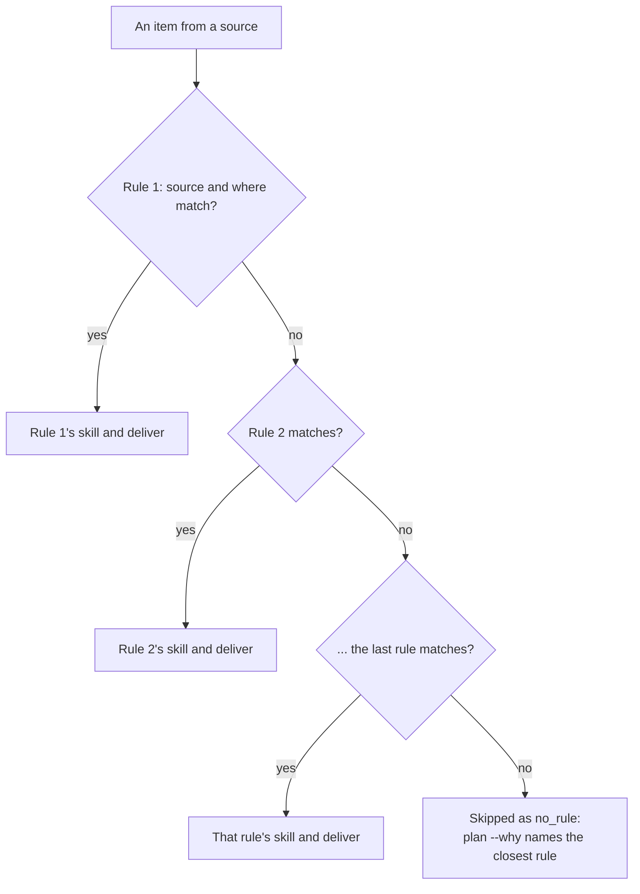

# Configuration

One YAML file, `~/.config/awaywork/config.yml` by default; `--config <path>` or `AWAYWORK_CONFIG` point elsewhere. This page goes by example. Every key, with its type and default, is in the [reference](../reference/config.md).

Where to find what:

- [Editing safely](#editing-safely): validate, preview.
- [Stability](#stability): what stays valid across releases.
- [A full example](#a-full-example): most keys in one file.
- [A base config](#a-base-config): share settings with `extends`.
- [Windows, limits and budget](#windows-limits-and-budget): when runs start, how much one does.
- [Providers](#providers): agents, their settings and logins, your own CLI.
- [Sources](#sources): where items come from, Bitbucket with Jira, routines.
- [Branch names](#branch-names): what a unit pushes to.
- [Linking PRs](#linking-prs): how a PR is tied to an item.
- [Repos and instructions](#repos-and-instructions): per-repo commands, and everything that runs in a clone.
- [Queue rules](#queue-rules): which skill runs on which item.
- [Notify](#notify): your command after each step and each run.
- [MCP servers](#mcp-servers): servers a rule gives its units.
- [Isolation](#isolation): a worker user or a container.
- [Old runs](#old-runs) and [Secrets](#secrets).

Gates, plans, threads and the store are in [Workflows](./workflows.md); multi-step rules in [Chains](./chains.md).

## Editing safely

```sh
awaywork doctor         # validate, including skill names
awaywork plan           # see what the change does to the next run
```

Or let your coding agent edit the queue, checked on your real items first: [With an AI agent](./agents.md).

For autocompletion in editors with the YAML language server, start the file with:

```yaml
# yaml-language-server: $schema=https://andreaprovenzale.github.io/awaywork/config.schema.json
```

`awaywork config schema` prints the same JSON Schema for the installed version.

## Stability

From 0.1.0-rc.1, a config valid on one minor release stays valid on the next. Keys marked experimental may change in a minor release, with a note in the release notes: so far only `forge.github.host`.

## A full example

```yaml
windows:                        # when scheduled runs start; this one is the default
  - { start: "01:00", end: "07:00" }
limits:                         # per run, every provider; unset by default
  units: 8
  units_per_repo: 3
  unit_minutes: 90              # stop a worker after this many minutes
keep_runs: 30d                  # default; older run dirs go when run or watch starts
watch: { every: 5m, debug: false }  # defaults; how often run: soon rules poll, and true logs every run line in watch.log
budget:                         # defaults; for every provider
  reserve: 10%                  # never go past 1 - reserve of any window
  per_run: 15%                  # at most this share of the long window per run
  session_max: 90%              # stop a worker past this share of the short window
  present_session_max: 40%      # the same, in a run outside every window
  fallback: { units: 4, turns: 60 }   # when the quota can't be read
providers:                      # order = routing preference
  - claude: { model: opus, settings: claude-worker.json }   # default: the binary's own model
  - codex: { config: { model_reasoning_effort: high } }
repos:                          # the only repos awaywork works in
  acme/*:                       # a bare key lists them, no settings
  acme/api:
    branch: feat/{key}-{title}
    setup: pnpm install --frozen-lockfile   # run before the worker
    secrets: [NPM_TOKEN]        # only setup sees these
    test: pnpm vitest run {files}
    instructions: notes/acme-api.md
sources:
  github: {}                    # your PRs, reviews and issues in those repos
  asana:
    workspace: "123"
    token_env: ASANA_TOKEN
    repo_map: { "1201": acme/api }   # project gid -> the repo its tasks' code lives in
    every: 15m                  # poll it for run: soon rules at most this often
branch: away/{key}             # default; {key} or {title} is required
instructions: [notes/me.md]     # every unit
skills: [house-style]           # every unit, next to a rule's skills; yours, in skills/ beside this file
queue:                          # first matching rule wins; top = highest priority
  - skill: fix
    where: { type: pr, mine: true, checks: failing }
    branch: fix/{key}
    run: soon                   # within minutes, not only in the windows
  - skill: implement
    source: github
    where: { type: issue, label: awaywork, repo: acme/api }
    order: oldest
    units: 2                    # at most 2 of these per run
  - skill: review
    where: { type: pr, review_requested: true, trusted: true }
    model: { claude: sonnet }
  - skill: implement
    source: asana
    where: { section: Ready, tags: backend }
    provider: codex
    skills: [our-api-conventions]   # yours too
    instructions: notes/backend.md
```

## A base config

Several configs, one per role, tend to repeat `windows`, `budget`, `sources` and `repos`. Put those in a base and have each role file `extends` it:

```yaml
# team/base.yml
windows: [{ start: "01:00", end: "07:00" }]
limits: { unit_minutes: 45 }
providers: [claude]
repos: { acme/api: }
sources: { github: {} }
instructions: [notes/team.md]
```

```yaml
# roles/developer.yml
extends: ../team/base.yml
limits: { units: 6, units_per_repo: 3 }
queue:
  - skill: fix
    source: github
    where: { type: pr, mine: true, checks: failing }
```

Maps merge key by key, the role winning: `limits` above gets all three keys. A list replaces the base's outright, `queue` and `windows` included, since rule order matters. An error names the file it comes from:

<!-- Generated by `pnpm docs:gen` from scripts/screens.ts. Do not edit. -->

```text config-doctor-extends
$ awaywork doctor --config roles/developer.yml
✖  team/base.yml: windows[0].end: expected a time like "01:00"
```

Details:

- `extends` is relative to the role file. One level only, local only: a base with its own `extends`, or a URL, is an error.
- There's no unsetting what the base sets: `null` is just an invalid value.
- Relative paths resolve against the file they're written in (`notes/team.md` is `team/notes/team.md`). So does the folder a custom source's `command`, a `context` command or a custom provider's `probe` runs in, and `claude: { settings }`. A custom source's `write` and `setup` run in the folder of the file that sets its `command`.
- Skills stay next to the file you pass to `--config`.
- An error inside a list the role sets names the role; a key only the base sets names the base.

## Windows, limits and budget

A run is one window opening, or one `awaywork run` by hand:

```yaml
windows:
  - { start: "01:00", end: "07:00" }          # the default
  - { days: [sat, sun], start: "10:00", end: "18:00" }
```

A scheduled run starts at `start`; no unit starts after `end`, and a running one stops there. `days` (`sun` to `sat`) are the days it opens on.

Pacing follows the clock, not the number of windows. A run may spend up to where an even spend over the long window stands at the next window's opening, or at the reset if that comes first, so more windows split the week finer rather than spend more. How the [budget](./how-it-works.md#budget) shares combine is in How it works; start with `per_run: 5%` for a week to see what a unit costs.

Limits cap what you'd have to review, per run and for every provider. None is set by default:

```yaml
limits: { units: 8, units_per_repo: 3, unit_minutes: 90 }
```

Units past a cap are skipped in queue order, the cap named in `awaywork plan` and the report. The keys are in the [reference](../reference/config.md#limits).

Details:

- Times are the machine's local time. In GitHub Actions they're the timezone you ran `schedule install` in, a run may start [up to an hour late in summer time](./scheduling.md#in-github-actions), and a hosted runner stops it at about 6 hours.
- [`awaywork watch`](./scheduling.md#on-your-machine) rereads windows every minute: no reinstall, unless you move the [wake](./scheduling.md#waking-up-for-it).
- `windows: []` means none: the daemon idles, and the Actions workflow runs only when dispatched. Windows shouldn't overlap.
- A run started outside every window stops workers at `present_session_max` (40%) instead of `session_max`, and skips providers whose quota it can't read.
- `per_run` caps each run, and `runs_until_reset` counts window openings.
- `budget` applies to every provider; a different budget takes a second config.
- A [`then`](./chains.md#then) chain is one unit. Each of a plan's tasks is one, in its own [repo](./workflows.md#across-repos), so a cap can cut a card's [block](./workflows.md#the-feature-block); the next run carries on.
- Only units whose first step got a provider count. Caps apply per `awaywork run`, like `fallback.units`, which every step draws on. A unit named with `--unit` goes past them.
- A rule's own `units` caps that rule; a `deliver: plan` rule's `plan_tasks` (8) caps its [plan](./workflows.md#plans)'s tasks.

## Providers

A list, in routing order. A bare name uses the defaults; a map sets `model` (passed as is: `claude --model`, `codex exec -m`, `agent --model`) and its own settings:

```yaml
providers:
  - claude: { model: opus, settings: claude-worker.json }
  - codex: { config: { model_reasoning_effort: high } }
  - cursor
```

Workers skip your user-level agent config. What you do want them to have, on every unit including someone else's PR, goes here:

- `claude: { settings }`: a settings file, relative to the config, passed as `--settings`. Auto-memory stays off, and workers run in `dontAsk` mode: a tool not pre-approved, by awaywork or your `permissions.allow`, is denied.
- `codex: { config }`: each key passed as `codex exec -c key=value`.

Cursor takes only `model` (its `auto` when unset). Details:

- It needs `CURSOR_API_KEY` in the env file, even on your machine: each run gets a fresh `HOME` in the clone, `.away/agent-home`, so none of your `~/.cursor` comes along, `agent login` included. Make a key in Cursor's dashboard.
- awaywork writes that `HOME`'s permissions: any shell command, read and write, plus the `tools` of the rule's [MCP servers](#mcp-servers). Never `--force`.
- Its commits can carry `Co-authored-by: Cursor <cursoragent@cursor.com>`, as Claude Code's can.
- A Cursor subagent is one turn toward the cap and one `task:` line in `worker.log`, whatever it does inside; `limits.unit_minutes` bounds it.
- Its usage shows only in its dashboard, so it runs on the [fallback](./how-it-works.md#budget) caps and sits out runs started outside a window.
- On a GitHub-hosted runner the action installs it: [Running Cursor](./scheduling.md#running-cursor).
- An older command provider of yours named `cursor` must be renamed: `providers[0].cursor: built in, so it takes no command; give your own provider another name`.

### Which login

Work and personal subscriptions on one machine? Pin each config's logins:

```yaml
providers:
  - claude: { config_dir: ~/.claude-work }
  - codex: { config_dir: ~/.codex-work }
forge: { github: { user: octocat-acme } }
```

`config_dir` is passed as `CLAUDE_CONFIG_DIR` or `CODEX_HOME`; log in there once (`CLAUDE_CONFIG_DIR=~/.claude-work claude /login`, `CODEX_HOME=~/.codex-work codex login`). `forge.github.user` picks a `gh auth status` account: its `gh auth token --user` becomes `GH_TOKEN` for everything awaywork does on GitHub, no `gh auth switch`. `doctor` names each login and fails with the fix:

<!-- Generated by `pnpm docs:gen` from scripts/screens.ts. Do not edit. -->

```text config-doctor-logins
✔  gh login: octocat-acme, pinned by forge.github.user
✔  claude login: <email>, max, in ~/.claude-work, pinned by providers[0].claude.config_dir
✖  codex login: ~/.codex-work doesn't exist; log in there with CODEX_HOME=~/.codex-work codex login
```

Details:

- `~/.claude` means Claude Code's default login, found only with `CLAUDE_CONFIG_DIR` unset, so that's what awaywork does.
- Unpinned, a run uses the environment: for a [scheduled job](./scheduling.md#on-your-machine), the env file and each binary's default, not a shell function that switches logins.
- The environment wins: `CLAUDE_CODE_OAUTH_TOKEN` over `config_dir`, `GH_TOKEN` or `GITHUB_TOKEN` over `user` (`GH_ENTERPRISE_TOKEN` with a `host`). So one config also runs in Actions or a container. `doctor` warns when that token is someone else's: `gh login: octocat from GH_TOKEN, not forge.github.user octocat-acme: a token in the environment wins; make it octocat-acme's, or unset it`.
- Cursor's login is `CURSOR_API_KEY`, everywhere.
- Under `isolation: user` or `container`, Claude's `config_dir` is refused (`set CLAUDE_CODE_OAUTH_TOKEN instead`). Codex's works: the `auth.json` it lends comes from there.
- A pin that can't be made stops `run`, `plan`, `approve`, `replay`, `sources` and `schedule install` before they touch anything (`forge.github.user: octocat-acme isn't logged in to gh; log in with gh auth login, as octocat-acme`), and `watch` starts nothing new until it can; working pins still apply to runs already going.

### Bring your own CLI

opencode, Amp and friends need no code in awaywork. Name a provider and give it a command; your CLI, your login:

```yaml
providers:
  - claude
  - opencode:
      command: opencode run --auto "$(cat "$AWAYWORK_PROMPT")"
      probe: ./opencode-quota.sh # optional; without it, windows only
limits:
  unit_minutes: 45
```

It runs in the clone like any worker, the prompt in the file `$AWAYWORK_PROMPT`, output to `worker.log`; exit 0 is a finished unit. (`--auto` approves whatever your opencode config doesn't deny; check your version's `--help`.) There's no turn cap, so `limits.unit_minutes` is required. The keys are in the [reference](../reference/config.md#providers-key).

A `probe` prints the quota as JSON. awaywork paces against the `long` window; `short` only feeds the session stop:

```json
{
  "windows": [
    { "name": "5h", "span": "short", "used": 0.2, "resetsAt": 1793021152, "minutes": 300 },
    { "name": "7d", "span": "long", "used": 0.3, "resetsAt": 1793539552, "minutes": 10080 }
  ]
}
```

Details:

- `secrets` are withheld from other workers and listed in Actions; `skills_dir` (default `.agents/skills`) is where the unit's skills go.
- No `model` key (put it in the command) and no `mcp`: a rule it may run can't name MCP servers, so route those elsewhere with `provider`.
- Nothing installs it on a GitHub-hosted runner, so there `plan` routes around it and `schedule install` leaves it out.
- `fallback.turns` doesn't apply; its 60 is for Claude, Codex and Cursor without a quota reading.
- Without a `probe` (or one with no `long` window) it runs on the `fallback` caps and sits out every run outside the windows, `run --unit` included. With no live rate-limit events, it can't stop mid-unit at the ceiling.
- The probe runs in the config's folder once per `plan` or `run`, after each unit and in `doctor`, with 60 s and your whole environment. `used` is 0 to 1, `resetsAt` unix seconds, `minutes` optional (a `long` window without it is 7 days).
- Whether the vendor allows unattended use is your call; `doctor` flags it `unattended: grey`.

## Sources

Each source reads your own items from one place:

| Source | Reads | You set |
| --- | --- | --- |
| `github` | Your PRs, PRs awaiting your review, issues assigned to you, in the [`repos`](#repos-and-instructions) you list | `{}` is enough; optional `search` |
| `asana` | Your incomplete tasks | `workspace` gid; optional `projects`, `repo_map` |
| `linear` | Your open issues | Optional `repo_map` |
| `jira` | Your unresolved issues | `site`, `email`; optional `cloud_id` (scoped token), `jql` (no `ORDER BY`), `repo_map` |
| `routines` | Items from the clock | [Routines](#routines) |
| any other name | Your command's JSON | [Custom sources](./custom-sources.md) |

The rest, defaults and `token_env` names included, is in the [reference](../reference/config.md#sources). Every source takes an `every` for [`run: soon`](#run-soon); all but `github` and `routines` a [`link`](#linking-prs).

`awaywork sources <id>` lists, read-only, the ids and names your keys and `where` take (`--json` for scripts):

<!-- Generated by `pnpm docs:gen` from scripts/screens.ts. Do not edit. -->

```text config-sources-linear
$ awaywork sources linear
linear:
  teams:
    - key: ENG
      name: Engineering
      states:
        - Todo
        - In Progress
    [...]
```

`github` lists your login and orgs; `asana` the workspaces, then the configured one's projects and sections; `jira` the projects and statuses, once `site` and `email` are set.

The forge, where the repos live and PRs open, is its own top-level key, GitHub unless you say otherwise:

```yaml
forge: github                 # the default; leave it out
# forge: bitbucket            # Bitbucket Cloud, see below
# forge: { github: { host: github.acme.com, user: octocat } }   # GitHub Enterprise, or a pinned gh account
```

`host` is a GitHub Enterprise host `gh` is logged in to; `user` is in [Which login](#which-login). A config has one forge. GitHub items come only with `sources.github`: without it, GitHub is still where your trackers' work opens its PRs.

::: warning Experimental

`forge.github.host` has only run in tests so far, never against a real GitHub Enterprise. `init`, `doctor` and artifact downloads still use `gh`'s default host. Tried it? [Open an issue](https://github.com/AndreaProvenzale/awaywork/issues/new) with how it went.

:::

### Tracker tokens

awaywork only reads with a tracker token, except for [`on_done`](#on-done), [questions](./workflows.md#questions) and [plans](./workflows.md#plans), and never hands it to the agent unless you list it in an [MCP server](#mcp-servers)'s `secrets`.

- **Asana** has no read-only token: make one just for awaywork, so you can revoke it alone.
- **Linear:** a personal API key (Settings > Account > Security & access), read-only when offered, or with write for those three.
- **Jira Cloud:** an Atlassian API token (id.atlassian.com > Security > API tokens). Prefer one with scopes, app Jira, `read:jira-work` plus `write:jira-work` for those three: `/away` then finds the `cloud_id`, and awaywork calls `api.atlassian.com`, as scoped tokens require. An unscoped token can do anything you can. Tokens last at most a year.
- Jira custom fields sharing a name are keyed by name and id: `fields.Team (customfield_10040)`.

### Context commands

A built-in source's `context` command fetches what an item points at, a Sentry issue or a runbook, with secrets the agent never gets:

```yaml
sources:
  github:
    context:
      command: ./fetch-sentry.sh   # reads $AWAYWORK_ITEM_URL, writes $AWAYWORK_CONTEXT_DIR/sentry.md
      secrets: [SENTRY_TOKEN]      # kept out of the agent's env
```

It runs per item before the worker, in the config's folder, never the clone, with `AWAYWORK_ITEM_KEY`, `AWAYWORK_ITEM_URL` and `AWAYWORK_ITEM_FILE` (the item as JSON). What it writes to `$AWAYWORK_CONTEXT_DIR` lands in `.away/context/<item>/extra/` as is, so never write a secret there (`curl -v` into a file, say). Its limits are in [What runs in the clone](#what-runs-in-the-clone). A custom source does this in its own `command`.

### Bitbucket and Jira

Code on Bitbucket Cloud, tickets in Jira? Set `forge: bitbucket` and list at least one repo, and draft PRs open on Bitbucket:

```yaml
forge: bitbucket
repos:
  acme/*:                          # the workspace is literal, the name globs
sources:
  jira:
    site: acme.atlassian.net
    email: me@acme.com
    repo_map: { ENG: acme/api }    # project key -> workspace/name on Bitbucket
```

It goes through Atlassian's `twg` CLI, and git over SSH with your keys. You need `twg` logged in (`twg setup bitbucket`, or a token in `TWG_BBC_TOKEN`) and an SSH key git can use without a passphrase prompt, since launchd and cron have no terminal; a key in an agent your scheduler sees works too. `doctor` checks both (details at the end of this section).

A run ends as on GitHub, with a draft PR whose footer links back to the item. `away/{key}` puts the Jira key in the branch, which Jira's development panel links on. [Plans](./workflows.md#plans) work too: twg finds task PRs, reads files a task [ships](./workflows.md#across-repos), and the build statuses a task [waits on](./workflows.md#waiting-on-a-check). Not yet:

- **Bitbucket's own items:** there is no Bitbucket source, so no fix or review rules on its PRs. Your open PRs still [link](#linking-prs) to items.
- **`deliver: push`:** refused, since twg reads neither branch restrictions nor auto-merge.
- **`deliver: pending_review`:** refused; GitHub only.
- **Going on with its own draft:** a draft that says `continue`, or asked, is yours to finish ([Continue](./workflows.md#continue)).
- **GitHub Actions or a container:** `schedule install` refuses both; use launchd, systemd or cron.
- **Fork PRs:** no pull refs to fetch, so the unit fails.
- **The `github` source:** refused with `forge: bitbucket`; one forge per config.

What `doctor` prints:

<!-- Generated by `pnpm docs:gen` from scripts/screens.ts. Do not edit. -->

```text config-doctor-bitbucket
✔  twg: 1.3.8
✔  twg acme
✔  git over ssh: acme/api
```

`twg acme` is `twg bb workspace get` per workspace; `git over ssh` a `git ls-remote` with `-o BatchMode=yes` added to git's ssh command (`GIT_SSH_COMMAND`, else `core.sshCommand`, else `ssh`; a `GIT_SSH` wrapper runs as is), so a prompting key fails here, not in a scheduled run. It warns when twg keeps its login anywhere but a file ([Safety](./safety.md#what-the-agent-can-reach)).

### Routines

Work with no ticket, only a day: every Monday you triage Sentry. A routine is an item that comes due on the clock, so rules, `plan` and attempts treat it like any other:

```yaml
sources:
  routines:
    sentry-triage:
      days: [mon]               # sun to sat; every day when unset
      at: "09:00"               # local time; or a list: ["09:00", "14:00"]
      repo: acme/api            # required: where the work happens
      title: Triage last week's Sentry issues
      description: Group new issues, link duplicates, draft fixes for the top three.

queue:
  - skill: triage
    source: routines
    where: { name: sentry-triage }
    deliver: report
    run: soon                   # within minutes of 09:00, not at the next window
```

Each is one `task`, its latest occurrence, keyed `<name>-<YYYYMMDD>-<HHMM>` in local time: branch `away/sentry-triage-20261026-0900`. `plan` lists when each comes due next, and `--why` which occurrence an item is:

<!-- Generated by `pnpm docs:gen` from scripts/screens.ts. Do not edit. -->

```text config-plan-why-routine
$ awaywork plan --why sentry-triage-20261026-0900
routines sentry-triage-20261026-0900  Triage last week's Sentry issues
  https://github.com/acme/api
  routine sentry-triage, due mon 2026-10-26 09:00; next mon 2026-11-02 09:00
  [...]
```

Details:

- A machine asleep all week wakes to one item, not a backlog. Once a unit on it finishes, it's [unchanged](./how-it-works.md#units) until the next occurrence, a new item.
- It's yours (`mine`), its `url` the repo's page. Rules match `name`, `repo`, `created` and `updated` (both the occurrence).
- Any name but `context` and `every`.
- On GitHub Actions, times are the workflow's `TZ`. Without `run: soon` it waits for a window: Monday's 09:00 runs Tuesday at 01:00 with the default one.
- No tracker to write to: `on_done` and `deliver: plan` are refused, and results or questions stay in the report; [`notify`](#notify) can send them on.
- It takes a [`context`](#context-commands) command. `init` writes no rules for routines: write yours.

## Branch names

`branch` is a template, set globally, per repo or per rule; the most specific wins:

```yaml
queue:
  - { skill: fix, where: { type: pr, mine: true, checks: failing }, branch: "fix/{title}" }
```

It needs `{key}` or `{title}` (a slug of at most 40 characters), else every unit would share it. Optional `{type}` is the conventional-commit type of the chain's first committing skill ([`metadata.type`](./skills.md#write-your-own)).

| Item                               | `{key}`       |
| ---------------------------------- | ------------- |
| GitHub PR or issue `acme/api#12`   | `acme-api-12` |
| Asana task with custom ID `ENG-12` | `ENG-12`      |
| Linear or Jira issue `ENG-12`      | `ENG-12`      |
| Task `api` of a plan on `ENG-12`   | `ENG-12-api`  |

The name is cosmetic, since awaywork finds its PRs by their footer, except for Jira, which links a PR only by the key in its branch or title: keep `{key}` in one of them.

awaywork pushes only branches that don't exist yet, but for a [`push`](./chains.md#push) rule and its own draft it [continues](./workflows.md#continue). When the name is taken:

- The unit takes the first free `<branch>-2` to `<branch>-10`, for every step of its chain.
- Unless awaywork tried there: a PR on that branch, open or closed unmerged, whose footer names one of the unit's items skips it as `awaywork tried this in <PR>; delete <branch> to run it again` (that record is on GitHub, so it holds on a runner without [attempts](./how-it-works.md#units)), unless it's the draft the unit [goes on](./workflows.md#continue) with. A merged one starts a new round with a suffix.
- A branch with no PR whose tip has the `Awaywork:` trailer is a push whose PR failed: skipped until you delete it. Without the trailer it's your work, passed over for a suffix.
- A [plan's task](./workflows.md#tasks) takes no suffix, since its PR is found by its branch: skipped until you delete it. So a `planned` rule's template renders from `{key}` alone (`{title}` or `{type}` is a config error, as a re-plan may retitle), and every `planned` rule of a source sets the same `branch`, or none does.

## Linking PRs

Trackers don't say which PR is a task's, so awaywork looks through your open PRs:

- Its own PR is linked by the items its footer names, never by names, so its PR for ENG-13 mentioning ENG-12 isn't ENG-12's. A footer naming no items counts as none.
- Yours is linked when its branch or title holds the key as a whole word, any case, or its body holds the source's `link` line. A bare key in the body doesn't count.

`link` is a line in the tracker's words, from the item's `{key}`, `{id}` and `{url}`, which awaywork also writes into its drafts:

| Source | Default `link` | Why |
| --- | --- | --- |
| `linear` | `Part of {key}` | Non-closing: merging leaves the issue to your workflow |
| `asana` | `{url}` | Asana links a PR whose description holds the task URL |
| `jira` | none | Jira links on the branch or title only |
| custom | none | Whatever your tracker reads, e.g. `Refs {key}` |

```yaml
sources:
  linear: { link: "Closes {key}" }   # merging closes the issue
```

## Repos and instructions

`repos` lists the repos awaywork works in, and holds each one's commands and instructions:

```yaml
repos:
  acme/web:                              # a bare key: listed, no settings
  acme/*: { setup: pnpm install --frozen-lockfile }   # a glob: every repo it names
  acme/api:
    secrets: [NPM_TOKEN]                 # only setup sees these
    verify: pnpm lint && pnpm test
    test: pnpm vitest run {files}
    instructions: notes/acme-api.md
```

- **It's the allowlist.** The `github` source reads these repos, and an item from any source, a custom one too, that names a repo no key matches, as its `repo` or its linked PR's, is skipped; `awaywork plan --skipped unlisted_repo` shows them. A repo the config names itself, a routine's `repo` or a `repo_map` value, has to be listed, or the config is refused.
- **A key** is `owner/name` or a `*` glob, which stays within the owner or the name (`acme/*`, `acme/api-*`).
- **Settings merge.** A repo takes the settings of every key that names it: globs first, in the order written, then its own key, a later one winning per setting. `secrets` add up and `gates` merge by name. Above, `acme/api` gets the glob's `setup` and its own `verify`.

- **`setup`** runs once per unit in the fresh clone, before any agent, outside the model; the agent is told it ran.
- **`verify`** runs once the chain ends, before publishing. A failure still publishes, its tail in the PR body or push summary, and a `deliver: pr` PR opens as a draft; the tail also lands in `verify.log` in the unit's `out/` in the run dir.
- **`test`** is a line in the agent's prompt.
- **`image`** is what the repo's units run in under [`isolation: container`](#in-a-container).
- **`instructions`** (top level, per repo, per rule) are file paths relative to the config they're in. A repo can also carry `.awaywork/instructions.md`, read unless the unit is on someone else's PR.

Top-level `skills` adds [skills](./skills.md#where-skills-come-from) to every unit. PR titles, bodies and commit messages have no config: the agent follows the repo's template, its commit style and your instructions.

Details on `setup` and its `secrets`:

- Later chain steps share the clone and don't rerun it, so a `when` or `until` command needing a step's new dependencies installs them itself (`pnpm i --frozen-lockfile && pnpm test`). Whatever setup leaves running is stopped.
- Its `secrets` reach setup only, masked in its output, passed from repository secrets in Actions. Read them from the repo's config (`${NPM_TOKEN}` in `.npmrc`), not your home, which the agent shares.
- It gets `GH_TOKEN` and `GH_ENTERPRISE_TOKEN` as `none`, so `gh` and git over https through gh's helper fail with a 401, even on a public repo. List `GH_TOKEN` in `secrets` to give it yours.
- On someone else's PR it runs the author's install scripts, so it gets no secrets, and runs only for an author with write access or org membership. No secrets either on an awaywork PR's branch a rule took up, which a worker wrote.
- A plan's task may name any repo `repos` lists, and runs with that repo's settings ([Across repos](./workflows.md#across-repos)).

### What runs in the clone

Every config command that touches a clone. All run in a shell outside the model, in the clone, except `context`, which runs in the config's folder. None gets a forge token.

| Command | When | Secrets | A failure |
| --- | --- | --- | --- |
| `repos.<repo>.setup` | Once per unit, before the first agent; not for later steps, nor on an untrusted author's PR | Its repo's `secrets`; none on someone else's PR or an awaywork branch a rule took up | Non-zero, over 15 minutes or the window's end skips the unit, the tail in the report |
| `sources.<id>.context.command` | Per item, before setup; not on a dry run | Its own `secrets` | Logged; the unit runs without `extra/`. Over two minutes, the window's end, over 1 MB, or a symlink or non-file in its output count as failures |
| `repos.<repo>.test` | Never by awaywork: the agent runs it if it wants | The agent's: its provider's and its rule's MCP servers' | Up to the agent |
| `repos.<repo>.verify` | Once per chain that ends with commits, before publishing; not for `report` | None | Its tail in the PR body or push summary; a `pr` PR opens as a draft; still published |
| `when.command` | Before a step's agent; not on an untrusted author's PR | None | The step is passed over; over 15 minutes or the window's end ends the chain, which publishes |
| `until.command` | After every loop step; not on an untrusted author's PR, where the loop ends | None | The loop goes on; uncommitted changes fail it too; the window's end ends the chain; a loop ending on a failure puts the tail in the PR body |
| `gates.<name>.command` | Once per chain with commits, after `verify`; not for `report` or `pending_review`, nor a dry run. A plan or report rule's own gate after its step, with `$AWAYWORK_OUT_DIR` | None | The gate fires: stdout in the decision card, a `pr` PR opens as a draft, a plan or report waits. So does a command that can't run, times out, hits the window's end or isn't run on an untrusted PR ([Gates](./workflows.md#gates)) |

`verify`, `when` and `until` share results: one command on one commit runs once; a gate always runs afresh. All four get the chain's start commit as `$AWAYWORK_FROM`, and their git ignores replace refs. Only a gate's git reads attributes from the start commit; the others keep the worktree's, so an eol or LFS rule the chain adds doesn't trip your `verify`. More in [Loops](./chains.md#loops).

## Queue rules

A rule maps items to a skill; the first match wins, top first. Only `skill` is required:

```yaml
queue:
  - skill: fix
    where: { type: pr, mine: true, checks: failing }
  - skill: implement
    source: jira
    where: { status: Ready }
    deliver: pr
```

| Key | Does |
| --- | --- |
| `skill`, `source`, `where` | What runs, on which items: [`where`](#where) |
| `provider`, `model` | Overrides routing for this rule; two models [retry](#retry-on-the-next-model) |
| `skills`, `mcp`, `instructions`, `with` | Extra skills, [MCP servers](#mcp-servers), instruction files, [parameters](./skills.md#write-your-own) |
| `deliver` | `draft_pr` (default), `pr`, [`push`](./chains.md#push), `report`, `pending_review` or [`plan`](./workflows.md#plans); see [Delivery](./how-it-works.md#delivery) |
| `branch`, `order`, `units` | [Branch template](#branch-names), [item order](#order), units per run |
| `then`, `quota` | [More steps](./chains.md#then), [quota checks](./chains.md#quota) |
| `plan_tasks` | On a `deliver: plan` rule, the most tasks its [plan](./workflows.md#plans) holds; 8 by default |
| `on_done` | [Comment and move](#on-done) your items |
| `wait`, `gates`, `post`, `thread` | Plan and report posts: [waiting](./workflows.md#posts-that-wait), [own gates](./workflows.md#gates-of-a-rule-s-own), [lean or full](./workflows.md#files-that-come-back), [where they go](./workflows.md#threads) |
| `run` | `window` (default) or [`soon`](#run-soon) |

Types, defaults and full meanings are in the [reference](../reference/config.md#queue).

An item goes down the list and stops at the first rule whose `source` and `where` it matches. One that matches none is skipped as `no_rule`, and `plan --why <key>` names the closest rule and the conditions it failed:



Four kinds of item go their own way: awaywork's own PRs reach only [`ours` rules](#your-reviewed-awaywork-prs), a plan's tasks only the first [`planned` rule](#a-plan-s-tasks) for their skill, a card carrying awaywork's plan [stays on its plan rule](./workflows.md#the-plan-sticks-to-the-card), and an item whose report you approved [goes on to the next rule](./workflows.md#posts-that-wait).

### `where`

```yaml
where:
  type: pr                          # equals
  checks: [failing, pending]        # any of
  review_requested: { not: true }   # not
  unresolved_threads: { gte: 2 }    # on a number field: gt, gte, lt, lte; combine for a range
  updated: { older_than: 3d }       # on a date field: older_than, newer_than; m, h, d or w
  title: { matches: '^\[bug\]' }    # on title, description or a text field: case-insensitive regex
  label: awaywork                # on a list field: contains; GitHub issues must also be assigned to you
  behind: { gt: 0 }                 # GitHub: your PR's base has commits its branch lacks; see sync
  conflicts: false                  # GitHub: it merges cleanly into its base
  "fields.Priority": High           # an Asana custom field
  blocked: false                    # Linear, Jira, Asana: no open blocker
  any:                              # at least one entry holds; each is a where, ANDed with the keys above
    - { label: urgent }
    - { checks: failing }
```

Strings compare ignoring case (`section: In progress` matches `In Progress`); numbers and booleans exactly; fixed values like `type` are lowercase. Every source has `title`, `description`, `approved`, `state`, `closed` and `planned`; the [field table](./how-it-works.md#items) lists the rest.

Details:

- A missing field equals nothing and is neither older nor newer than anything. Spans count back from when the plan runs.
- Config errors: an unknown key (the error lists each source's keys), an invalid regex, an empty `any` entry.
- `plan` names the match an item failed, for `any` each entry's.
- `approved` is the skill of the newest result of awaywork's on the item that you approved or that went ahead ([Posts that wait](./workflows.md#posts-that-wait)); `approved: true` is an error that says so.

#### Your reviewed awaywork PRs

awaywork's own PRs match only rules whose top-level `where` names `ours` (in `any` it's an error), so they wait for your review. After it:

```yaml
- skill: fix
  where: { type: pr, mine: true, ours: true, my_unresolved_threads: { not: 0 } }
```

- The new PR stacks on awaywork's, on a branch named after it (`away/acme-api-9` for #9).
- Merge it, and the next pickup takes `-2`. While it's open or closed unmerged, #9 is skipped as `awaywork tried this in <PR>; delete away/acme-api-9 to run it again`.
- Resolve the threads it answered, or the rule takes #9 up again for them.
- The rule runs on threads you started, but the agent reads every unresolved one.
- `ours` is the GitHub source's: a custom source's `ours` field holds nothing back.

#### A plan's tasks

A [task](./workflows.md#tasks) matches only rules whose top-level `where` names `planned: true`, the first whose `skill` is the task's (`implement` by default), and those rules take only tasks. Tasks carry their card's fields:

```yaml
- skill: implement
  where: { planned: true }
  deliver: pr
- skill: fix
  where: { planned: true, labels: bug }   # a plan's `skill: fix` tasks, on bug cards only
```

- A plan naming a skill no `planned` rule takes isn't posted.
- A `planned` rule delivers `draft_pr`, `pr` or `report`. A task is done when its PR merges, or, under a rule that reports, once its result is on the card: a [report task](./workflows.md#report-tasks), which nothing can wait on.
- Config errors: `planned: false`, `planned` inside `any`, and a `deliver: plan` rule with no `planned` rule.

### Finished items

Rules see open items until one names `state`: `open`, `merged` or `closed` (closed unmerged, done, canceled). `closed` is when it finished, a date field:

```yaml
- skill: review
  where: { type: pr, mine: true, state: merged, closed: { newer_than: 14d } }
  deliver: report
```

<!-- Generated by `pnpm docs:gen` from scripts/screens.ts. Do not edit. -->

```text config-plan-rules-merged
$ awaywork plan --rules
Queue
  #1  review  type=pr mine=true state=merged closed:newer_than=14d deliver=report
       85 taken: acme/api#329, acme/api#328, acme/api#327, …
```

Details:

- A `where`, or an `any` entry under one, that never names `state` matches open items only: `any: [{ state: merged, label: release }, { label: hotfix }]` takes merged `release` PRs and open `hotfix` ones.
- `closed` without a `state` that can be `merged` or `closed` is an error; so is `closed: { older_than }` without a `newer_than`.
- Only when a rule can match finished items (in `any` and `not` too) does its source read them: back to the widest `closed: { newer_than }`, or 7 days.
- GitHub reads your merged or closed PRs and closed assigned issues, plus your `search` ANDed with `is:closed`; search stops at 1,000 results, and `plan` warns near it. Jira reads resolved issues, Linear completed or canceled ones (archived too), Asana completed tasks; [custom sources](./custom-sources.md#finished-items) print their own.
- A finished item links no PR: its unit branches from the default branch. So `push` and `pending_review` are errors on a rule matching only finished items, and a rule matching both skips them.
- Attempts work as for open items; a PR merged since its last unit counts as changed.

### `order`

Units run in the source's order, newest first for GitHub, so with little quota the oldest can wait. `order: oldest`, `newest` or `updated` sorts them; items without the time go last. A card's [tasks](./workflows.md#the-feature-block) run back to back where the first ranks, in dependency order.

### Retry on the next model

```yaml
- skill: fix
  where: { type: pr, mine: true, checks: failing }
  model: { claude: [sonnet, opus] }
```

A step that fails on `sonnet` (a failed turn or the turn cap) runs once more, right away, on `opus`: in a one-step rule and in each step of a [chain](./chains.md#then), where a step can bring its own pair. Details:

- The retry starts from the clone as the failed step found it, its commits, edits and `.away/out/` changes dropped (gitignored files stay), on the same provider, without rechecking [`when`](./chains.md#when) or [`quota`](./chains.md#quota).
- Only a failure retries: not a quota stop, the time limit or Ctrl-C. No budget left, and the failure stands.
- Both attempts show in the report and cost budget. For [giving up](./how-it-works.md#units) on an item the retry counts, unless a quota, session or window stop cut it short. `notify` hears only the retry.

### `on_done`

Moving the card tells the next person it's their turn; a comment tells them what happened:

```yaml
- skill: implement
  source: jira
  where: { status: Ready }
  on_done: { comment: result, move: In Review }
```

`comment: result` posts, before the move, the result headed with the rule's skill: a report rule's report, else what it published (`Opened <PR>`, `Opened <PR> as a draft`, `Pushed 2 commits onto <PR>`, `Left your pending review on <PR>`), then a `Status:` line and `— awaywork`.

`move` is in the tracker's words, ignoring case: a Jira status (via its transition), a Linear state of the team, an Asana section (in the first of the task's projects that `projects` names and has it), a GitHub label (created if new), or a custom source's [`write`](./custom-sources.md#writing-back). Both show under the unit in the report:

<!-- Generated by `pnpm docs:gen` from scripts/screens.ts. Do not edit. -->

```text config-report-on-done
  1  ENG-12  implement  done, 7 turns  https://github.com/acme/api/pull/41
     result posted on https://acme.atlassian.net/browse/ENG-12
     on_done moved ENG-12 to "In Review"
```

When it runs:

- Once the chain published: a PR opened, a push landed, a report written, a pending review left. Not after a failed or stopped step, a run that ended first, a loop out of rounds, a step that left nothing or asked [questions](./workflows.md#questions). A passed-over step, fired gates or a failed `verify` don't hold it back.
- `deliver: plan`: once the [plan](./workflows.md#plans) is posted. It takes no `comment`, as the plan is the result.
- A report whose post [waits](./workflows.md#posts-that-wait): the result posts, and the move waits for your `approve`, made while the card is still where the post saw it.
- A [report task](./workflows.md#report-tasks) posts its result on the card regardless; a PR task only when asked. A `planned` rule moves the task's card, which [stays with its plan rule](./workflows.md#tasks).

What it writes to:

- The unit's items that are yours and from the rule's tracker (its `source`, else the matched item's). A Jira rule leaves the PR in the unit alone.
- Yours: your PR, an assigned issue, a Jira, Linear, Asana or custom source item. Never a PR you're reviewing or a `search`-only item (`not moved, not yours`, `got no result, not yours`).
- Ownership is reread right before the move: `couldn't move ENG-12 to In Review: ENG-12 is no longer yours: not assigned to you`. A custom `write` checks it itself.
- A missing status names the ones there are: `ENG-12 has no transition to "In Review", only to "QA", "Done"`.
- Bitbucket and a custom source without `write` can't move; `doctor` warns. The token needs write scope (`write:jira-work`, a Linear key with write); Asana's and gh's have it.
- A result over 30 KB isn't posted. Neither write fails the unit; errors are masked in the report.
- Each write changes the item's updated time. awaywork reads it before and after; if it's still the plan's (or the result's), it records the new one so its own writes don't look like a change, while someone else's still counts. A custom `write` prints both times for this; otherwise make the rule stop matching where the item moved to.

### `run: soon`

Some work shouldn't wait for the night: a PR gone red, an answer to awaywork's [questions](./workflows.md#questions). [`awaywork watch`](./scheduling.md#soon-runs) starts a soon rule's units within minutes of them coming due, a new item or one changed since its last attempt:

```yaml
watch: { every: 5m }            # the default
sources:
  jira: { site: acme.atlassian.net, email: me@acme.dev, every: 15m }   # a slow tracker
queue:
  - skill: fix
    where: { type: pr, mine: true, checks: failing }
    run: soon
```

Details:

- The daemon polls the soon rules' sources every `watch.every`, a source with its own longer `every` less often (both 1m or more). A poll plans only the soon rules and reads no quota.
- Window runs, manual `run` and `plan` take every rule; `plan` marks soon units `#1 soon`.
- GitHub Actions has no daemon: soon rules run in the windows. Costs and backoff are in [Scheduling](./scheduling.md#soon-runs).

## Notify

`notify.command` runs as you, with your environment, on two events in `AWAYWORK_EVENT`:

- **`run`**, when a run ends, dry runs included: `AWAYWORK_REPORT` is the morning report's path, with `report.json` beside it, and `AWAYWORK_RUN_ID` the run.
- **`unit`**, for every step of a unit once it published, before the next unit. None on a dry run; Ctrl-C stops the running one and fires no more.

```yaml
notify:                         # a line per step
  command: >-
    [ "$AWAYWORK_EVENT" = unit ] || exit 0;
    echo "$AWAYWORK_UNIT $AWAYWORK_STATUS $AWAYWORK_PR_URL" >> ~/awaywork.log
```

The command gets both events, so filter as above. `secrets` names the env vars it reads: workers never see them, and Actions passes them from repository secrets. Both events have `AWAYWORK_RUN_ID`; a `unit` event also has:

| Variable | Holds |
| --- | --- |
| `AWAYWORK_UNIT`, `AWAYWORK_SKILL`, `AWAYWORK_STATUS` | The step (`acme-api-12-review-1`), its skill, how it ended (`done`, `failed`, `skipped`...) |
| `AWAYWORK_PR_URL` | On every step of a unit that opened a PR; never on a [`push`](./chains.md#push), so a hook can't touch your own PR |
| `AWAYWORK_REPORT` | What the step wrote: its report, or the PR body |
| `AWAYWORK_ITEM_URL`, `AWAYWORK_ITEM_KEY`, `AWAYWORK_SOURCE` | One line per item, in order |
| `AWAYWORK_REPO` | `owner/name` |
| `AWAYWORK_VERDICT`, `AWAYWORK_OUT_DIR` | The step's verdict, and its kept `.away/out/`, which also holds earlier steps' files: check `$AWAYWORK_SKILL` first |

There are no built-in integrations. A failure or a run over a minute is logged (`notify failed for acme-api-1: Command failed with exit code 3: ...`) and the run still succeeds; anything left in the background is stopped. Recipes, ntfy, Slack and Notion among them, are in [Where results go](./results.md#recipes).

### PR labels, reviewers and ready for review

Ready for review is [`deliver: pr`](#queue-rules). Otherwise a PR gets the agent's title and body, no labels or reviewers, into the base awaywork picked. `gh` in the hook adds the rest:

```yaml
notify:
  command: |
    set -e
    [ "$AWAYWORK_EVENT" = unit ] && [ -n "$AWAYWORK_PR_URL" ] || exit 0
    gh pr edit "$AWAYWORK_PR_URL" --add-label awaywork
    # every step of the PR fires: ask octocat once, and never on a draft
    skip=$(gh pr view "$AWAYWORK_PR_URL" --json isDraft,reviewRequests -q '.isDraft or any(.reviewRequests[]; .login == "octocat")')
    [ "$skip" = false ] || exit 0
    gh pr edit "$AWAYWORK_PR_URL" --add-reviewer octocat
```

- `set -e` stops at a failing `gh`; the next step tries again.
- `--base develop` moves the base too. Leave it out on a plan's [stacked tasks](./workflows.md#the-feature-block) and on a rule that takes up an awaywork PR: their PRs sit on another PR's branch, and moving the base breaks the stack.
- It's your token, not a worker's. A reviewer, and the CODEOWNERS a ready PR asks, get notified: treat that like a comment you'd post.

## MCP servers

Declare servers under `mcp`; rules and steps name the ones they get:

```yaml
mcp:
  sentry:                       # HTTP
    url: https://mcp.sentry.dev/mcp
    headers: { Authorization: "Bearer ${SENTRY_TOKEN}" }
    secrets: [SENTRY_TOKEN]
  db:                           # stdio
    command: npx
    args: [-y, some-postgres-mcp]
    env: { READ_ONLY: "1" }
    secrets: [DATABASE_URL]     # in the server's env as DATABASE_URL
    tools: [query]              # default: all the server's tools

queue:
  - skill: implement
    where: { type: issue, label: bug }
    mcp: [sentry]
    then:
      - { skill: review, mcp: [db] }
```

The shape is a subset of Claude Code's `.mcp.json`, translated per agent. A `then` step inherits its rule's servers unless it names its own; `mcp: []` gives none. Details:

- A stdio server gets its `secrets` in its env; an HTTP one in headers, as `${NAME}` or `Bearer ${NAME}`. Never in `command`, `args` or `url` (the process list shows them) or `env` (Codex takes literals only).
- `GH_`, `GITHUB_` and `TWG_` names are reserved: workers never get forge logins, and Actions refuses `GITHUB_` secrets.
- `tools` limits what the agent may call. Only units naming a server get its secrets; `schedule` maps them into Actions, and `doctor` shows whether each is set.
- Servers start for your own PRs, issues and tasks, never on someone else's PR or an issue it closes, nor with a secret unset.
- Only token-based servers work unattended; workers never get your claude.ai connectors. Its secret is one the agent can read, its tools ones injected text can call: [Safety](./safety.md#mcp-servers).

## Isolation

By default setup, the agent and the checks run as you:

```yaml
isolation: user # default: none; or container
```

- **`none`:** as you. [Safety](./safety.md)'s measures keep credentials out of the agent's way, not its reach ([Not a sandbox](./safety.md#not-a-sandbox)).
- **`user`:** as `awaywork`, a user with nothing of yours, which you make once on Linux.
- **`container`:** a fresh container of the repo's image per command: [In a container](#in-a-container).

`doctor` says how to make the user, here for a user `runner` (uid and gid 1001):

<!-- Generated by `pnpm docs:gen` from scripts/screens.ts. Do not edit. -->

```text config-doctor-isolation-user
✖  isolation: user, but can't run as the awaywork user (sudo: unknown user awaywork); make the worker user once:
    sudo useradd --no-create-home --user-group --shell /usr/sbin/nologin awaywork
    echo awaywork | sudo tee -a /etc/cron.deny /etc/at.deny
    sudo visudo -f /etc/sudoers.d/awaywork   # with these two lines:
    runner ALL=(awaywork) NOPASSWD:SETENV: ALL
    runner ALL=(root) NOPASSWD: /usr/bin/chown -R -h -P awaywork\: /tmp/awaywork-[A-Za-z0-9][A-Za-z0-9][A-Za-z0-9][A-Za-z0-9][A-Za-z0-9][A-Za-z0-9], /usr/bin/chown -R -h -P 1001\:1001 /tmp/awaywork-[A-Za-z0-9][A-Za-z0-9][A-Za-z0-9][A-Za-z0-9][A-Za-z0-9][A-Za-z0-9]
```

No home, no login shell: each clone gets a fresh `HOME`. The first sudoers line runs anything as the worker; the second only the two `chown`s that hand it a clone and its `HOME` and take them back ([why that's safe](./safety.md#a-worker-user-on-your-linux-machine)). Then `doctor` says `✔  isolation: user: setup, the agent and the checks run as awaywork`. What changes:

- **Logins.** Your keychain login isn't there: give Claude a `CLAUDE_CODE_OAUTH_TOKEN` (`claude setup-token`) in the env file; `doctor` warns until you do. Cursor needs `CURSOR_API_KEY` anyway. Codex borrows your `auth.json` for the run and its refreshed tokens are saved back, under Codex's lock; read [what that doesn't close](./safety.md#a-worker-user-on-your-linux-machine) first.
- **Tools** must be system-wide: the worker can't run what nvm, `~/.local/bin` or `~/.cargo` put in your home, and `doctor` warns about each such `PATH` entry. For Cursor: `sudo env HOME=/opt/cursor bash -c 'curl https://cursor.com/install -fsS | bash'`, then link `agent` into `/usr/local/bin`.
- **Your home** must be closed (`chmod o-rwx ~`); `doctor` warns until it is.
- **Linux only:** `isolation: user runs on Linux only, not darwin`.
- **Always on** a GitHub-hosted runner and in awaywork's image, whatever the config says; the action or the [Dockerfile](./scheduling.md#in-a-container) makes the user.
- **One developer per worker user:** the `chown` line reaches anyone's awaywork clones.

### In a container

```yaml
isolation: container
repos:
  acme/api:
    image: ghcr.io/acme/api-dev:latest # what setup, the agent and the checks run in
    setup: pnpm i --frozen-lockfile
```

The one for your Mac, and for more than a user hides on Linux. Every setup, agent run and check starts a fresh container of the repo's `image` (Docker Desktop, Colima or Linux's engine). It mounts the clone, at its own path, and the skills plugin read-only, nothing else: no home, no docker socket. It runs as your uid and gid, every capability dropped, `no-new-privileges`. `doctor` checks Docker, each image (pulling it if missing, failing if it can't) and the agents' CLIs in it:

<!-- Generated by `pnpm docs:gen` from scripts/screens.ts. Do not edit. -->

```text config-doctor-container
✔  isolation: container: setup, the agent and the checks run in a fresh container of the repo's image (Docker 27.4.0)
✔  isolation: acme/leak: awaywork-leak has claude 2.1.290 (Claude Code stand-in), codex codex-cli 0.162.1 (stand-in)
```

The image is yours to build, and all the units get:

- **The agent CLIs and toolchain** the repo's rules use, and the commands of its stdio [MCP servers](#mcp-servers), which start inside. Not `gh` or `glab`: awaywork's forge calls run outside. Install system-wide, not under `/root`. awaywork skips the `ENTRYPOINT`.
- **One per repo:** under `container`, a `repos` entry without `image` is an error, and a unit in a repo with no entry is skipped (`no image for acme/web: isolation: container needs one in its repos entry`). Nothing falls back to you.
- **Pulled once**, by the first `docker run` or `doctor`; `docker pull` to update.
- **Only the env it needs:** the image's, awaywork's placeholders, git config and prompt path, and that phase's secrets by name, never on argv. Nothing else of yours, ssh agent included.
- **A `HOME` in the clone,** `.away/home`, fresh per clone: what setup puts there reaches the chain, then goes. Bake caches into the image.
- **Logins:** Claude needs `CLAUDE_CODE_OAUTH_TOKEN`, Cursor `CURSOR_API_KEY` (its `HOME` is `.away/agent-home`). Codex gets your `auth.json` (`~/.codex`, `$CODEX_HOME` or `config_dir`) for the run, copied back after under its probes' lock when it's a refresh of the one lent, since a refresh rotates it ([Providers](../providers.md#codex)). Probes and `--version` checks run on your machine.
- **Clones in your home,** in the run dir, not `/tmp`: the one place Colima and Docker Desktop both share. `doctor` fails if the engine can't mount it.
- **Removal:** each container is gone before awaywork reads the clone, `docker rm -f` on a timeout, the window's end or Ctrl-C. No answer from docker within a minute, and the clone is lost. `awaywork replay` runs in one too.
- **Cost:** an image per repo to keep current, a few hundred ms per command on Colima, slow file sharing on macOS, and Linux only: no Xcode.

## Old runs

Run dirs keep plans, logs, context and reports, and a `replay`'s clone, easily 100 MB. `keep_runs` (a span, `30d` by default) says how long:

```yaml
keep_runs: 14d
```

Each `awaywork run` prunes once it holds the run lock (not on `--dry-run`), going by run id; [`watch`](./scheduling.md#on-your-machine) does at start and daily, logging it. Runs in progress and those holding an item's latest report stay. A removal prints `Removed 3 runs older than 30d, 124.8 MB freed`; a failure is a `warning:`. `report --list`, `stats` and `replay` see only kept runs.

## Secrets

The config holds env var **names** only. Values come from the environment or `~/.config/awaywork/env`, the environment winning. `awaywork secret ASANA_TOKEN` saves one there off your shell history, at a hidden prompt or from a pipe (`pbpaste | awaywork secret ASANA_TOKEN`), replacing an existing line.

| Variable | Used by |
| --- | --- |
| `CLAUDE_CODE_OAUTH_TOKEN` | Claude without the local login (`claude setup-token`); wins over `config_dir` |
| `ASANA_TOKEN`, `LINEAR_API_KEY`, `JIRA_API_TOKEN` (or your `token_env`) | Asana, Linear, Jira |
| `GH_TOKEN` | GitHub in Actions; locally `gh`'s login or `forge.github.user`'s |
| A custom source's `secrets` | Its `command` and `write` |
| `context.secrets`, `notify.secrets`, `repos.<repo>.secrets` | That `context` command, the notify command, that repo's `setup` |
| `mcp.<name>.secrets` | That server, for units whose rule names it |
