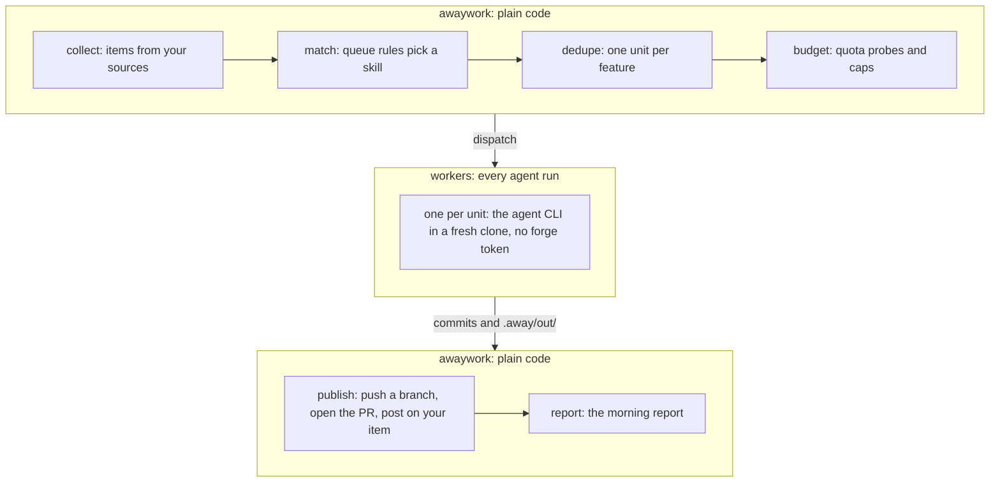

# How it works

A run collects items from your sources, matches each to a queue rule's skill, dedupes them into one unit per feature, budgets the quota, dispatches a worker per unit, publishes what it left on your forge and tracker, and reports.



Workers make every model call but one: each step, each gate's judge and `sync`'s conflict resolution run in the unit's clone. awaywork's own is the quota probe `plan`, `run` and `doctor` make, one Haiku turn for Claude; Codex reads its quota without one. Everything else is plain code you can inspect with `awaywork plan` before a run.

## Items

An item is one open thing of yours a source returns: a PR, an issue, a task. Rules match on:

- `type` (`pr`, `issue` or `task`), `title` and `description`;
- `approved`: the skill of awaywork's newest result on it that you approved or that [went ahead](./workflows/posts.md#posts-that-wait);
- `state`: `open`, or `merged` or `closed` for the [finished items](./config/queue-rules.md#finished-items) a rule asks for; `closed` is when it finished;
- `planned`: it's a [task](./workflows/tasks.md) of a plan you approved;
- the source's own fields:

| Source | Items | Fields |
| --- | --- | --- |
| GitHub | Open PRs you authored, PRs awaiting your review, issues assigned to you, plus any extra `search` (e.g. `label:awaywork`, `mentions:@me`), in the repos [`repos`](./config/repos.md#repos-and-instructions) lists; your merged and closed ones too when a rule asks | `repo`, `label`, `author`, `trusted`, `mine`, `ours`, `draft`, `checks`, `unresolved_threads`, `my_unresolved_threads`, `files`, `changed_lines`, `conflicts`, `behind`, `review_requested`, `created`, `updated` |
| Asana | Incomplete tasks assigned to you in a workspace, optionally some projects; completed ones too when a rule asks | `project`, `section`, `blocked` (a dependency is incomplete), `tags`, `repo` (from `repo_map`), `fields.<custom field>`, `created`, `updated`, `due` |
| Linear | Issues assigned to you that are neither completed nor canceled; completed and canceled ones too when a rule asks | `team` (key), `status` (the workflow state), `labels`, `priority` (e.g. `High`), `blocked` (an open blocker), `project`, `repo` (from `repo_map`), `created`, `updated` |
| Jira Cloud | Unresolved issues assigned to you, optionally narrowed by `jql`; resolved ones too when a rule asks | `project` (key), `status`, `labels`, `priority`, `blocked` (an open "is blocked by" link), `issuetype` (e.g. `Bug`), `repo` (from `repo_map`), `fields.<custom field>`, `created`, `updated` |
| Routines | One task per [routine](./config/sources.md#routines) in your config: its latest occurrence | `name`, `repo`, `created`, `updated` (both the occurrence) |

GitHub's fields that need a word:

- `trusted`: the author is an owner, member or collaborator. `mine`: a PR you authored or an issue assigned to you. `ours`: awaywork opened it.
- `checks`: `failing`, `pending` or `passing`.
- `unresolved_threads`: those [shown to the agent](./safety/index.md#public-repos); `my_unresolved_threads`: the ones you started.
- `files`: the first 500 paths the PR touches; test with `matches`. `changed_lines`: additions plus deletions.
- `conflicts`: it doesn't merge cleanly into its base; unset while GitHub works it out.
- `behind`: commits on its base its branch lacks, on your own open PRs.

## The queue

An ordered list of rules. Each item takes the **first** rule it matches, and one that matches none is skipped. A rule names the `skill` that does the work:

```yaml
queue:
  - skill: fix
    where: { type: pr, mine: true, checks: failing }
  - skill: implement
    where: { type: issue, label: awaywork }
```

GitHub reads only issues assigned to you, so a labelled issue nobody assigned to you plans nothing, unless a `search` reads it (then `mine: true` keeps a rule to yours). Within a rule, items come in the source's order (GitHub: newest first) unless the rule sets `order`.

With no `queue`, or an empty one, nothing runs: `plan` says so and `doctor` warns. `awaywork init` writes these rules, minus those for sources you didn't configure:

| #   | Skill       | Source | Where                                        |
| --- | ----------- | ------ | -------------------------------------------- |
| 1   | `fix`       | GitHub | my PR, checks failing                        |
| 2   | `fix`       | Asana  | section `QA`                                 |
| 3   | `fix`       | Linear | status `QA`                                  |
| 4   | `fix`       | Jira   | status `QA`                                  |
| 5   | `fix`       | GitHub | my PR, unresolved threads                    |
| 6   | `fix`       | GitHub | my awaywork PR, unresolved threads I started |
| 7   | `review`    | GitHub | my review requested, trusted author          |
| 8   | `implement` | Asana  | section `In progress`                        |
| 9   | `implement` | Linear | status `In Progress`                         |
| 10  | `implement` | Jira   | status `In Progress`                         |
| 11  | `plan`      | Asana  | section `Current sprint`                     |
| 12  | `plan`      | Linear | status `Todo`                                |
| 13  | `plan`      | Jira   | status `To Do`                               |

The section and status names are guesses; the [`/away` setup](./away.md#set-up) writes the queue out with your tracker's real ones.

## Units

A unit is the work on one feature: items that share a key or a linked PR (repo and branch), ranked at its best item's rule. An Asana task linked to your PR joins it. An awaywork PR links to the items its footer names; yours links by the key in its branch or title, or the source's [`link`](./config/repos.md#linking-prs) line in its body.

- It works in the linked PR's repo, else the item's `repo`; with neither it's skipped.
- Units run one at a time, in queue order. Each is a chain: the rule's skill, then its [`then`](./config/chains.md#then) steps, in one clone, publishing once at the end. A [loop](./config/chains.md#loops) repeats steps; a [`when`](./config/chains.md#when) step runs only if its condition holds.
- The first step gets the item's latest report in `.away/context/previous/report.md`, marked as from an earlier run; later steps get the step before. That's how an approved `implement` finds its plan, on a retry too: a failed `implement` with no report doesn't replace it.
- A PR stacks only on the awaywork PR a rule took up, or on the PR of the [task](./workflows/tasks.md#the-feature-block) it waits on. Its body says to merge that first; with GitHub's [stacked PRs](https://gh.io/stacks) awaywork links them. Every other PR starts from the default branch or your PR's branch, so each can be merged, parked or closed alone.
- Optional [caps](./config/providers.md#windows-limits-and-budget) limit units per run, per repo and per rule; a chain counts once.

### Skipped units

`awaywork plan` says why a unit makes no work this run:

- **Waiting for review:** it links an open awaywork PR. awaywork doesn't add to work you haven't read.
- **Waiting for your answer:** the item's newest comment is awaywork's [questions](./workflows/questions.md#questions).
- **Waiting for your approval:** of awaywork's [plan](./workflows/plans.md) on it, or of a report rule's result that [waits](./workflows/posts.md#posts-that-wait).
- **Unchanged since run `<id>`:** no item changed (`updated`, and for a [`sync`](./config/chains.md#sync) its base's head) since a worker last finished this skill on it, so a review isn't redone every run. A [`continue`](./workflows/questions.md#continue) is exempt.
- **Gave up after 3 attempts; next try on `<date>`:** its chain didn't finish 3 runs in a row. It retries a week later, changed or not, and again a week after each failed try, so an error that fires nightly isn't retried nightly.
- **Skipped by you:** `awaywork skip <source:key>` (e.g. `github:acme/api#5`) holds an item, and any unit it joins, until `awaywork unskip` or the `--until` date. `plan --skipped skipped_by_you` lists it with the `--reason`. Skips live in `~/.local/state/awaywork/skips.json`.

`run --unit` runs a unit anyway, unchanged, skipped or given up; a given-up one runs as its one try.

Details:

- An awaywork PR matches only rules whose `where` names `ours`, like the default `fix` on threads you left on it. That rule takes the unit even over a better-ranked linked item, and its draft stacks on the awaywork PR.
- A GitHub issue's draft PR into the default branch says `Closes` it, which links them, so the issue waits with the draft.
- awaywork's draft whose footer says it goes on there doesn't wait: the unit [continues](./workflows/questions.md#continue) on it.
- A PR awaywork [pushed onto](./config/chains.md#push) waits while its head is awaywork's push, unless that was a [`sync`](./config/chains.md#sync)'s clean merge.
- An attempt is one chain, finished when every step that ran was done and no publish left anything behind. A failure, an error, a `unit_minutes` timeout or unpushed commits don't finish it; a plan report then a failed implement is one failure.
- A finished attempt clears the count; another skill starts a new one. Skipped, dry-run and aborted units don't count, nor do stops the item didn't or may not have caused (quota, session limit, window end, a watchdog stop for low memory or disk). Attempts live in `~/.local/state/awaywork/attempts.json`.

## Budget

Each provider gets a ceiling for the run on its long window: the week for Claude, the week or month for Codex. Cursor's usage shows only in its dashboard, so it runs on the fallback. The ceiling is the lowest of:

- `used + per_run`, when `per_run` is set;
- `1 - reserve` (default reserve 10%);
- pacing: `(1 - reserve) × elapsed / length`, an even spend from 0 at the window's start to `1 - reserve` at its reset. Day 3 of 7 with a 10% reserve gives 38.6%. What a night leaves unused piles up for the next run.

Inside a window, pacing is read at the next window's opening or the reset, whichever is first, since nobody else spends what piles up before then; outside every window, at the run's start.

A worker stops once its provider reports the long window past the ceiling, or the short (5 h) window past the session limit. Claude reports quota during the run, so it stops mid-run; Codex is read after each run, so it stops between units. A provider whose quota can't be read gets a fixed `fallback` of units and turns per run.

The session limit depends on where the run started:

- Inside a window you're away: `session_max` (default 90%).
- Outside every window (a manual `awaywork run` by day) you're present: `present_session_max` (default 40%). A provider whose quota can't be read sits it out, since its fallback counts runs, not your usage.

It reads the whole 5-hour window, your own sessions included, so a present run backs off when you've been busy. `plan` says which limit a run started now gets.

## Routing

A rule's `provider` list, else the global `providers` order: the first under its ceiling takes the unit, and when a window fills, the next unit goes to the next provider.

## The worker

Each unit runs in a fresh clone, on a new branch cut from its base: the linked PR's branch, else the default branch. `setup` runs once, before any agent; every step then works in that clone and branch.

- `.away/context/` holds the prefetched item: PR view, diff, unresolved threads and every check (a failed one with its log), or the issue or task with its comments.
- Skills go where the agent looks: `.agents/skills/` for Codex, a plugin for Claude Code and Cursor.
- The prompt: the fixed [harness](https://github.com/AndreaProvenzale/awaywork/blob/main/harness.md), the skill, then your instructions (global, per repo, in-repo `.awaywork/instructions.md` unless someone else opened the PR, per rule).
- No forge token, and no source's or other provider's secret ([Safety](./safety/index.md#what-the-agent-can-reach)); on a GitHub-hosted runner, a [user of its own](./safety/isolation.md#a-worker-user-on-github-hosted-runners).
- A turn cap: 200, or `fallback.turns` without a quota reading. `limits.unit_minutes`, when set, caps wall-clock time (`stopped: time`).
- A watchdog stops it below 1.5 GB of free memory or 2 GB of disk and kills what it left running. The floors are checked before each unit too: a short machine skips it and every later one while short (`disk below 2 GB`), spending no quota.
- A fork's PR is fetched from `refs/pull/<number>/head`; the unit fails if that's no longer the head its source read.
- A branch name taken on the remote gets a `-2` to `-10` suffix, unless awaywork already tried there ([Branch names](./config/repos.md#branch-names)).

## Delivery

A rule's `deliver` says what its unit leaves. An opt-in one is never a skill's default: only a rule picks it.

| `deliver` | Leaves |
| --- | --- |
| `draft_pr` | A draft PR. The default |
| `pr` | A PR ready for review. Opt-in |
| `report` | A report in the morning report; nothing pushed |
| `pending_review` | Your pending review on the PR it worked on. Opt-in, GitHub only |
| `plan` | A plan posted on your item, waiting for your approval. Opt-in |
| `push` | Commits fast-forwarded onto your own PR. Opt-in |

- **`draft_pr`:** the worker commits and writes `.away/out/pr.md` (first line the title), which later steps keep current. awaywork adds an `Awaywork: <run id>` trailer, pushes the new branch and opens one draft PR into that base. No `pr.md`, no publish. Never into someone else's PR or a fork's: there a chain that could commit is skipped with the reason; a report still works.
- **`pr`:** a `draft_pr` that opens ready for review, pinging whoever a ready PR pings, code owners included. It stays a draft, saying why, when a step failed, stopped or never ran, it [asked questions](./workflows/questions.md#questions) or said [`continue`](./workflows/questions.md#continue), [`verify`](./config/repos.md#repos-and-instructions) failed, a [loop](./config/chains.md#loops) ended before its `until` held, or a [gate](./workflows/gates.md) fired.
- **`report`:** no step commits; each writes `.away/out/report.md`, and the chain's reports, joined, go into the morning report.
- **`pending_review`:** a `report` that also lands on the PR, anyone's or a fork's: the last report and the line comments in `.away/out/review.json` become your pending review at the commit the clone read, seen only by you until you submit it. If GitHub refuses a line comment (one off the diff, say), they all go in the body. When a step failed, stopped or never ran, or GitHub refuses the review (you have one pending there already, say), the report goes alone with the reason.
- **`plan`:** a `report` whose step also writes `.away/out/plan.yml`: [Plans](./workflows/plans.md).
- **`push`:** the commits and `pr.md`, pushed with the trailer onto your own open PR's branch as a fast-forward. The PR body isn't touched; `pr.md` goes into the morning report. No `pr.md`, no push. Under [`sync`](./config/chains.md#sync) the one commit is awaywork's merge of the PR's base; a worker runs only to resolve a [conflict](./config/chains.md#conflicts), without committing. It pushes only while ([`push`](./config/chains.md#push)):
  - the PR is yours, open, in the repo, without auto-merge;
  - its head is still where the clone started;
  - its branch isn't on a fork, the default branch, protected, or someone else's open PR's.

A skill commits unless its metadata says it reports, as `review` and `plan` do; `deliver` says where the commits go, and a chain that committed nothing reports.

A PR's body gets its items' [`link`](./config/repos.md#linking-prs) lines and a footer naming awaywork, the run and the unit's items, which is how the next plan links it back.

Each step also writes one word to a file in `.away/out/`:

- `verdict`, if its skill defines verdicts (`approve`, say): the report shows it, and a [loop](./config/chains.md#loops) can end on it.
- `status`, asked of every step: `done`, `ask` after writing [questions](./workflows/questions.md#questions), or `continue` when it made progress and needs [another run](./workflows/questions.md#continue). awaywork acts on `ask` and `continue`; `done` only lets a draft it goes on with turn ready. With no status file, awaywork reads what the step left, as always.
