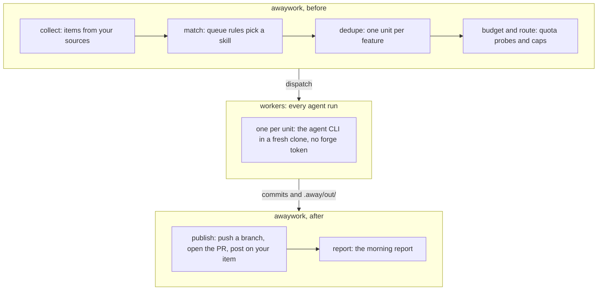

# How it works

A run collects items from your sources, gives each the skill of the first queue rule it matches, groups them into one unit per feature, and hands each unit to a worker while the quota allows. awaywork then publishes what the worker left and writes the morning report.



awaywork itself is plain code, and `awaywork plan` shows what it would do before a run. Only workers call a model: each step, and the optional [gate judges](./workflows/gates.md#judges) and [`sync`](./config/chains.md#conflicts) conflict resolution, all run in the unit's clone. The one exception is the quota probe in `plan`, `run` and `doctor`: one Haiku turn for Claude; Codex reads its quota without one.

## Items

An item is one open thing of yours that a source returns: a PR, an issue, a task.

Rules match on what every item has, like `type`, `title` and `state`, and on the source's own fields, like `checks` on a GitHub PR or `section` on an Asana task: see [Fields](./config/where.md#fields).

## The queue

The queue is an ordered list of rules. Each item takes the **first** rule it matches, and one that matches none is skipped. A rule names the `skill` that does the work:

```yaml
queue:
  - skill: fix
    where: { type: pr, mine: true, checks: failing }
  - skill: implement
    where: { type: issue, label: awaywork }
```

GitHub reads only issues assigned to you, so the second rule takes a labelled issue once it's assigned to you too.

With no `queue`, nothing runs: `plan` says so and `doctor` warns. `awaywork init` writes the [default queue](./config/queue-rules.md#the-default-queue) for the sources you configured; [Queue rules](./config/queue-rules.md) has the rest.

## Units

Items about the same feature become one **unit**, so a task and the PR that fixes it get one worker, not two. Items join when they share a key or [link](./config/repos.md#linking-prs) the same PR. The unit works in that PR's repo, else the item's `repo`, and ranks at the best rule any of its items matched; with no repo it's skipped.

Units run one at a time, in queue order, within optional [caps](./config/providers.md#windows-limits-and-budget) per run, repo and rule. Each runs its rule's skill, then any [`then`](./config/chains.md#then) steps, in one clone, and publishes once at the end: one PR, one push or one report.

A unit's PR starts from the default branch, or from your PR's branch when it works on your PR, so each can be merged, parked or closed on its own. It stacks only on an awaywork PR a rule took up, or on the PR of the [task](./workflows/tasks.md#the-feature-block) it waits on.

### Skipped units

Most skipped units are waiting for you, since awaywork doesn't add to work you haven't read. `awaywork plan` says why:

- **Waiting for review:** it links an open awaywork PR.
- **Waiting for your answer:** to awaywork's [questions](./workflows/questions.md#questions) on the item.
- **Waiting for your approval:** of awaywork's [plan](./workflows/plans.md), or of a report that [waits](./workflows/posts.md#posts-that-wait).
- **Unchanged since run `<id>`:** nothing changed since a worker last finished this skill on it.
- **Gave up after 3 attempts:** it tries again a week later.
- **Skipped by you:** with `awaywork skip`.

`run --unit` runs one anyway. The exact rules are in [Why a unit waits](./running.md#why-a-unit-waits).

## Budget

Each provider gets a ceiling for the run on its long window: the week for Claude, the week or month for Codex.

```py
ceiling = min(used + per_run,
              1 - reserve,
              (1 - reserve) * elapsed / length)
```

- `used + per_run` caps a single run, when `per_run` is set.
- `1 - reserve` keeps a share back; the default reserve is 10%.
- The last term is pacing: an even spend from 0 at the window's start to `1 - reserve` at its reset. Day 3 of 7 with a 10% reserve gives 0.9 × 3/7 = 38.6%. What a night leaves unused carries over to the next run.

A worker stops once its provider is past the ceiling, or past the session limit on the short (5 h) window. That window counts your own sessions too, so the limit depends on whether you're around:

- A run inside a window, while you're away: `session_max` (default 90%).
- A manual `awaywork run` by day: `present_session_max` (default 40%).

Claude reports quota during the run, so it stops mid-unit; Codex is read after each unit, so it stops between units. A provider whose quota can't be read, like Cursor, gets a fixed `fallback` of units and turns per run. `plan` says which limit a run started now gets; the keys are in [Providers and budget](./config/providers.md#windows-limits-and-budget).

**Routing:** a unit goes to the first provider under its ceiling, in the rule's `provider` list, else the global `providers` order. When one fills up, the next unit goes to the next.

## The worker

Each unit runs in a fresh clone, on a new branch cut from its base. `setup` runs once, before any agent; then every step works in that clone and branch. The worker gets:

- the item, prefetched into `.away/context/`: the PR's diff, unresolved threads and checks (a failed one with its log), or the issue or task with its comments;
- a prompt: the fixed [harness](https://github.com/AndreaProvenzale/awaywork/blob/main/harness.md), the skill, then your instructions (global, per repo, in-repo `.awaywork/instructions.md` unless someone else opened the PR, per rule);
- the skills, where its agent looks: `.agents/skills/` for Codex, a plugin for Claude Code and Cursor.

It gets no forge token, and no source's or other provider's secret ([Safety](./safety/index.md#what-the-agent-can-reach)). It stops at a turn cap (200, or `fallback.turns` without a quota reading), at `limits.unit_minutes` when set, and when the [watchdog](./safety/index.md#resources) finds the machine short of memory or disk.

## Delivery

A rule's `deliver` says what its unit leaves. The opt-in ones are never a skill's default: only a rule picks them.

| `deliver` | Leaves |
| --- | --- |
| `draft_pr` | A draft PR. The default |
| `pr` | A PR ready for review. Opt-in |
| `report` | A report in the morning report; nothing pushed |
| `pending_review` | Your pending review on the PR it worked on. Opt-in, GitHub only |
| `plan` | A plan posted on your item, waiting for your approval. Opt-in |
| `push` | Commits fast-forwarded onto your own PR. Opt-in |

The worker never pushes or posts. It commits, and writes what it wants published to `.away/out/`: `pr.md` for a PR, `report.md` for a report. awaywork does the rest. A skill commits unless it reports, as `review` and `plan` do, and a chain that committed nothing reports. What each value does, and when a `pr` stays a draft, is in [Each `deliver`](./results.md#each-deliver).
