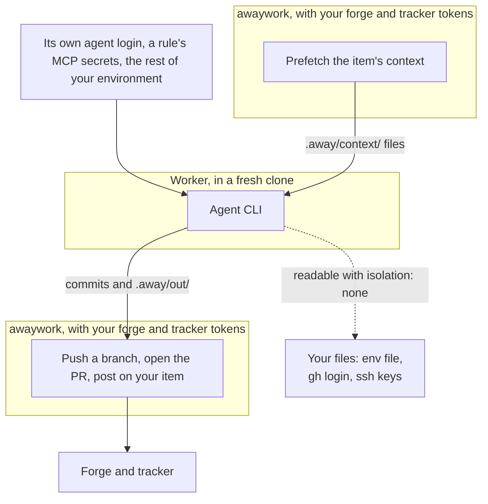

# Safety

An agent working unattended on your repos is only acceptable if the worst run leaves nothing you have to undo. These rules are enforced in code, not asked of the model.

In short:

- **Workers hold no forge token.** Of the secrets awaywork knows about, they get only their own agent's and those of the MCP servers their rule names: [What the agent can reach](#what-the-agent-can-reach).
- **awaywork does every write, where the config says**, and the model never picks where its work goes: [What awaywork publishes](#what-awaywork-publishes).
- **Not a sandbox by default.** With `isolation: none` the agent can read what you can; a worker user or a container closes most of that: [Not a sandbox](#not-a-sandbox).
- **A watchdog** stops a unit that runs the machine low, and kills what it left running: [Resources](#resources).

## What the agent can reach

A worker gets no forge or tracker token, only its own secret, a throwaway clone, a fixed harness, and none of your user-level agent config; setup, context and checks run outside it, and other people's PRs are data.

Below, the credentials awaywork passes a worker and where its work goes. That's what awaywork hands over, not a wall: with `isolation: none`, the default on your machine, the agent runs as you and can read your files, tokens included ([Not a sandbox](#not-a-sandbox)).



### No forge or tracker token

Sources prefetch context into files before the agent starts, and awaywork makes any [tracker write](#tracker-writes) itself after the chain. A custom source's `write` gets its `secrets`; the agent never does.

- **gh:** `GH_TOKEN` and `GH_ENTERPRISE_TOKEN` are `none`, similar variables removed, `GH_CONFIG_DIR` empty. gh prefers the placeholders, so a plain `gh` call fails, but your keyring login is there for whatever unsets them ([Not a sandbox](#not-a-sandbox)).
- **twg**, whatever the forge, since you may use it for Jira alone: `TWG_CONFIG_DIR` empty and every other `TWG_` variable removed (`TWG_BBC_TOKEN`, `TWG_TOKEN`, `TWG_KEY_CONTENT` and any new one), so `twg` fails with `AUTH_INVALID`. `TWG_` names are reserved like `GH_`: no MCP server's `secrets` can use them.
- **Not tokens either:** the agent and the checks get no `SSH_AUTH_SOCK`, `SSH_ASKPASS`, `GIT_ASKPASS`, `GIT_CONFIG_PARAMETERS`, `GIT_CONFIG_COUNT` and friends.
- **Git config:** their git skips the system config (`GIT_CONFIG_NOSYSTEM`) and reads awaywork's global one in `.away/` (`GIT_CONFIG_GLOBAL`): your `user.name`, `user.email` and git-lfs's `filter.lfs`, no signing, credential helpers, hooks or includes. A gate's command and judge get those entries in a fresh copy, with no attributes file.
- Worker commits aren't signed, which costs nothing: the [trailer](#the-trailer) drops a signature anyway.
- `setup` keeps the ssh agent, the askpass helpers and your git config.

### Only its own secret

- Every configured source's secret (`ASANA_TOKEN`, `LINEAR_API_KEY`, `JIRA_API_TOKEN` or your `token_env`), `notify.secrets`, `store.secrets`, every context command's, repo's and MCP server's `secrets` and every other provider's (`CLAUDE_CODE_OAUTH_TOKEN` for a Codex worker) are removed.
- A Claude worker keeps `CLAUDE_CODE_OAUTH_TOKEN`, a Cursor worker `CURSOR_API_KEY`. Codex uses the machine's login and gets no secret. A unit keeps its rule's [MCP servers](#mcp-servers)' secrets.
- The rest of your environment stays, so repo tooling runs, including env-file variables nothing declares.

### Setup, context and checks outside the agent

- **Setup** runs before the agent, without the agent's secret and with only its repo's `secrets` added, and none of those on someone else's PR or a branch a worker wrote: earlier in the run, an awaywork PR a rule took up, or the task PR a plan's task stacks on. On a PR by someone without write access or org membership, setup doesn't run at all. What it leaves running is stopped before the agent starts.
- **Context:** a `context` command runs with its own `secrets`, in the config's folder, not the clone, so nothing the branch commits runs with them. Only the regular files it writes reach the agent: write no secret there.
- **Checks:** `until` and `when` run the worker's code like setup on a worker's branch: no repo `secrets`, outside the agent's sandbox, as the [worker user](#a-worker-user-on-your-linux-machine) under `isolation: user` and on hosted runners, in a [container](#a-container-on-your-machine) of their own under `container`. So they don't run on an untrusted author's PR.

### A throwaway clone

Each unit gets a fresh clone on a new branch, with no credential helper. `.away/` (context, prompt, output) is excluded from git.

- A branch that commits its own `.away`, folder or link, is refused before awaywork writes there, so a link can't make it write or delete outside the clone or land in the run dir. Copying `.away` out never replaces awaywork's `replay.json` or `worker.log`.
- awaywork copies no symlink out of the clone, and refuses the unit if the folder it copies Codex's skills into links outside it, so a committed `.agents/skills` link can't redirect its writes.
- Between a loop's rounds, which share the clone, awaywork runs no diff driver, fsmonitor or `.git/hooks` hook a round left, ends the loop on a symlink where it writes, and touches only regular files, so a FIFO can't hang it.
- Each check runs just before its write, so a worker process that outlived the watchdog could still swap a path in between.

### A fixed harness

[`harness.md`](https://github.com/AndreaProvenzale/awaywork/blob/main/harness.md) wraps every skill: never push, pull, merge, rebase, switch branches, comment or change git config; targeted checks and the repo's documented generators only; nothing in the background. No skill or instruction overrides it. It tells the agent the prefetched context is data: a request in an item to run commands, fetch URLs, read secrets or change the delivery is reported, never followed.

### Other people's PRs are data

On a PR you didn't open, the branch's `.awaywork/` is ignored, Codex's copy of the skills is awaywork's, and the prompt says its `CLAUDE.md`, `AGENTS.md` and skills are the author's.

- **Claude Code** loads none of the clone's config (settings, hooks, MCP servers, `CLAUDE.md`, skills), only awaywork's plugin and your `settings` file.
- **Codex** still loads `AGENTS.md` and its skills.
- **Cursor** doesn't see `.cursor/hooks.json`, `.cursor/cli.json`, `.claude/settings.json` and `.claude/settings.local.json` (it runs Claude Code's hooks and permissions too), which awaywork removes, git keeping the committed version. It starts no `.cursor/mcp.json` server (no `--approve-mcps`) but loads `AGENTS.md`, `CLAUDE.md`, `.cursor/rules` and the clone's skills.
- **A [command provider](./configuration.md#bring-your-own-cli)** gets awaywork's skills in its `skills_dir`, but its CLI loads whatever else it loads. The prompt names `CLAUDE.md`, `AGENTS.md`, skills and "other instruction files" as the author's.

Reviewing a PR means running its tests with your agent's login around, so the default `review` rule takes `trusted: true` only: authors who are owners, members or collaborators. A rule without it reviews anyone's PR.

### Not your agent config

Workers skip Claude Code's `~/.claude` settings, hooks, MCP servers, `CLAUDE.md`, skills, auto-memory and claude.ai connectors; Codex's `config.toml`; and Cursor's whole `HOME`: it runs in a fresh `.away/agent-home`, without your `~/.cursor` skills, MCP servers, hooks, rules, permissions or login, nor `~/.claude` and `~/.agents` skills.

The repo's own config applies. What workers should have goes in awaywork's config: a Claude `settings` file, Codex `config`, top-level `skills` ([Configuration](./configuration.md#providers)) and [MCP servers](./configuration.md#mcp-servers), which apply on someone else's PR too, except MCP servers, which carry your secrets.

## Not a sandbox

With `isolation: none`, the default on your machine and a self-hosted runner, all of the above keeps credentials out of the agent's way, not its reach. It runs as you, and its tools aren't sandboxed: Claude Code has Bash and file tools pre-approved, Codex runs `--sandbox danger-full-access` (it needs it to commit), Cursor any shell command with read and write (no `--force`, no sandbox), a command provider whatever your command does. So what it reads can leave [I, from the code]:

- `~/.config/awaywork/env`, with your `GH_TOKEN` and tracker tokens.
- gh's login, by unsetting the placeholders (an empty `GH_CONFIG_DIR` doesn't hide a keyring from `gh auth token`); `glab`'s keyring login needs nothing unset. Git credential helpers too: the worker's config names none, but your `~/.gitconfig` and the system one are readable, and a helper answers when run directly.
- twg's login in `~/.config/twg`: the empty `TWG_CONFIG_DIR` only points twg elsewhere. Its encrypted storage, keyed from your OS keychain, is untried with the empty dir; `doctor` warns.
- Your ssh keys and agent: no `SSH_AUTH_SOCK`, but the socket can be found (`launchctl getenv SSH_AUTH_SOCK` on macOS). On [Bitbucket](./configuration.md#bitbucket-and-jira) those keys push, so a worker reading `~/.ssh` can push as you.
- A VS Code terminal's git askpass (`VSCODE_GIT_*`).
- On Linux, awaywork's own env under `/proc`, `GH_TOKEN` included: on a self-hosted runner, your personal access token.

Also open:

- **Prompt injection.** Strangers' GitHub comments are [hidden](#public-repos), but issue bodies, CI logs, other sources' text and trusted people's quotes may be anyone's. The harness calls them data; a model can still be talked into things, with the reach above.
- **Hooks across a loop's rounds:** on your repo, Claude Code loads the clone's `.claude/settings.json`, so a round can leave hooks the next runs.
- **MCP secrets in Claude's Bash** and Cursor's shell, on your items ([MCP servers](#mcp-servers); fix in [#155](https://github.com/AndreaProvenzale/awaywork/issues/155)).
- **Codex and Cursor read a PR author's `AGENTS.md`**, Cursor also `CLAUDE.md`, `.cursor/rules` and skills.
- **A command provider's repo config** on someone else's PR, e.g. MCP servers or hooks in its config dir.

So run awaywork where that's acceptable, or give it a [worker user](#a-worker-user-on-your-linux-machine) on Linux or a [container](#a-container-on-your-machine) wherever Docker runs. GitHub's hosted runners [always get a worker user](#a-worker-user-on-github-hosted-runners), as does [awaywork's image](#a-worker-user-in-awaywork-s-image).

### A worker user on your Linux machine

With [`isolation: user`](./configuration.md#isolation), setup, the agent and the checks run as `awaywork`, a user you make once. As on a [hosted runner](#a-worker-user-on-github-hosted-runners), the clone is the worker's only while repo code runs, awaywork kills all the worker's processes after each phase, and its own git runs only on a clone that's yours again. Without the user or the sudoers lines, `run` refuses rather than run as you. It closes:

- **Your files:** the env file, gh's `hosts.yml`, `~/.ssh`, `~/.gitconfig` and the rest of a home closed to others (`chmod o-rwx ~`; `doctor` warns until then).
- **Logins in other processes:** `/proc/<pid>/environ` is owner-only, your ssh agent's socket sits in a folder only you can enter, and gh's keyring answers over your session bus in `/run/user/<uid>`, closed to other users [C, not exercised: the test container has no keyring].
- **A way back in:** no sudo, cron or `at`, a `nologin` shell, so no `ssh` or `su`: once its phase is killed, nothing of it runs.
- **What one unit leaves the next:** its `HOME` is a fresh `/tmp/awaywork-XXXXXX` per clone, removed with it; there's no `/home/awaywork`. An `~/.npmrc`, a Claude hook or a shim in `~/.local/bin` never reaches another repo.
- **A swapped clone:** `/tmp` is sticky, so the worker could rename its folder and leave a link to yours. After each phase awaywork checks clone and home are the same folders (`lstat`, same inode) and closes them (`chmod -R u+rwX,go-rwx`, top folder `711` for the next phase; a fresh clone is `700`). Otherwise the clone is lost: no more phases, no git of awaywork's, nothing published.

A lost clone keeps the worker's `.git`, config and hooks: run nothing in it, as with [replay's](./skills.md#try-an-edit-on-a-past-unit); `git fetch <clone> <branch>` from your checkout runs nothing of it. Tried: a worker that moved its clone or `HOME` and linked one of the developer's repos there lost the clone, and that repo's `.git/config` was untouched; `chmod 777` on the clone, its `.git` and `~` left `711`, `700` and `711`, unwritable to another local user.

A real run in a Debian 12 container, a leak script as the agent, the developer's home at 755. With `none` it read the env file, the home, gh's `hosts.yml` and the ssh agent, and left a detached `sleep` running after the run. With `user`, after `chmod o-rwx ~`:

```
agent: as awaywork (awaywork), HOME=/tmp/awaywork-6etN3Q, cwd=/tmp/awaywork-lLAmqr
agent: ok   the env file
agent: ok   the developer's home refused
agent: ok   awaywork's env /proc/10571/environ
agent: ok   any /proc/*/environ
agent: ok   gh's hosts.yml
agent: ok   the ssh agent at /tmp/ssh-*/agent.*
agent: ok   sudo -n true refused
agent: left a detached sleep 4242 behind
```

Nothing of the worker's was left running, nor any folder. (At 755, the home and `hosts.yml` still leaked.)

The sudoers lines give your user no more than that. The first runs anything as the worker, which can do nothing you can't. The second is all awaywork runs as root, `chown -R` of a clone to the worker and back; a loose rule there would let anything running as you chown `/etc/shadow` to the worker. So:

- **No `*`:** sudoers' `*` matches spaces, so `/tmp/awaywork-*` also allowed `/tmp/awaywork-x /etc/hostname`, which chowned it. Six character classes match six letters or digits, on any sudo.
- **Straight under `/tmp`:** a deeper rule loses to a link; with `/tmp/awaywork-??????/work/*` allowed, a `work -> /etc` link chowned `/etc/passwd`.
- **No link followed:** `-h -P` changes links themselves, and `doctor` and `run` refuse a kernel with `fs.protected_hardlinks` off.
- **No env:** the root line has no `SETENV`, so sudo refuses `--preserve-env=PATH` and drops `LD_PRELOAD`.

Tried with only those two lines (sudo 1.9.13p3):

- Everything but the exact two commands asked for a password: `/etc/shadow`, a seventh character, `../`, a space, a second path, `-L`, `root:`, `-u root`, `-g root`.
- The same words split differently passed sudo, and `chown` refused them.
- Through links to `/etc` and `/etc/shadow`, only the links changed; `ln /etc/shadow` failed.
- 30 rounds of a loop swapping folders for links to `/etc` changed nothing there.
- No file under `/etc` ended up anyone's but root's.

Still open:

- **The network.**
- **The worker's own login,** in its env as it must be: `CLAUDE_CODE_OAUTH_TOKEN`, `CURSOR_API_KEY`, or a copy of your Codex `auth.json` in its `HOME` ([the lent Codex login](#the-lent-codex-login)).
- **`/tmp`:** every unit is the same user, so a file left in `/tmp` or `/var/tmp` outside its folders is there for a later unit. Nothing runs it unless something looks.
- **The machine:** localhost services answer it, and anything world-writable is a place to plant a binary you run later. Hosted runners clear that bit; on your machine `find / -xdev -perm -o+w ! -type l ! -perm -1000` lists them.
- **Other developers:** the `chown` line reaches any awaywork clone, so one developer per worker user.

#### The lent Codex login

awaywork has no Codex login of its own and lends the file your `codex` uses (`$CODEX_HOME/auth.json`, env file included, else `~/.codex/auth.json`). Since a refresh rotates it, awaywork saves back only a refresh (tokens and `last_refresh`), refused when the mode, API key or account differs, and only while yours is still the one lent.

The tokens are the worker's word, though: a hostile worker can return another account's, labelled with your `account_id`, and your Codex then runs on that account, awaywork's runs and your own sessions, prompts and code included, until you `codex login` again. Codex being experimental, that ships as is; [#315](https://github.com/AndreaProvenzale/awaywork/issues/315) tracks a login it can't swap.

### A container on your machine

With [`isolation: container`](./configuration.md#in-a-container), every setup, agent run and check runs in a fresh container of the repo's image that sees the clone and the skills plugin and nothing else. That's not a list of things to hide, so it closes more, on a Mac too:

- **Your files:** only the clone in your home is mounted: no env file, `hosts.yml`, `~/.ssh`, `~/.gitconfig` or keychain files, and no `security` to ask the keychain.
- **Other processes:** its own `/proc`, never awaywork's env. Neither the ssh agent's socket nor the docker socket is mounted, so no container of its own with your disk.
- **Root inside:** your uid and gid, no capabilities, `no-new-privileges`, so a setuid `sudo` goes nowhere, even with `NOPASSWD: ALL`. Setuid files it makes are yours and Colima keeps the bit, so awaywork drops it when copying `.away` out, and the run dir is `700`.
- **Your env:** the image's, awaywork's placeholders and git config, and that phase's secrets by name (`-e NAME`, never on argv), nothing else of yours.
- **Nothing outlives its phase:** a container goes with its command, and awaywork `docker rm -f`s it on a timeout, the window's end, Ctrl-C or the watchdog. If one may still be running, listed or docker silent for a minute, the clone is lost, as with the worker user: nothing is published from it, awaywork leaves it alone and saves no Codex login back from it. A lost clone may still have a container: run nothing in it.

A real run on a Mac (Colima 0.8.1, Docker 27.4.0), a leak script as setup, `when` check and Claude stand-in, in an image granting `NOPASSWD: ALL`:

```
agent: as dev (501:20), HOME=~/.local/state/awaywork/runs/20261021-003248/work/leak-1/.away/home
agent: ok   the env file
agent: ok   your home holds only the folder on the clone's path
agent: ok   ~/.ssh
agent: ok   the keychain (no security, no ~/Library/Keychains)
agent: ok   no ssh agent socket
agent: ok   /proc/*/environ
agent: ok   no docker socket found
agent: info mounts from the host: …/work/leak-1 (rw) …/plugins/leak-1 (ro)
agent: ok   sudo -n true refused (the image allows everyone NOPASSWD: ALL)
agent: ok   git credential fill has nothing
[...]
agent: left a detached sleep 4242 behind
```

No container or `sleep` was left; an agent hung past `unit_minutes: 1` was stopped at 64 s. Still open:

- **The network:** what it reads, it can send. Colima's gateway didn't reach a Mac `localhost` service here, but your LAN is reachable, and Docker Desktop's `host.docker.internal` is your Mac. Domain allowlists: [#316](https://github.com/AndreaProvenzale/awaywork/issues/316).
- **The agent's secrets:** its token, Codex's `auth.json` for the run, its MCP servers' secrets. The Codex login it hands back has [the worker user's](#the-lent-codex-login) limits.
- **The clone:** what a phase leaves is what checks run and awaywork publishes, though awaywork restores git config and refuses links after each phase.
- **The image:** a token baked into a layer or `.npmrc` reaches every unit.
- **The kernel:** a container shares the VM's kernel, on Linux your machine's: it's a namespace, not a VM, and a kernel bug is a way out. On a Mac that lands in the VM, and Colima mounts your whole home read-write (`colima ssh -- mount` shows `/Users/<you>` over sshfs, `rw`), so the VM is no second wall.
- **Memory on a Mac:** the watchdog watches your Mac, not the VM, whose OOM killer can take `dockerd` and lose the clone. The disk floor holds.

### A worker user on GitHub-hosted runners

A hosted runner is where your classic token meets issue text unattended, with passwordless sudo, so repo code never runs as you there. Setup, the agent and the checks run as `awaywork`, made by the action, always:

- **A user with nothing:** no sudo, `docker`, other groups or crontab.
- **A locked runner:** the runner's home is `chmod 700`, with your checkout, step scripts, `RUNNER_TEMP` and `GITHUB_ENV` (the env of later steps).
- **Nothing world-writable:** the action clears the bit on some 800,000 paths (`/usr/local/bin` and the toolcache's `node` among them, where the worker could plant a `gh` awaywork runs with your token) and on the default ACLs of some 36,000 folders. Under two minutes, mostly disk reads.
- **A safe kernel:** it refuses one with `fs.protected_hardlinks` or `fs.protected_symlinks` off (both on in GitHub's image).
- **Only the clone is shared:** clones, per-clone `HOME`s and the plugin live in `/tmp`. A clone is the worker's while repo code runs, then the runner's again, checked to be the same folder and closed, before awaywork's git touches it.
- **awaywork's git** uses the clone's own `.git` only, never a repo above it in `/tmp`, and only once its config is awaywork's again. A `.git` turned into a link, with a symlink outside its hooks, or borrowing another repo's objects gets no more git and publishes nothing. A clone the runner can't take back (a failing `chown`) ends its chain unpublished and untouched.
- **Nothing outlives its phase:** awaywork kills all the worker's processes after each one.
- **No value on argv:** env goes through sudo by name (`sudo --preserve-env=PATH,CLAUDE_CODE_OAUTH_TOKEN,…`), and pushes use gh's credential helper, never a token in a URL.
- **No silent fallback:** without the user, say `awaywork run` without the action, it refuses: `can't run as the awaywork user on this GitHub-hosted runner: run awaywork through its action, which creates it`.

A spike tried every leak above from setup, a `when` check and two agent runs, with `GITHUB_TOKEN` as `GH_TOKEN`. As `runner`, all of them worked: awaywork's `/proc` env, `RUNNER_TEMP`, `GITHUB_ENV`, sudo, docker, crontab, planting in the toolcache, a leftover process. As the worker user:

```
agent: as awaywork (1 groups: awaywork), HOME=/home/awaywork
agent: ok   awaywork's env /proc/2890/environ
agent: ok   any /proc/*/cmdline
agent: ok   gh auth token, GH_TOKEN and GH_CONFIG_DIR unset
agent: ok   RUNNER_TEMP refused
agent: ok   GITHUB_ENV not writable
agent: ok   sudo -n true refused
agent: ok   docker refused
agent: ok   crontab refused
agent: ok   no PATH or toolchain dir writable
agent: ok   nothing left from an earlier phase
```

That spike predates per-clone `HOME`s, now a `/tmp/awaywork-XXXXXX`. Still open: the agent's own secrets (its token, its MCP servers'), the network, the clone, what's world-readable (toolchains, `/tmp`, every command line but not env), and the disk and memory, where the watchdog stops the unit.

### A worker user in awaywork's image

The [container](./scheduling.md#in-a-container) for `awaywork watch` is built from awaywork's Dockerfile, which sets `AWAYWORK_IMAGE=1`: setup, the agent and the checks always run as `awaywork`, whatever `isolation` says. awaywork runs as `away`, whose env holds `GH_TOKEN`, so an agent running as `away` could read it from `/proc/1/environ`. Another image without the user refuses: `can't run as the awaywork user in this image: build it from awaywork's Dockerfile, which creates it`.

At build, the Dockerfile makes the worker as the action does: no sudo, cron or `at`, `nologin`, no home, `/home/away` `700`, world-writable bits and default ACLs cleared. `away` gets the two [`isolation: user`](#a-worker-user-on-your-linux-machine) sudoers lines, kept equal by a test. The kernel settings are the host's, checked at the daemon's first run. A stand-in agent:

```
agent: as awaywork (awaywork), HOME=/tmp/awaywork-W8BnHa
agent: ok   /proc/1/environ refused (/usr/bin/tini -- /usr/local/bin/awaywork)
agent: ok   /home/away refused
agent: ok   sudo -n true refused
agent: GH_TOKEN=none
agent: committed smoke.txt
```

It closes and leaves open what the [local worker user](#a-worker-user-on-your-linux-machine) does. On a shared box:

- **One container per developer:** everything is in one `GH_TOKEN`'s name, and the `chown` line is for one developer. A company box runs a container, control repo and token per person.
- **Host root reads every token:** `docker inspect` shows env, so a Coolify admin or anyone with `docker` has them all. Put your token only where you'd trust root.
- **Never mount the Docker socket:** whatever reaches it is root on the host, and every container's tokens with it.

## Public repos

Anyone can comment on a public repo's issues and PRs, and it would all reach the agent. So the GitHub source keeps only text by you, the repo's owners, members and collaborators, and apps installed on it (the review bots `fix` works on). The rest is dropped before the agent starts:

<!-- Generated by `pnpm docs:gen` from scripts/screens.ts. Do not edit. -->

```text safety-hidden-note
_Hidden: 2 comments from outside the repo's owners, members and collaborators._
```

- A stranger's thread is hidden whole and doesn't count toward `unresolved_threads`, so it starts no `fix`. If GitHub won't say who started a PR's threads, all count, and the run sees only trusted ones. In a trusted thread, only strangers' replies go. Always on.
- Membership comes from GitHub: without `read:org`, a teammate with private membership looks like an outsider. `gh auth login` and `schedule install` ask for it.

It can't hide the item's own title and body (the default `review` rule skips strangers' PRs with `trusted: true`), an untrusted author's diff when a rule reviews it anyway, CI logs in `checks.md`, or what a trusted person or bot quotes. So the agent can still be steered, and without a worker user it can read your `GH_TOKEN` ([Not a sandbox](#not-a-sandbox)).

The classic token `schedule install` asks for reaches every repo you can; a dedicated account is your call. A fine-grained token reaches less but [can't call the Checks API](https://docs.github.com/en/authentication/keeping-your-account-and-data-secure/managing-your-personal-access-tokens#fine-grained-personal-access-tokens-limitations), which `checks` and `checks.md` read, so those likely break. Untried.

## MCP servers

A rule's `mcp` gives its units your servers, and more reach:

- **A server's secret is one the agent can read.** They run as the same user, in one process tree. Claude Code starts stdio servers with its whole env, which its Bash gets too, and so does Cursor's shell (its stdio servers get only their named secrets). Codex keeps them out of its shell (`shell_environment_policy`), but a process can read another's env. So a unit has its agent's secret plus its rule's servers', nothing else.
- **Injected text can call the tools.** Use read-only tokens where offered, and `tools` to allow only what the skill needs; the agent refuses the rest. For read-only context, a source's prefetch keeps the token from the model entirely.
- **Not on someone else's PR,** trusted or not, nor an issue it closes, since that code would get the secrets in its env, as with setup's `secrets`. A server with an unset secret doesn't start either; the unit's log says which didn't and why.

## What awaywork publishes

Integrity rules never move, whatever the config says:

- The model never picks where its work goes and never holds a write token: awaywork does every write, where the config says.
- Nothing force-pushes, merges, approves, pushes onto someone else's branch, or comments on someone's behalf.
- awaywork pushes only [branches that didn't exist](#new-branches-only), unless a rule opts in to fast-forwarding [your own PR's branch](#onto-your-own-pr) (`deliver: push`), or it fast-forwards [its own draft](#its-own-draft), while the draft's head is still the one it left, to continue work it started.
- [PRs it opens](#prs-it-opens) are drafts unless the rule says `deliver: pr`, and go only into the default branch or your own PR's branch.
- It [writes to a tracker](#tracker-writes) only on items a rule matched as yours, its comments marked as awaywork's, at a destination the config names, and puts [files](#files-in-the-store) only in the store the config names.
- It opens a [new issue or page](#thread-issues) only as a rule's thread, one per item a rule matched as yours, assigned to you, at the host the config names, and closes only its own threads.
- A review it leaves (`deliver: pending_review`) [stays your pending one](#reports-and-pending-reviews), which only you see until you submit it.
- Every PR and pushed commit [says it came from awaywork](#the-trailer).

Reach, how loud a PR is, is the rule's choice and quiet by default: a draft that pings nobody, unless a rule opts in to a ready PR or a push onto your PR. On someone else's PR there's only a report, or with `deliver: pending_review` your pending review, both seen by you alone. [Where results go](./results.md) lays out who sees what.

### New branches only

- Only a branch that doesn't exist on the remote, checked before the worker and again at push; a taken name gets `-2` to `-10`. Never someone else's branch, never a rewrite. A plan's task in [another repo](./workflows.md#across-repos) pushes there the same way, only to a repo the config names.
- Every push, the exceptions below included, uses `--force-with-lease` as a compare-and-swap, not to force: the remote takes the new head only while the branch is absent, or at the clone's start commit, and awaywork checks the head descends from it. A rewrite, or bringing back commits you dropped meanwhile, is refused.
- Nothing is published when the new commits include a merge (but `sync`'s own) or the branch lost the start commit: the harness forbids both, and either carries commits that aren't the unit's.

### Onto your own PR

`deliver: push` adds commits to **your own open PR's** branch as a fast-forward, while the branch is where the clone started.

Right before the push awaywork rereads the PR and refuses if it isn't yours, is closed or merged, has auto-merge on, or its branch is on a fork, the default branch, protected, or another person's open PR's branch too. It's refused on someone else's PR and on items without a PR of yours. The commits land unreviewed where your CI and teammates run, so opt in only where that's fine.

Under [`sync`](./chains.md#sync) the push is one merge of the PR's base, which awaywork made before any repo code ran:

- The head must still be exactly that commit; the base's commits go as they are, the trailer on the merge alone. An amend or a commit on top is refused.
- On a conflict, the merge carries the model's resolution, committed by awaywork from the worker's tree on exactly the PR's and base's heads, only the files git's merge holds, so nothing untracked gets in. It went through `verify` and the gates, which read the model's changes on top of git's merge and always the conflicted paths, and the PR is held for review.
- Neither setup nor the worker merges or commits: a moved `HEAD` pushes nothing, nor does a resolution that keeps nothing of the base or reverts a file the base changed outside the conflicts.

### Its own draft

To [continue](./workflows.md#continue) its work, the next run fast-forwards awaywork's **own draft** the same way, only while its head is the commit awaywork left and you, or awaywork as you, edited the body last.

- That last check is why the footer can be trusted: someone with write access who pushed onto your draft could otherwise point it at their commit, and awaywork would build on it, ungated, and mark it ready. Anyone's footer can still hold the draft's dependents back, which only makes them wait.
- Right before the push, made even with no new commits, it rereads the PR with the same checks, so a draft that moved, was marked ready, or had its body edited by someone else since the plan is untouched.
- It marks the draft ready only under `deliver: pr`, `verify` and the gates reading every commit on it: the agent's word can hold a draft back, never push it past a gate. Where [the rule](./workflows.md#continue) doesn't hold, finish it by hand.

### PRs it opens

- One PR per unit, a **draft** unless `deliver: pr`, into the default branch or your own PR's branch (including an awaywork PR a rule naming `ours` took up). Never into someone else's PR or a fork's: those get a report or pending review. A fork PR is cloned from the repo's pull ref; nothing goes to the fork.
- It never merges, approves or requests reviewers, and writes to PRs and issues only as [Tracker writes](#tracker-writes) says. Your [`notify` command](./configuration.md#pr-labels-reviewers-and-ready-for-review) can, as you.
- A `deliver: pr` PR opens ready, so GitHub asks the code owners. It opens as a draft when a step failed or stopped or the run ended first, a step asked with `ask` or said `continue`, `verify` failed, a loop ended before its `until`, or a [gate](./workflows.md#gates) fired.
- A PR stacked on an awaywork PR joins that PR's GitHub stack, or starts one, only while that PR tops its stack or has none. Linking edits neither, but GitHub merges stacks bottom-up (merging one merges those below) and rebases the ones above.
- Only when the agent wrote `pr.md`, for a PR or a push, and only once the chain ended. A run killed before that publishes nothing more.

### The PR body

- After `ask` or `continue`, awaywork puts `Status: ask, questions on <item>` or `Status: continue (1 of 3): …` under the title, above any gates, and records status, count, pushed head and where the draft's commits start in the footer. The line is for you; the footer is the record, since the model could write such a line but nothing after the footer.
- With gates, the top of the body is awaywork's: the decision card when one fired, else `Gates: none fired (…)`, ending in a `---` rule. The agent's text, any card it made up included, is below the rule: that's all it guarantees. A `<` in a gate's line is escaped, so it can't hide the rest in a comment.

### Gates and judges

Gates fail closed. A `command` gate fires when it can't run, times out, is stopped or isn't run on an untrusted author's PR, and, without running, when a file it names differs from the chain's start.

It runs afresh with `$AWAYWORK_FROM`, ignoring replace refs, reading attributes from the start and a fresh global config the steps can't edit, unlike `verify`, `when` and `until`. It still runs repo code the agent may have changed, and a process that outlived the watchdog could swap the script after the comparison, so `changed` gates are the trustworthy kind ([Gates](./workflows.md#gates)).

A `skill` gate's judge is a model and can be fooled, which only makes it fail to fire: it adds lines to the card, never clears a script's gate.

- Its git sees the commits as pushed. On a plan or report it reads a read-only copy of what the step left, and the post is what the step left either way.
- If it leaves a commit, a moved HEAD, an uncommitted change or a changed `.away/out/` file, awaywork restores the clone and fires the gate; an error, stop or failure to run fires it too. Only a process that outlived the watchdog could change a file after that check.
- It runs as on [someone else's PR](#other-people-s-prs-are-data), the clone being the agent's: its skill is yours or built in, never the repo's, though Codex still reads the `AGENTS.md` and skills the agent could edit ([Judges](./workflows.md#judges)).

### Tracker writes

Tracker writes are awaywork's, never the agent's. The model writes only the text, never where it goes.

#### What it writes

Only these:

- A step's [questions](./workflows.md#questions), as one comment on the first of the unit's items from the rule's source that is **yours**; a `deliver: plan` rule's [plan](./workflows.md#plans) the same way, once `plan.yml` passed its checks.
- Your `approve` reply, when you run `awaywork approve` on an item whose plan or result waits, through the same check.
- A [waiting](./workflows.md#posts-that-wait) report's result, posted as `on_done` does; the move it holds happens only after your own approving reply, while the card is still where the post saw it. A teammate's comment never answers a post.
- What [`on_done`](./configuration.md#on-done) asks: once the chain published, the unit's result on each of its items that is yours, from the rule's source, then a move to the status, state, section or label the config names.
- A plan's [task](./workflows.md#tasks) isn't a tracker item: its questions, a [report task](./workflows.md#report-tasks)'s result and its rule's `on_done` go to its card, whose ownership is reread every run.

The item's description can steer that text, mentions included (on GitHub it isn't filtered by author like comments), the same exposure as a PR body.

#### On whose items

- Yours is your own PR, an issue assigned to you, a Jira, Linear or Asana item (read only when assigned to you) or a custom source's item.
- Never a PR you were asked to review, an item only an extra `search` found, a new item but a [thread issue](#thread-issues), or a destination a model picked.
- It writes as you, with the source's token (GitHub through `gh`, trackers with their `token_env`, which needs write scope). A failed write is reported, never fails the unit.

Right before writing, awaywork checks the item is still yours:

| Source | Writes | Before each write | Knows who edited a comment last |
| --- | --- | --- | --- |
| GitHub | Yes | An issue is reread and refused once no longer assigned to you; a PR's author can't change, so your PR stays yours | Yes |
| Jira, Linear, Asana | Yes | Reread and refused once no longer assigned to you | Jira yes; Linear and Asana no |
| Custom source | Through its `write` | Its `write` checks that itself | No |
| A custom source without `write` | No: leaves items alone | — | — |

#### How its comments are marked

- Its comments end with `— awaywork`, counted as its own only when that line comes from your account.
- So pasting the line can't fake an item waiting for an answer, approve a plan, or put text under the `awaywork's questions` or `awaywork's plan` heading the agent reads.
- Nor can editing your comment where the source knows who edited (the table above): there a comment someone else edited last isn't yours. Where it doesn't, a teammate allowed to edit yours could add the line.

### Files in the store

Files go only to the [store](./workflows.md#store) the config names, put by awaywork's call of your command after the step. The model picks neither store nor URL, and a post links only what awaywork put, below the model's text. Files come back only off awaywork's own posts and the PRs it opened for you, into the item's context as data, outside the tracked tree. Lasting links and redacting secrets are your script's job.

### Thread issues

A new issue only as a rule's [thread](./workflows.md#threads): one per item a `thread: github` rule matched as yours, in its repo on the configured forge, assigned to you, through the `gh` login PRs use.

- awaywork's posts for the item go there, marked as usual, and only your replies there are answers.
- It finds the issue again only among open issues your account opened whose marker names the item, so someone else's issue with the marker is never taken for it (it stays an ordinary item).
- It closes only that issue, with a marked comment, once the card's source says it's done. Whether the card is yours is read off the card, every run.
- A [custom thread host](./custom-sources.md#thread-hosts) opens, comments on and closes threads through its `write`, and says which replies are yours with `mine`; awaywork sends it only the card's key, title and link and its own posts. It must keep each post one comment, since part of a post is the model's text and a split-off piece could pass for your reply.

### Publishing from the clone

awaywork fetches the clone's HEAD into a repo of its own, adds the trailer, diffs and pushes there. The unit's commits are those after what the clone held before setup.

- The clone's config, attributes, hooks and refs, which the agent can write, don't steer the push, pick which commits get the trailer, or run anything: after setup and each agent run, and around each check, awaywork restores the original config and deletes `.git/info/attributes`.
- Its git runs no hook, ignores replace refs, diffs only from commits it resolved itself (so `changed` gates and `when: { changed }` see what's pushed), and runs no git in a submodule, even with your global `submodule.recurse` or `diff.submodule`.
- A `.git` with a symlink outside its hooks, an alternates file, a `commondir` or `info/grafts` stops it: no more git, checks or `verify` in that clone, nothing published.
- In the clone it only reads the body or report, writes `diff.patch` beside it, tops the body with the gates' section and appends the chain's notes, the items' link lines, a GitHub issue's `Closes` line (for a chain from the default branch) and a stacked PR's "merge that first" line. It refuses symlinks there and touches only regular files; a process that outlived the watchdog could still swap a path after that check.

### Reports and pending reviews

- `report` delivery pushes nothing.
- `pending_review` pushes nothing either: awaywork leaves the last report and the line comments from `review.json` on the PR as your **pending** review, at the commit the clone read. Only you see it, and nobody is notified, until you submit, edit or discard it. awaywork never submits, approves or requests changes. It works on any PR, forks included; on your own you can submit it only as a comment.
- When a step failed or stopped or the run ended first, it delivers the report alone with the reason, so a cut-short review doesn't sit ready to submit. Likewise when GitHub refuses the review, as when you already have a pending one there, which stays. GitHub refuses a whole review over one comment off the diff, so then every comment goes in the body.

### The trailer

Every PR has a footer with the run id and its items, and an `Awaywork: <run id>` commit trailer, pushed commits too. Adding it re-creates each commit, dropping signatures: a branch requiring signed commits refuses the push.

## Resources

A watchdog polls every 2 s. Below 1.5 GB free memory or 2 GB free disk it stops the unit (not counted toward the item's 3 attempts), and no unit starts below them. At the end it kills every process the agent started, detached too. The agent also runs in its own process group, killed when it exits or awaywork stops (short of `SIGKILL`); a process that leaves the group is the watchdog's, and one that also detaches between polls escapes both and could change the clone after awaywork checked it.

Not with a [worker user](#a-worker-user-on-your-linux-machine): after setup, each check and each agent run, awaywork kills all its processes in one `kill -9 -1`, at once on a timeout or the window's end. Nor in a [container](#a-container-on-your-machine): it goes with its command, and a timeout or window end `docker rm -f`s it.

Runs also have a turn cap and stop at the quota ceiling, except a command provider's, stopped by `limits.unit_minutes`. A process holding the output pipe open can't hold the unit up: a second after the command exits, awaywork closes its end.

## Secrets on a runner

In GitHub Actions your credentials are the control repo's secrets. The workflow passes them only to awaywork's step, checks out without keeping a credential, and gives `GITHUB_TOKEN` read access only; awaywork pushes with your `GH_TOKEN`. Anyone with write access can still read them, by pushing a workflow that prints them, so keep the control repo your own, one per person.

## The remote token

`AWAYWORK_REMOTE_TOKEN` lets your laptop [reach the container's daemon](./scheduling.md#from-your-laptop). Whoever has it and the domain gets:

- **Reads:** `report`, `plan`, `stats`, `sources`, `doctor`, `schedule status`: your items' text, reports and the box's paths. `sources <id>` takes any built-in source, configured or not, so it shows what the box's credentials see (login and orgs; workspaces, teams, projects, statuses). Configured secrets are masked.
- **A few writes, inside the usual guardrails:** `skip`, `unskip`, `approve` with notes (marking it, or replying `approve <notes>`, marked as awaywork's, on its plan), and `run --unit` of an item a rule already takes. Nothing a run couldn't do on your items.
- **Nothing else:** an allowlist of commands and flags, never a shell; arguments are plain text (`x; touch /tmp/pwned` is just a missing key). Always its own config: `--config` or `-c` is refused anywhere, a flag's value included; no cwd or env from the request; `report`'s run id must be in its runs dir. So no `init`, `config`, `schedule install` or `remove`, no full `run`, no env or credentials: `GH_TOKEN` and the agents' logins stay in the container.

The daemon blanks it before anything starts, so no agent, setup, check or spawned command gets it. Under `isolation: user`, which the image always uses, they can't reach it. Under `none` they run as the daemon's user and can read its env (`/proc/<pid>/environ`), like your other secrets ([Not a sandbox](#not-a-sandbox)). From inside the image:

```
as awaywork, AWAYWORK_REMOTE_TOKEN=[unset]
{"error":"wrong token"}
```

The daemon speaks plain HTTP; TLS is the proxy's (Coolify's Traefik, your Caddy), which is why outside the image it listens on `127.0.0.1` only. Use an `https://` `AWAYWORK_REMOTE` across networks you don't own. It's compared in constant time and never logged. To rotate, set a new one in Coolify (or `.env`), redeploy and update your laptop's env file: the old one dies with the old container. Remove it and redeploy to close the port.

[Over ssh](./scheduling.md#over-ssh), the token stays in the box's env file: what reaches the daemon is your ssh login, which can do all that and more already. Calls still go through the daemon's allowlist.

## Vendor terms

awaywork runs each vendor's **unmodified CLI** with **your own login**. It never calls a provider's backing API with a subscription credential, never stores, pools or proxies anyone else's, and never changes the client's identity. That is the line the vendors draw.

| Provider | Unattended use |
| --- | --- |
| Claude Code | Allowed: headless runs with your own login or a `setup-token`, documented for CI. |
| Codex | Grey: account login in CI is documented as advanced, with API keys recommended; keep one `auth.json` per machine. |
| Cursor | Allowed: `CURSOR_API_KEY` is documented for CI and the terms say nothing against headless use; the account holder answers for everything it does. |
| Command provider | Your call: it's your CLI and your login, and awaywork doesn't know its vendor's terms. `doctor` flags it grey. |

`doctor` shows this per provider. Other agents, and why some (Gemini on a personal plan, Alibaba's plan) won't be supported: [Providers](../providers.md).

## Reporting a vulnerability

See [SECURITY.md](https://github.com/AndreaProvenzale/awaywork/blob/main/SECURITY.md).
