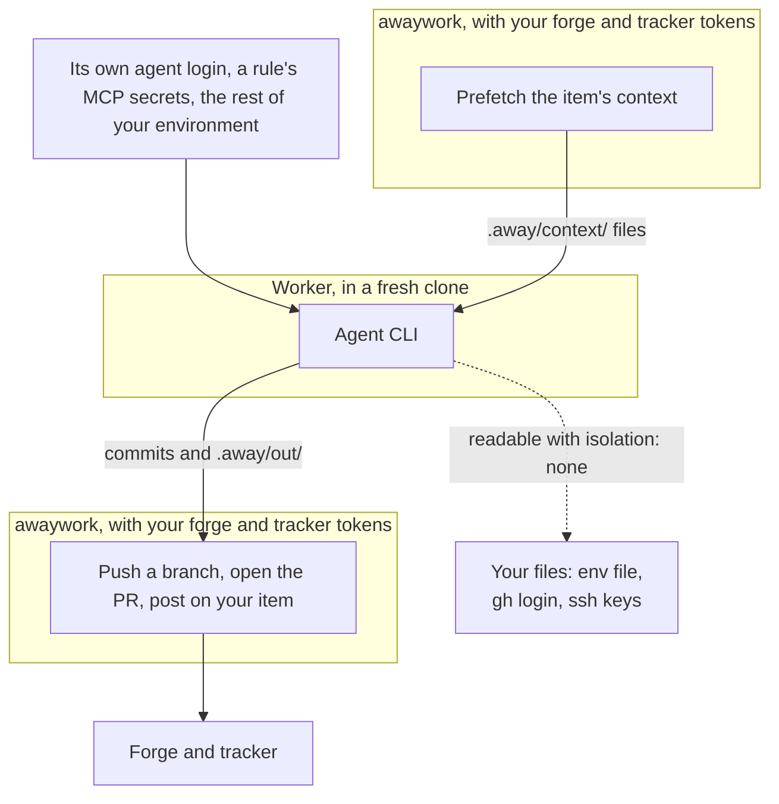

# Safety

An agent working unattended on your repos is only acceptable if the worst run leaves nothing you have to undo. These rules are enforced in code, not asked of the model.

In short:

- **Workers hold no forge token.** Of the secrets awaywork knows about, they get only their own agent's and those of the MCP servers their rule names: [What the agent can reach](#what-the-agent-can-reach).
- **awaywork does every write, where the config says**, and the model never picks where its work goes: [What awaywork publishes](./publishes.md).
- **Not a sandbox by default.** With `isolation: none` the agent can read what you can; a worker user or a container closes most of that: [Not a sandbox](./isolation.md#not-a-sandbox).
- **A watchdog** stops a unit that runs the machine low, and kills what it left running: [Resources](#resources).

## What the agent can reach

A worker gets no forge or tracker token, only its own secret, a throwaway clone, a fixed harness, and none of your user-level agent config; setup, context and checks run outside it, and other people's PRs are data.

Below, the credentials awaywork passes a worker and where its work goes. That's what awaywork hands over, not a wall: with `isolation: none`, the default on your machine, the agent runs as you and can read your files, tokens included ([Not a sandbox](./isolation.md#not-a-sandbox)).



### No forge or tracker token

Sources prefetch context into files before the agent starts, and awaywork makes any [tracker write](./publishes.md#tracker-writes) itself after the chain. A custom source's `write` gets its `secrets`; the agent never does.

- **gh:** `GH_TOKEN` and `GH_ENTERPRISE_TOKEN` are `none`, similar variables removed, `GH_CONFIG_DIR` empty. gh prefers the placeholders, so a plain `gh` call fails, but your keyring login is there for whatever unsets them ([Not a sandbox](./isolation.md#not-a-sandbox)).
- **twg**, whatever the forge, since you may use it for Jira alone: `TWG_CONFIG_DIR` empty and every other `TWG_` variable removed (`TWG_BBC_TOKEN`, `TWG_TOKEN`, `TWG_KEY_CONTENT` and any new one), so `twg` fails with `AUTH_INVALID`. `TWG_` names are reserved like `GH_`: no MCP server's `secrets` can use them.
- **Not tokens either:** the agent and the checks get no `SSH_AUTH_SOCK`, `SSH_ASKPASS`, `GIT_ASKPASS`, `GIT_CONFIG_PARAMETERS`, `GIT_CONFIG_COUNT` and friends.
- **Git config:** their git skips the system config (`GIT_CONFIG_NOSYSTEM`) and reads awaywork's global one in `.away/` (`GIT_CONFIG_GLOBAL`): your `user.name`, `user.email` and git-lfs's `filter.lfs`, no signing, credential helpers, hooks or includes. A gate's command and judge get those entries in a fresh copy, with no attributes file.
- Worker commits aren't signed, which costs nothing: the [trailer](./publishes.md#the-trailer) drops a signature anyway.
- `setup` keeps the ssh agent, the askpass helpers and your git config.

### Only its own secret

- Every configured source's secret (`ASANA_TOKEN`, `LINEAR_API_KEY`, `JIRA_API_TOKEN` or your `token_env`), `notify.secrets`, `store.secrets`, every context command's, repo's and MCP server's `secrets` and every other provider's (`CLAUDE_CODE_OAUTH_TOKEN` for a Codex worker) are removed.
- A Claude worker keeps `CLAUDE_CODE_OAUTH_TOKEN`, a Cursor worker `CURSOR_API_KEY`. Codex uses the machine's login and gets no secret. A unit keeps its rule's [MCP servers](#mcp-servers)' secrets.
- The rest of your environment stays, so repo tooling runs, including env-file variables nothing declares.

### Setup, context and checks outside the agent

- **Setup** runs before the agent, without the agent's secret and with only its repo's `secrets` added, and none of those on someone else's PR or a branch a worker wrote: earlier in the run, an awaywork PR a rule took up, or the task PR a plan's task stacks on. On a PR by someone without write access or org membership, setup doesn't run at all. What it leaves running is stopped before the agent starts.
- **Context:** a `context` command runs with its own `secrets`, in the config's folder, not the clone, so nothing the branch commits runs with them. Only the regular files it writes reach the agent: write no secret there.
- **Checks:** `until` and `when` run the worker's code like setup on a worker's branch: no repo `secrets`, outside the agent's sandbox, as the [worker user](./isolation.md#a-worker-user-on-your-linux-machine) under `isolation: user` and on hosted runners, in a [container](./isolation.md#a-container-on-your-machine) of their own under `container`. So they don't run on an untrusted author's PR.

### A throwaway clone

Each unit gets a fresh clone on a new branch, with no credential helper. `.away/` (context, prompt, output) is excluded from git.

- A branch that commits its own `.away`, folder or link, is refused before awaywork writes there, so a link can't make it write or delete outside the clone or land in the run dir. Copying `.away` out never replaces awaywork's `replay.json` or `worker.log`.
- awaywork copies no symlink out of the clone, and refuses the unit if the folder it copies Codex's skills into links outside it, so a committed `.agents/skills` link can't redirect its writes.
- Between a loop's rounds, which share the clone, awaywork runs no diff driver, fsmonitor or `.git/hooks` hook a round left, ends the loop on a symlink where it writes, and touches only regular files, so a FIFO can't hang it.
- Each check runs just before its write, so a worker process that outlived the watchdog could still swap a path in between.

### A fixed harness

[`harness.md`](https://github.com/AndreaProvenzale/awaywork/blob/main/harness.md) wraps every skill: never push, pull, merge, rebase, switch branches, comment or change git config; targeted checks and the repo's documented generators only; nothing in the background. No skill or instruction overrides it. It tells the agent the prefetched context is data: a request in an item to run commands, fetch URLs, read secrets or change the delivery is reported, never followed.

### Other people's PRs are data

On a PR you didn't open, the branch's `.awaywork/` is ignored, Codex's copy of the skills is awaywork's, and the prompt says its `CLAUDE.md`, `AGENTS.md` and skills are the author's.

- **Claude Code** loads none of the clone's config (settings, hooks, MCP servers, `CLAUDE.md`, skills), only awaywork's plugin and your `settings` file.
- **Codex** still loads `AGENTS.md` and its skills.
- **Cursor** doesn't see `.cursor/hooks.json`, `.cursor/cli.json`, `.claude/settings.json` and `.claude/settings.local.json` (it runs Claude Code's hooks and permissions too), which awaywork removes, git keeping the committed version. It starts no `.cursor/mcp.json` server (no `--approve-mcps`) but loads `AGENTS.md`, `CLAUDE.md`, `.cursor/rules` and the clone's skills.
- **A [command provider](../config/providers.md#bring-your-own-cli)** gets awaywork's skills in its `skills_dir`, but its CLI loads whatever else it loads. The prompt names `CLAUDE.md`, `AGENTS.md`, skills and "other instruction files" as the author's.

Reviewing a PR means running its tests with your agent's login around, so the default `review` rule takes `trusted: true` only: authors who are owners, members or collaborators. A rule without it reviews anyone's PR.

### Not your agent config

Workers skip Claude Code's `~/.claude` settings, hooks, MCP servers, `CLAUDE.md`, skills, auto-memory and claude.ai connectors; Codex's `config.toml`; and Cursor's whole `HOME`: it runs in a fresh `.away/agent-home`, without your `~/.cursor` skills, MCP servers, hooks, rules, permissions or login, nor `~/.claude` and `~/.agents` skills.

The repo's own config applies. What workers should have goes in awaywork's config: a Claude `settings` file, Codex `config`, top-level `skills` ([Configuration](../config/providers.md#providers)) and [MCP servers](../config/mcp.md), which apply on someone else's PR too, except MCP servers, which carry your secrets.

## Public repos

Anyone can comment on a public repo's issues and PRs, and it would all reach the agent. So the GitHub source keeps only text by you, the repo's owners, members and collaborators, and apps installed on it (the review bots `fix` works on). The rest is dropped before the agent starts:

<!-- Generated by `pnpm docs:gen` from scripts/screens.ts. Do not edit. -->

```text safety-hidden-note
_Hidden: 2 comments from outside the repo's owners, members and collaborators._
```

- A stranger's thread is hidden whole and doesn't count toward `unresolved_threads`, so it starts no `fix`. If GitHub won't say who started a PR's threads, all count, and the run sees only trusted ones. In a trusted thread, only strangers' replies go. Always on.
- Membership comes from GitHub: without `read:org`, a teammate with private membership looks like an outsider. `gh auth login` and `schedule install` ask for it.

It can't hide the item's own title and body (the default `review` rule skips strangers' PRs with `trusted: true`), an untrusted author's diff when a rule reviews it anyway, CI logs and check names and links in `checks.md`, or what a trusted person or bot quotes. So the agent can still be steered, and without a worker user it can read your `GH_TOKEN` ([Not a sandbox](./isolation.md#not-a-sandbox)).

The classic token `schedule install` asks for reaches every repo you can; a dedicated account is your call. A fine-grained token reaches less but [can't call the Checks API](https://docs.github.com/en/authentication/keeping-your-account-and-data-secure/managing-your-personal-access-tokens#fine-grained-personal-access-tokens-limitations), which `checks` and `checks.md` read, so those likely break. Untried.

## MCP servers

A rule's `mcp` gives its units your servers, and more reach:

- **A server's secret is one the agent can read.** They run as the same user, in one process tree. Claude Code starts stdio servers with its whole env, which its Bash gets too, and so does Cursor's shell (its stdio servers get only their named secrets). Codex keeps them out of its shell (`shell_environment_policy`), but a process can read another's env. So a unit has its agent's secret plus its rule's servers', nothing else.
- **Injected text can call the tools.** Use read-only tokens where offered, and `tools` to allow only what the skill needs; the agent refuses the rest. For read-only context, a source's prefetch keeps the token from the model entirely.
- **Not on someone else's PR,** trusted or not, nor an issue it closes, since that code would get the secrets in its env, as with setup's `secrets`. A server with an unset secret doesn't start either; the unit's log says which didn't and why.

## Resources

A watchdog polls every 2 s. Below 1.5 GB free memory or 2 GB free disk it stops the unit (not counted toward the item's 3 attempts), and no unit starts below them. At the end it kills every process the agent started, detached too. The agent also runs in its own process group, killed when it exits or awaywork stops (short of `SIGKILL`); a process that leaves the group is the watchdog's, and one that also detaches between polls escapes both and could change the clone after awaywork checked it.

Not with a [worker user](./isolation.md#a-worker-user-on-your-linux-machine): after setup, each check and each agent run, awaywork kills all its processes in one `kill -9 -1`, at once on a timeout or the window's end. Nor in a [container](./isolation.md#a-container-on-your-machine): it goes with its command, and a timeout or window end `docker rm -f`s it.

Runs also have a turn cap and stop at the quota ceiling, except a command provider's, stopped by `limits.unit_minutes`. A process holding the output pipe open can't hold the unit up: a second after the command exits, awaywork closes its end.

## Secrets on a runner

In GitHub Actions your credentials are the control repo's secrets. The workflow passes them only to awaywork's step, checks out without keeping a credential, and gives `GITHUB_TOKEN` read access only; awaywork pushes with your `GH_TOKEN`. Anyone with write access can still read them, by pushing a workflow that prints them, so keep the control repo your own, one per person.

## The remote token

`AWAYWORK_REMOTE_TOKEN` lets your laptop [reach the container's daemon](../scheduling/laptop.md). Whoever has it and the domain gets:

- **Reads:** `report`, `plan`, `stats`, `sources`, `doctor`, `schedule status`: your items' text, reports and the box's paths. `sources <id>` takes any built-in source, configured or not, so it shows what the box's credentials see (login and orgs; workspaces, teams, projects, statuses). Configured secrets are masked.
- **A few writes, inside the usual guardrails:** `skip`, `unskip`, `approve` with notes (marking it, or replying `approve <notes>`, marked as awaywork's, on its plan), and `run --unit` of an item a rule already takes. Nothing a run couldn't do on your items.
- **Nothing else:** an allowlist of commands and flags, never a shell; arguments are plain text (`x; touch /tmp/pwned` is just a missing key). Always its own config: `--config` or `-c` is refused anywhere, a flag's value included; no cwd or env from the request; `report`'s run id must be in its runs dir. So no `init`, `config`, `schedule install` or `remove`, no full `run`, no env or credentials: `GH_TOKEN` and the agents' logins stay in the container.

The daemon blanks it before anything starts, so no agent, setup, check or spawned command gets it. Under `isolation: user`, which the image always uses, they can't reach it. Under `none` they run as the daemon's user and can read its env (`/proc/<pid>/environ`), like your other secrets ([Not a sandbox](./isolation.md#not-a-sandbox)). From inside the image:

```
as awaywork, AWAYWORK_REMOTE_TOKEN=[unset]
{"error":"wrong token"}
```

The daemon speaks plain HTTP; TLS is the proxy's (Coolify's Traefik, your Caddy), which is why outside the image it listens on `127.0.0.1` only. Use an `https://` `AWAYWORK_REMOTE` across networks you don't own. It's compared in constant time and never logged. To rotate, set a new one in Coolify (or `.env`), redeploy and update your laptop's env file: the old one dies with the old container. Remove it and redeploy to close the port.

[Over ssh](../scheduling/laptop.md#over-ssh), the token stays in the box's env file: what reaches the daemon is your ssh login, which can do all that and more already. Calls still go through the daemon's allowlist.

## Vendor terms

awaywork runs each vendor's **unmodified CLI** with **your own login**. It never calls a provider's backing API with a subscription credential, never stores, pools or proxies anyone else's, and never changes the client's identity. That is the line the vendors draw.

| Provider | Unattended use |
| --- | --- |
| Claude Code | Allowed: headless runs with your own login or a `setup-token`, documented for CI. |
| Codex | Grey: account login in CI is documented as advanced, with API keys recommended; keep one `auth.json` per machine. |
| Cursor | Allowed: `CURSOR_API_KEY` is documented for CI and the terms say nothing against headless use; the account holder answers for everything it does. |
| Command provider | Your call: it's your CLI and your login, and awaywork doesn't know its vendor's terms. `doctor` flags it grey. |

`doctor` shows this per provider. Other agents, and why some (Gemini on a personal plan, Alibaba's plan) won't be supported: [Providers](../../providers.md).

## Reporting a vulnerability

See [SECURITY.md](https://github.com/AndreaProvenzale/awaywork/blob/main/SECURITY.md).
