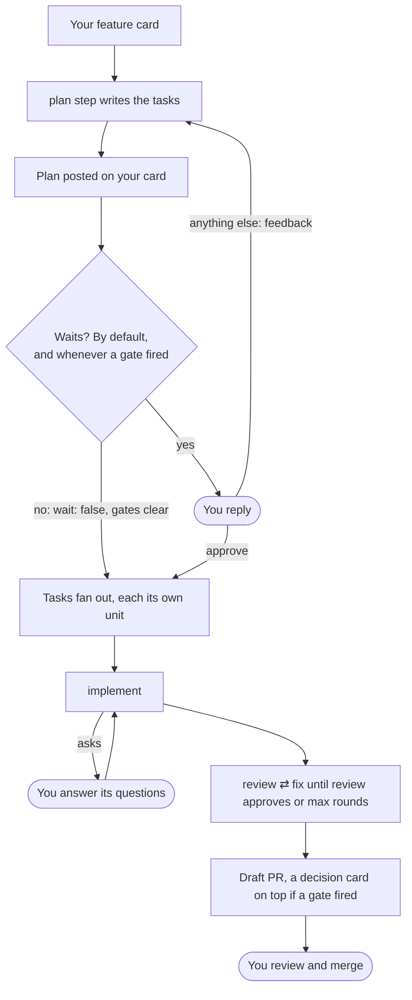

# Workflows

Where a run stops for a person, and how the work goes on from your answer:

- [Questions](#questions): a step needs your answer, so it asks on your item.
- [Continue](#continue): work too big for one run goes on in the next, on the same draft.
- [Gates](#gates): a change that needs a human (a migration, a new route, a bumped dependency) gets a decision card on the PR.
- [Plans](#plans): a feature across a few PRs or repos is split into tasks you approve first.
- [Posts that wait](#posts-that-wait): a report you read before the next stage starts.
- [Threads](#threads): the card can't take awaywork's posts, so they go to a GitHub issue.
- [Store](#store): big plans, contracts and screenshots live outside the post and [come back](#files-that-come-back) to the next step.
- [Proving a change](#proving-a-change): a skill of your own shows the change does what the card asks, and gates check what it left.

awaywork keeps none of this in its state dir: every wait is read off the item, its PR or its thread, so a fresh runner still waits and goes on.

A feature card under a `deliver: plan` rule, with an `implement` rule and a review-and-fix [loop](./chains.md#loops) taking its tasks, stops for you at the plan, at any questions, and at the PR. Your reply is what moves it on:



## Questions

A step that can't go on without an answer, like `implement` on a vague issue, asks on your item:

1. It writes its questions to `.away/out/questions.md` and `ask` to `.away/out/status`, and the chain ends.
2. awaywork posts them as one comment, marked `— awaywork`, on the unit's item from the rule's own tracker (the one [`on_done`](./configuration.md#on-done) would move), when that item is yours: your PR, an issue assigned to you, a tracker item.
3. The unit is skipped as **waiting for your answer**, under Needs you as `answer question`.
4. A reply ends the wait, and the next run takes the unit with the same rule: within minutes on a [`run: soon`](./configuration.md#run-soon) rule.

The model writes the questions, awaywork the last two paragraphs. On GitHub it shows up as you:

<!-- Generated by `pnpm docs:gen` from scripts/screens.ts. Do not edit. -->

```text workflows-questions
octocat commented

Before I write code for "Add rate limits":

1. Per user or per API key? The issue says "per client", and src/auth.ts has both.
2. Should a burst over the limit get a 429, or wait for the bucket to refill?

Reply here to answer: awaywork's next run takes this up again with your reply.

— awaywork
```

The result reads `asked questions`, the report lists them under Questions, and `awaywork run` prints `questions posted on <url>`, the comment's URL on GitHub, the item's elsewhere. The next run's `item.md` has the comment headed `awaywork's questions`, replies after it; a step that still can't go on asks again.

Details:

- awaywork's own comment bumping `updated` isn't a change.
- Any later comment the agent sees ends it, yours or a teammate's: on GitHub an owner's, member's or collaborator's; on a tracker, any comment on an item assigned to you.
- Bots don't (GitHub's bots, Jira's and Linear's apps, Linear's integrations): they show in `item.md` but the unit keeps waiting. Asana and custom sources don't mark bots, so there an integration's comment ends it.
- A comment is awaywork's only when its `— awaywork` line comes from your account, so a pasted one doesn't hold your item ([Safety](./safety.md#what-awaywork-publishes)).
- On an item that isn't yours, a source that can't write (a custom source without `write`) on a rule without a [thread](#threads), or a failed post, the questions stay in the morning report with the reason; the unit is still done.
- A step that committed and asks opens a draft (`draft: asked questions`) headed `Status: ask, questions on <item>`, `status=ask` in the footer, as for [`continue`](#continue); under `push` the commits go onto your PR. Once answered, the next run goes on with that draft, `run: soon` included.
- With no status file awaywork guesses as before: a step that committed went on, so `questions.md` stays in `out/`, unposted. A word other than `done`, `ask` or `continue`, or `ask` without `questions.md`, reads as no file, with a line in the run's log.
- A chain that asked doesn't run its rule's `on_done`.

## Continue

You get one draft PR that grows over several window runs, `Status: continue (1 of 3)` on top. Under `deliver: pr` it turns ready for review once done; mark it ready yourself to take it over: a ready PR, or a draft with no status in its footer, waits for review like any awaywork PR.

A step commits what's solid and writes `continue` to `.away/out/status`. The chain stops there, so no review or fix runs on half-done work, and publishes what it has. Under `draft_pr` or `pr` that's a draft (`draft: the agent will continue`), the count in its footer:

<!-- Generated by `pnpm docs:gen` from scripts/screens.ts. Do not edit. -->

```text workflows-continue-draft
Export screen

Status: continue (1 of 3): awaywork's next window run goes on here

[...]

---
<!-- awaywork run=20261026-232730 item=github:acme%2Fapi%231%2Fapp status=continue continued=1 head=1f8a2313462c9a1f49af169ae1822d14c8adcde3 from=16548667d8e02a7a03e25135ff6054b195de8e51 -->
Opened by awaywork (run `20261026-232730`): a coding agent worked on this unattended. Review it like any other contribution.
```

The next run that would take the item anyway (window, scheduled or manual, never `run: soon`) goes on with the draft. Its commits fast-forward onto it, no new PR or suffixed branch, and the new `pr.md` replaces title and body:

<!-- Generated by `pnpm docs:gen` from scripts/screens.ts. Do not edit. -->

```text workflows-continue-plan
Units 1
     item            rule     skill                 provider  deliver  title
  1  acme/api#1/app  #2 soon  implement (built-in)  claude    pr       Export screen
     in acme/web
     goes on with its draft https://github.com/acme/web/pull/13, which said continue (1 of 3)
```

Once the agent says `done` (or writes no status file) and `verify`, the gates and the loops pass on every commit of the draft, a `deliver: pr` draft turns ready for review; a `draft_pr` stays a draft, its status line gone. The agent's word can only hold a PR back.

Details:

- awaywork reads the footer back: status, count, the head it pushed, and the commit the draft's commits start after. The visible line is for you; the agent could write a `Status:` line itself, but not after the footer.
- The run that goes on clones the draft's branch, its prompt saying so, with the last report (or the draft's body, if no run of it is kept on the machine) in `.away/context/previous/report.md`.
- A chain that committed nothing has no draft, so its questions are posted.
- The footer still holds the draft's [dependents](#tasks) back.
- A `run: soon` run skips a `continue` as `goes on from <PR> in the next window run`.
- **A report** that says `continue` posts its result where results go (a [report task](#report-tasks)'s, `on_done: { comment: result }`'s) with `Status: continue (1 of 3)`, and runs again from it as `previous/report.md`, up to the same cap. Clear a capped count with `awaywork skip`, or by deleting awaywork's `continue` results on the item. Otherwise it only reports.
- A `continue` with nowhere to keep its count (no commits on a new branch, or a `push`, `pending_review` or `plan` rule) reads as no status file, with a log line.
- A chain that says `continue` skips its rule's `on_done` move: the unit isn't done.

### When it won't go on

awaywork goes on only with its own GitHub draft: head where it left it, opened by you, body last edited by you, under 3 continues. Otherwise the report says `<why>: finish <PR> by hand`, the draft opens without the status line, its questions stay in the report, and the next plan skips the unit:

<!-- Generated by `pnpm docs:gen` from scripts/screens.ts. Do not edit. -->

```text workflows-finish-by-hand
Needs you 1
  acme/web
    #7  Export screen  finish by hand
        awaywork's draft says continue, but it moved from 1f8a231,…
```

The whys: `awaywork goes on with its own draft on GitHub only`, `someone else opened or edited it last`, `it moved from <sha>, where awaywork left it`, `it continued 3 times`.

## Gates

A gate checks what a unit leaves, its commits and the files its steps wrote, and fires when a human should look first. Where it fires decides what happens:

| The unit leaves | A fired gate |
| --- | --- |
| A PR (`draft_pr`, `pr`) | Puts a [decision card](#the-decision-card) on top of the PR; a `deliver: pr` PR stays a draft |
| A `push` onto your PR | Still pushes, the card atop the push's summary in the report |
| A plan or report | Makes the [post wait](#posts-that-wait) for your approve, the card on top |

Gates go at three levels: top-level and per repo, which run on every chain that publishes commits, and on [a rule](#gates-of-a-rule-s-own). Each gate has a name and one of:

- `changed`: git globs from the repo root, firing when the chain's commits touch a match;
- `command`: a script, firing when it exits non-zero, its stdout the gate's line;
- `skill`: a [judge](#judges).

```yaml
gates:
  schema: { changed: ["**/migrations/**", "**/*.prisma"] }
  routes: { command: scripts/route-diff.sh } # non-zero exit = fires, stdout = the line
  deps: { changed: [package.json, pnpm-lock.yaml] }
  risk: { skill: judge } # a model reads the chain's commits and may fire it
repos:
  acme/backend:
    gates:
      schema: { changed: ["src/db/schema/**"] } # joins the top-level schema globs
      queues: { changed: ["src/jobs/**"] } # only this repo has it
```

Top-level gates apply to every repo; a repo's `gates` only add. A gate both define fires on either's globs, and if both have a `command` or `skill`, both run and either fires it. A repo can't turn off or loosen a top-level gate.

A command diffs from `$AWAYWORK_FROM`: the chain's start commit, or git's automatic merge on a [`sync`](./chains.md#conflicts) a model resolved. Never from a branch like `origin/main`: the clone's refs are the agent's to move. It also gets `$AWAYWORK_OUT_DIR`, a read-only copy of what the steps left in `.away/out/`: the PR body, a screenshot a step saved, any other file.

```sh
#!/bin/sh
# scripts/route-diff.sh: fires when the chain adds a route
routes=$(git diff --text "$AWAYWORK_FROM" HEAD -- src/routes | grep -E '^\+ *router\.(get|post)')
[ -z "$routes" ] || { echo "$routes"; exit 1; }
```

### The decision card

Gates run on every chain that publishes commits, after its steps and `verify`, judges last, on the chain's own commits. A fired gate puts the card first in the PR body, under the title, above the agent's text and awaywork's chain notes:

<!-- Generated by `pnpm docs:gen` from scripts/screens.ts. Do not edit. -->

```markdown workflows-decision-card
## Needs a decision

### Gates (from scripts)

- schema: migrations/20261023_add_vat_mode.ts
- routes: + GET /exports/vat   + POST /exports/vat/retry

### Judge

- risk: VAT rounding moved from the invoice total to each line → totals change on open invoices

---
```

With none fired, that spot holds `Gates: none fired (schema, routes, deps)` above the same rule. So with gates, awaywork's section comes first and the agent's text sits below the rule, a made-up card included; that's all it guarantees. No gates, no section. A `changed` line lists the first three matching paths and how many more; a `command` line is its stdout on one line, cut at 300 characters, or why it failed if it printed nothing.

By `deliver`:

- `pr` opens as a draft, the report saying `draft: gate schema fired` with the card's lines under the unit.
- `draft_pr` was a draft anyway: only the card is new.
- `push` still pushes. Your PR's body is yours, so the card tops the push's summary in the morning report: `1 commit pushed onto feat/vat-export, gate schema fired, report below`.
- `report`, `plan` and `pending_review` commit nothing, so these gates don't run; a plan or report rule takes [gates of its own](#gates-of-a-rule-s-own).

### Gates fail closed

A command that can't run, times out, is stopped or isn't run on an untrusted author's PR fires its gate with the reason: ``- routes: `scripts/route-diff.sh` not checked: timed out after 15 min``.

The agent could rewrite the script that judges it, so right before a command runs, awaywork compares each file it names with that path at the clone's start commit, before `setup` or any agent (on an awaywork PR a rule took up, where that PR left the default branch). A file that differs, is new or is gone fires the gate unrun (``- routes: `scripts/route-diff.sh` changed, not run``), committed, uncommitted, hidden from `git status` or changed by `verify` alike.

A `changed` gate is the one to trust: awaywork computes it from the commits it pushes ([Safety](./safety.md#what-awaywork-publishes)).

Details:

- The command must name its script by repo-root path, as a word of its own: `bash ./scripts/route-diff.sh` or `(scripts/route-diff.sh) && echo ok` count, `cd scripts && sh route-diff.sh` doesn't.
- A named file missing at the chain's start always fires it, so don't name one the command writes.
- Only named files are compared, and the command runs repo code the agent may have changed: a sourced helper, code it calls, a module loaded from beside it. `python3 scripts/gate.py` imports an agent-committed `scripts/json.py` before the real `json`, so run Python with `-I`; Node looks for `node_modules` up from the script the same way.
- A gate can't change `.away/out/`: once the gates ran, awaywork puts back what the steps left, as plain files, so a link or an executable bit in it is dropped.
- What can't blank the diff: replace refs (the command's git ignores them); attributes like `* -diff`, which make it `Binary files … differ` (awaywork deletes `.git/info/attributes` first, and git reads `.gitattributes` files, committed or not, from the start commit, not the worktree; older git ignores that, hence `--text`); the steps' git config, like `diff.external` or a textconv driver (the command's git reads a fresh global config awaywork writes, with your identity and git-lfs's filter, no attributes file).

### Judges

A `skill` gate is a judge: a model that reads the chain's commits and fires when it finds something a human must decide. After the scripts, awaywork runs that skill in the chain's clone as one more model run, routed on the rule's providers and models like a step, told which commit to diff from, where the read-only copy of the steps' `.away/out/` is, and to change nothing. Writing `fires` to `.away/out/verdict` fires the gate, the first ten lines of its `report.md` going into the card's Judge part.

The built-in `judge` looks for schema and data changes, public routes and API contracts, money and rounding, auth, infra, performance-sensitive paths, dependency changes, anything irreversible. Name your own skill to judge by your rules: yours or a built-in, never the repo's. A gate's `instructions`, files relative to the config, reach its judge's prompt (`risk: { skill: judge, instructions: [judges/money.md] }`); the rule's and repo's don't, being written for the agent it judges.

Details:

- Any other verdict, or none, adds nothing. Scripts set the minimum; a judge only adds, and can't clear a script's gate, even one with its name.
- It reads what the agent wrote, `// reviewed: safe` comments included, so it can be fooled, and then it just doesn't fire.
- It can't change what's published: a commit, moved HEAD, uncommitted change or changed `.away/out/` file it leaves is put back, and the gate fires with `the judge changed the clone; awaywork dropped its changes`. A worker process that outlived the watchdog could still change a file after that.
- It fails closed: a judge that errors, times out, is stopped or can't run fires with `judge didn't run: <why>`, so a run out of quota drafts its `deliver: pr` PR.
- Each judge is one more model run per published chain, on the steps' quota, logged as `acme-backend-412: gate risk, judge on claude`, its own log beside what the chain published (`out/judge-risk-judge.log`).

### Gates of a rule's own

A rule takes `gates` of its own, for a check only its units need. On a rule that opens a PR or pushes, a `planned` one included, they run with the top-level and repo gates, on top of them, and one that fires does what theirs does:

```yaml
queue:
  - skill: implement
    where: { labels: ui }
    deliver: pr
    gates:
      proof: { command: scripts/has-screenshot.sh } # reads $AWAYWORK_OUT_DIR/screenshot.png
      copy: { changed: ["src/locales/**"] }
```

Like the others, they run only when the chain has commits: one that left none reports, ungated. The exception is a chain that left no commits and has `on_done` to write, say a `review` that approves, so the `fix` after it is passed over: the rule's own gates run first, on `$AWAYWORK_OUT_DIR` alone (no `$AWAYWORK_FROM`, and `changed` matches nothing), and one that fires holds `on_done`'s comment and move back, its line in the unit's report. The unit is still handled: nothing retries it and `awaywork approve` has nothing to approve, so the comment and the move are yours to make, or change the item to run it again. Top-level and repo gates don't run there.

A rule whose skills all report, as `review` does, could never run them, so its items are skipped with `set deliver: report (review commits nothing, so its gates would never run)`, and `awaywork doctor` warns about the rule.

A `deliver: plan` or `report` rule's own gates are the only ones it has (top-level and repo ones never run there: no diff). They run on what the step left, and one that fires makes the [post wait](#posts-that-wait) for your approve, the card on top:

```yaml
queue:
  - skill: plan
    deliver: plan
    wait: false # goes ahead unless a gate fires
    gates:
      product: { skill: judge, instructions: [judges/product.md] } # your rules, from the config only
      size: { command: scripts/plan-size.sh } # reads $AWAYWORK_OUT_DIR/plan.yml
```

- A command gets `$AWAYWORK_OUT_DIR`, a read-only copy of the step's `.away/out/`: `report.md`, the post's text, a plan's `plan.yml`, any other file it wrote. No `$AWAYWORK_FROM`: nothing was committed.
- A judge gets the same copy, told to judge those files against the item, not a diff. The built-in `judge` looks for product calls: acceptance criteria that can go two ways, UX or copy, scope the card doesn't settle, data kept or shown to someone new, a contract another team owns.
- The post is what the step left: awaywork restores `.away/out/` before posting, and a judge that changed it fires.
- None fired: `Gates: none fired (product, size)` tops the post, which under `wait: false` goes ahead, its mark line naming the gates that ran clear.
- On a `planned` rule that reports, one that fires makes the [task's result wait](#a-gate-on-a-report-task), and holds the card's other tasks until you answer.
- A rule gate takes no name a top-level or repo gate has, and on a plan or report rule no `changed`: there's no diff. A `pending_review` rule takes no gates.

## Plans

A feature spanning a few PRs doesn't fit one unit. Give its card a `deliver: plan` rule and its step splits the work into tasks you approve first:

```yaml
queue:
  - skill: plan
    where: { label: awaywork-feature }
    deliver: plan
    on_done: { move: Plan review }
  - skill: implement
    where: { planned: true }
    deliver: pr
```

The second rule takes the [tasks](#tasks) once you approve. The plan rule's steps all report, and the prompt asks for `.away/out/plan.yml` too: the built-in `plan` skill writes it, any skill can.

### `plan.yml`

`tasks:` holds up to the plan rule's `plan_tasks` tasks (8 by default) when the rule writes it; a posted plan isn't counted again. Each task has:

- `id`: lowercase letters, digits and dashes;
- `title`, and optionally a `description`;
- `skill`: one a `planned` rule takes, `implement` when unset;
- `repo`: the card's when unset, or another the config names ([Across repos](#across-repos));
- `ships`: files its PR will hold that tasks in other repos need;
- `after`: task ids mapped to `merged`, `opened` ([The feature block](#the-feature-block)) or a check's name ([Waiting on a check](#waiting-on-a-check)).

An optional `contract:` names one file the step wrote under `.away/out/`, like an OpenAPI diff or a shared schema, posted with the plan.

The prompt lists the skills `planned` rules take, marking `(reports)` those whose rule opens no PR (a reporting skill like `review`, or an all-report chain): they make [report tasks](#report-tasks).

awaywork checks the file in plain code:

- ids unique and not [retired](#task-details), under the cap;
- every skill taken by a `planned` rule, no `after` naming a report task;
- every repo one the config names, `ships` paths inside the repo;
- every `after` naming another task, no cycles, a task's `opened` and check tasks in its repo on one chain;
- a `contract` under `.away/out/`, no unknown key.

### The plan comment

awaywork posts report, contract and file as one comment on your item, where [questions](#questions) would go. The model writes report and file; awaywork adds the fences, a [contract](#across-repos)'s heading, and the last two paragraphs:

<!-- Generated by `pnpm docs:gen` from scripts/screens.ts. Do not edit. -->

````text workflows-plan-comment
VAT export lands in two PRs: the endpoint first, then the button that calls it.

- `api`: `GET /exports/vat` in `src/routes/exports.ts`, paged like `/exports/sales`, with a test next to `sales.test.ts`.
- `web`: an Export button on the reports page, behind the `vat_export` flag; it waits for the endpoint to merge.

Open question: should the export include voided invoices? I left them out.

```yaml
tasks:
  - id: api
    title: VAT export endpoint
    description: Add GET /exports/vat to src/routes/exports.ts, paged like /exports/sales.
  - id: web
    title: Export button
    description: Add an Export button to the reports page behind the vat_export flag.
    after: { api: merged }
```

To approve, reply with approve as the first line; the lines below it reach the tasks as notes. Any other reply is feedback: awaywork plans again with it.

— awaywork
````

The run says where it went, and [`on_done`](./configuration.md#on-done) fires once it's posted:

<!-- Generated by `pnpm docs:gen` from scripts/screens.ts. Do not edit. -->

```text workflows-plan-posted
  1  ENG-2101  plan   done    report
     VAT export lands in two PRs: the endpoint first, then the button that calls it.
     plan posted on https://acme.atlassian.net/browse/ENG-2101, tasks api, web; it waits for your approve
     on_done moved ENG-2101 to "Plan review"
```

Until you answer, the card is skipped as **waiting for your approval**, under Needs you as `approve`.

### Your answer

- **Approve:** reply from your own account with `approve` as the first line, any case; lines below are notes for the tasks. `awaywork approve <source:key> [notes]`, or `a` in the report, posts it for you, marked like any awaywork comment, through the same ownership check, and refuses a plan you already answered. The next run [fans it out](#tasks):

  <!-- Generated by `pnpm docs:gen` from scripts/screens.ts. Do not edit. -->

  ```text workflows-approve
  $ awaywork approve tracker:ENG-2101 Leave voided invoices out.
  plan approved: replied approve, with your notes, on https://acme.atlassian.net/browse/ENG-2101
  ```

- **Anything else of yours is feedback,** `approve if web waits` included. The next run plans again with the whole thread in `item.md` (the plan headed `awaywork's plan`) and posts a new plan, which waits for a fresh approval whatever `wait` says. A re-plan that isn't posted is skipped as unchanged until the card changes.
- **Only you answer,** with your first reply after the plan. A teammate's, code owner's or bot's comment is context in `item.md`, and your later comments change nothing. Edit your reply to change your mind before the next run reads it; one someone else edited isn't yours anymore.
- **`wait: false`** posts the plan and goes on, its mark line saying `— awaywork · went ahead` and that a reply changes nothing. It counts as its own answer; the next run fans it out with no notes. Its [gates](#gates-of-a-rule-s-own) still run, and one that fires makes it wait, the card on top.

### Details

- The plan is awaywork's newest plan comment, read off the card every run. GitHub reads the whole thread, past its last 50 comments.
- Edit the plan comment to fix a task, and the next run checks your edit; one that breaks it skips the card as **plan refused** with the reason, under Needs you. A plan comment someone else edited isn't awaywork's anymore ([Safety](./safety.md#what-awaywork-publishes)), so the card gets a new plan.
- A plan isn't posted when it fails its checks (in the file, or read back from the comment), `plan.yml` or the contract is missing, or the comment with the contract passes 30 KB (a [lean](#files-that-come-back) plan pins them, and isn't posted when the [store](#store) fails to put either or skips it: `plan.yml isn't in the store`). The reason stays in the morning report (`plan not posted: plan.yml: task id "api" is used twice`) and `on_done` doesn't fire. Nor on an item that isn't yours, a source that can't write on a rule without a [thread](#threads), or a failed post. A step that asks [questions](#questions) posts those instead.
- A `deliver: plan` rule that matches only merged or closed items, names a `source` that can't write without [`thread: github`](#threads), or has no `planned` rule for its tasks is a config error.

### Tasks

Approve, and each task becomes a child item keyed `ENG-2101/api`, down the queue like any item, on its own branch `away/ENG-2101-api`, opening its own PR. The card makes no unit of its own anymore.

- A task matches only rules whose top-level `where` names `planned`, the first whose `skill` is the task's; such a rule takes nothing else. Caps, attempts, `skip`, gates and chains work on tasks as on anything.
- Tasks without `after` run in parallel; `after` orders them, and a card's tasks run back to back, as one [block](#the-feature-block).
- A task carries the card's source, URL, owner, fields and whole thread, and its repo unless the plan names another, so `where: { planned: true, labels: backend }` works.

Its `item.md` is awaywork's own, the task first:

<!-- Generated by `pnpm docs:gen` from scripts/screens.ts. Do not edit. -->

```markdown workflows-task-item
# ENG-2101/api: VAT export endpoint

https://acme.atlassian.net/browse/ENG-2101

Add GET /exports/vat to src/routes/exports.ts, paged like /exports/sales.

## The plan

This is task `api` of the plan you approved on ENG-2101. [...]

Your notes on approving it:

Leave voided invoices out.

## The card: ENG-2101, Export VAT report
[...]
```

Every run reads the plan off the card and each task's PR off the forge (the PR on the task's branch whose footer names the task, open, merged or closed). `awaywork plan --skipped` shows the card, run by run:

| What happened | The card | Its tasks |
| --- | --- | --- |
| You approved | `fanned out: api no PR yet, web waits for api` | `api` runs and opens its PR; `web` is skipped as `waiting for task api's PR to merge` |
| `api`'s PR is open | `fanned out: api PR open, web waits for api` | `api` waits for your review, under Needs you, like any awaywork PR |
| `api` said `continue` | `fanned out: api draft says continue, web waits for api` | the next window run [goes on](#continue) with `api`'s draft |
| `api` merged | `fanned out: api merged, web no PR yet` | `web` runs, cut from the default branch, which has `api` in it |
| `web`'s PR closed unmerged | plans again | none run until you approve the new plan |
| Every task done | `all tasks done: close or move the card`, under Needs you | none: each merged, or a [report task](#report-tasks) posted its `done` result |

A task's PR says `Part of <card>`, never closes the card, and its footer names only the task, so the card never links its tasks' PRs or folds into one.

#### The plan sticks to the card

Once awaywork's plan comment is on an open card of yours, the card goes to the `deliver: plan` rule it matches, else the first for its source whatever its `where` says now, and no other rule takes it whole. `plan --rules` lists it there, with `(plan)` after its key when the `where` no longer holds. So a `planned` rule's `on_done: { move: In Progress }` can move the card off a plan rule on `status: To Do` and its tasks still run, where a catch-all `implement` lower down would otherwise take the card as one unit.

- It leaves the plan flow when closed or reassigned (read every run); `awaywork skip` on the card holds it and all its tasks.
- Someone else's edit to the card's only plan comment makes it not awaywork's: back to ordinary matching.
- With no `deliver: plan` rule left for its source, a catch-all may take the card whole, next to its open task PRs.

#### Task details

- **Questions from a task** go on the card, headed `Questions from task api` (`awaywork's questions from task api` in `item.md`), through the usual ownership check. The run stops the card's [block](#the-feature-block) there: no task of the card runs after it that run, skipped as `api's questions wait for your answer`, so one post of a card waits for you at a time. While they wait, later runs skip every task of the card as `waiting for your answer to task api's questions`. The first comment after them that's neither a bot's nor awaywork's answers them.
- **A task's PR is its result:** it posts nothing else on the card. A [report task](#report-tasks) posts its report there instead.
- **Writes go to the card:** a `planned` rule's `on_done` moves the card; a task writes nowhere else. Reassign the card and nothing fans out or writes (`plan approved, but the card isn't yours: its tasks don't run`).
- **A task PR closed unmerged** after the plan was posted re-plans the card, though the card didn't change. Its id is retired: the prompt names it and its PR, with the tasks whose PR is open or merged, and a plan reusing it isn't posted. The new plan needs a fresh approval, even under `wait: false`; a task that keeps its id keeps its PR.
- **A task's branch is its name for good.** When something else holds `away/ENG-2101-api`, the task is skipped with `delete it to run this task`, never moved to `-2`, which its PR lookup wouldn't find.
- A [`branch`](./configuration.md#branch-names) template renders from the task's key alone, so a re-plan that retitles a task keeps its PR: `{title}` or `{type}` in a `planned` rule's template, own or inherited, is a config error. A re-plan may hand a task another skill, and so another `planned` rule, so all `planned` rules for a source set the same `branch`, or none does.
- A task branch whose PR failed to open still reads `no PR yet` (the PR is the task's state), and each morning report says `away/ENG-2101-api exists on acme/api without a PR; delete it to run again`.
- A task takes no approval of its own, the plan's covers it: no `approved`, `awaywork approve tracker:ENG-2101/api` is refused, and a `planned` rule takes no `wait`. The one exception is a report task's result that a [gate of its rule](#a-gate-on-a-report-task) fired on: it waits for your reply.
- On [Bitbucket](./configuration.md#bitbucket-and-jira) it works the same, through twg. A declined or superseded PR counts as closed unmerged, when last updated; a stacked task's PR goes into the branch of the one below (no stacks there); a task whose draft says `continue`, or asks, holds its dependents back, but it's yours to [finish](#continue).

### Report tasks

For [proof of the change](#proving-a-change), a write-up or a prototype link, give the skill a `planned` rule that reports, and the plan can hand it a task:

```yaml
queue:
  - skill: plan
    where: { label: awaywork-feature }
    deliver: plan
  - skill: implement
    where: { planned: true }
    deliver: pr
  - skill: prove
    where: { planned: true }
    deliver: report
```

```yaml
tasks:
  - { id: app, title: Export screen }
  - { id: qa, title: Proof, skill: prove, after: { app: opened } }
```

Its result is its report, posted on the card when its chain finishes, as [`on_done: { comment: result }`](./configuration.md#on-done) would, unasked: `Result of task qa`, the report, `Status: done` (`awaywork's result of task qa` in `item.md`). Like any awaywork comment, it answers nobody's questions, a plan's included, and isn't a change to the card.

- It's **done** once a `done` result for it, newer than your approval, is on the card, and no [gate holds it](#a-gate-on-a-report-task): `plan` skips it as `done: its result is on <card>`, and the card reads `qa done`. Until then it runs, failed attempts counting as usual. A re-plan's approval leaves older results behind, so its tasks report again.
- A `continue` result isn't done: the task [runs again](#continue).
- **Nothing can wait on it:** no PR to stack on, check or merge, so a plan whose `after` names one isn't posted. It can wait on others, as `qa` waits for `app`.
- A `planned` rule delivers `draft_pr`, `pr` or `report`; anything else is a config error.

#### A gate on a report task

Give the rule [gates of its own](#gates-of-a-rule-s-own) to check what the task left, say that every acceptance criterion has a file:

```yaml
queue:
  - skill: prove
    where: { planned: true }
    deliver: report
    gates:
      proof: { command: sh scripts/evidence-gate.sh } # reads $AWAYWORK_OUT_DIR
```

One that fires posts the result as a [post that waits](#posts-that-wait), the gate's line on top:

<!-- Generated by `pnpm docs:gen` from scripts/screens.ts. Do not edit. -->

```text workflows-task-gate
Result of task qa

## Needs a decision

### Gates (from scripts)

- proof: no file for criterion 3

---

Two of three criteria recorded against the preview.

Status: done

To approve, reply with approve as the first line. Any other reply is feedback: awaywork runs this step again with it.

— awaywork · waits
```

- **It holds the feature**, as a task's [questions](#task-details) do. The task isn't done: `plan` skips it as **waiting for your approval** (`approve`, `task qa's result`), under Needs you, and every other task of the card as `waiting for your approval of task qa's result on <card>`. The card reads `fanned out: api waits for qa, qa waits for your approval`.
- **One post of a card waits at a time.** The run that posts it stops the card's [block](#the-feature-block): no task of the card runs after it that run, skipped as `qa's result waits for your approval`. Results the tasks before it posted stay as they are.
- **Your first reply after it decides**, from your own account; a teammate's comment is context. First line `approve`: you accept the gap, and the task is done. `awaywork approve tracker:ENG-2101/qa`, the card's key or `a` posts it. Anything else is feedback, and ends the hold too: the card reads `qa runs again on your feedback`, the task runs again with the thread in `item.md`, ahead of the tasks after it, and the other tasks go on. Its gates run on the new result: if one fires again that run, the tasks after it stop behind it. A [pinned file](#files-that-come-back) of the post edited in the store is feedback too, whatever you replied, though the card didn't change.
- **None fired:** `Gates: none fired (proof)` tops the result, marked `— awaywork · went ahead · gates=proof`, and the task is done as without gates.
- A newer plan leaves the result behind: `approve tracker:ENG-2101/qa` is refused as `older than the plan`, and while that plan waits your reply answers the plan.
- A `planned` rule's `on_done: { move }` is held with the post, as on [any that waits](#posts-that-wait).
- All of it is read off the card or its thread every run.

### The feature block

`after` says what a task waits for:

- **`merged`**: run after run, until that task's PR merges; then it's cut from the default branch, which has it. Each PR lands and is reviewed before the next starts.
- **`opened`**: only until that task's PR opens, in the same run. Its clone starts from that task's branch and its PR stacks on that task's, so the whole feature is up for review in the morning, as a stack. A task in [another repo](#across-repos) only waits.
- **a check's name**, like `Vercel Preview`: `opened` plus that check passing, which takes a later run ([Waiting on a check](#waiting-on-a-check)).

The run that sees a card runs its tasks back to back, as one block, in the order they wait on each other, before the next unit, wherever the first ranks. A task joins once every `merged` task it names merged and every `opened` one has an open or merged PR, or runs earlier in the block. So a block stops only where it needs you: at `merged`, to merge something, or at a task's post that waits, its [questions](#task-details) or a result [a gate fired on](#a-gate-on-a-report-task), to answer it.

```yaml
tasks:
  - id: api
    title: VAT export endpoint
  - id: web
    title: Export button
    after: { api: opened }
```

The run after `approve`:

<!-- Generated by `pnpm docs:gen` from scripts/screens.ts. Do not edit. -->

```text workflows-stacked
Units 2
     item          rule  skill                 provider  deliver  title
  1  ENG-2101/api  #2    implement (built-in)  fake      pr       VAT export endpoint
  2  ENG-2101/web  #2    implement (built-in)  fake      pr       Export button
     after api, stacks on its PR

Skipped 1: 1 fanned_out
```

`api` opens `away/ENG-2101-api`; `web` is cloned from it and its PR goes into it, the body ending `Stacked on <api's PR>: merge that first.` Once `api`'s PR is open, a later run stacks the same way, and `plan --why ENG-2101/web` shows `after api opened (PR #41 open)` and `stack after api, stacks on #41`.

When the task before opens no PR (it failed, asked or committed nothing), those stacked on it are skipped as `api opened no PR`. When it never ran (`setup` failed, Ctrl-C, the window's end, or `run --unit` named only the task after it), they're skipped as `api didn't run`, and those on them as `web didn't run`.

| What happened | The card | Its tasks |
| --- | --- | --- |
| You approved | `fanned out: api no PR yet, web no PR yet` | `api` opens its PR, then `web` runs on `api`'s branch and opens its PR, stacked on `api`'s |
| `api` failed | `fanned out: api no PR yet, web no PR yet` | `web` is skipped as `api opened no PR`; both run again next run |
| `api` said `continue` | `fanned out: api draft says continue, web no PR yet` | `web` is skipped as `api left a draft that says continue`; the window run that finishes `api` runs `web` right after it, stacked on its PR. A check on `api`'s PR waits as `its draft says continue` |
| A cap cut the block after `api` | `fanned out: api PR open, web no PR yet` | the next run stacks `web` on `api`'s open PR: `after api, stacks on #41` |
| `api` merged before `web` ran | `fanned out: api merged, web no PR yet` | `web` is cut from the default branch |
| Both PRs are open | `fanned out: api PR open, web PR open` | both wait for your review |

#### Stacking details

- **One chain.** A task's `opened` tasks, check ones too, lie on one chain, each after the one before, and it stacks on the last. With `api` after `{ schema: opened }`, `web` after `{ api: opened, schema: opened }` stacks on `api`, which holds `schema`. Off one chain there's nowhere to stack, so the plan isn't posted: `task web: its opened tasks api, schema aren't on one chain: make each after the one before, e.g. schema after api: opened`.
- **A merged PR in the stack:** a task stacks on the first unmerged PR down the stack. With `api`'s PR merged into `schema`'s branch, `web` after `{ api: opened }` stacks on `schema` (`after api, stacks on schema's #10`), cut from the default branch only once the whole stack merged.
- **`merged` and `opened` mix:** `merged` says when it can start, `opened` where. `web` after `{ schema: merged, api: opened }` waits as `waiting for task schema's PR to merge`, then stacks on `api`. `merged` means on the default branch: if `api` stacks on `schema` and merges into its branch first, `web` after `{ api: merged }` waits as `waiting for task schema's PR to merge, api's merged into it`.
- A task waiting on an `opened` task that doesn't run (waiting for an answer, unchanged, gave up, cut by a cap) is skipped as `waiting for task api's PR to open`. Caps and the window's end can cut a block; the next run carries on from the task with no PR.
- **No secrets in a stacked setup.** A stacked clone starts on a branch a worker wrote, so `setup` gets none of the repo's `secrets`, as on any awaywork PR a rule takes up again ([Safety](./safety.md#what-the-agent-can-reach)). If `setup` needs one (a registry token for `pnpm install`, say), use `merged`, not `opened`, or every stacked task fails setup.
- **Merge the stack bottom-up.** Once `api`'s PR merges and its branch is deleted, GitHub retargets `web`'s to the default branch; awaywork does nothing. After a squash merge `web` still carries `api`'s commits: merging the default branch into it usually resolves cleanly.

### Across repos

A task's `repo` can be any repo [`repos`](./configuration.md#repos-and-instructions) lists, by name or by glob; unset, it's the card's. A card with no repo needs one on every task. The plan step can also write a contract, the interface the tasks agree on, and a task lists in `ships` the files its PR will hold that other repos' tasks need, like the spec a client is generated from:

```yaml
contract: .away/out/openapi.yaml
tasks:
  - id: api
    title: VAT export endpoint
    ships: [openapi.yaml]
  - id: web
    title: Export button
    repo: acme/web
    after: { api: opened }
```

The contract goes in the plan comment before `plan.yml`, under a heading naming it, in a fence longer than any backtick run in it (so a Markdown contract with fences survives):

<!-- Generated by `pnpm docs:gen` from scripts/screens.ts. Do not edit. -->

````text workflows-contract-plan
VAT export spans two repos: the endpoint in acme/backend, then the button in acme/web.

### Contract: openapi.yaml

```yaml
openapi: 3.1.0
[...]
```

```yaml
contract: .away/out/openapi.yaml
[...]
```
````

You approve it with the plan. Every task finds it in `.away/context/<task>/contract/openapi.yaml`, beside `item.md`, its prompt saying it was approved.

Each task is a unit in its own repo: clone, `setup`, `secrets`, `test`, branch template, gates and `units_per_repo` are that repo's, and its PR opens there. Questions and `on_done` still go to the card.

`opened` across repos only waits: with no branch to stack on, `web` is cut from `acme/web`'s default branch, which no agent wrote, so its `setup` gets the repo's `secrets`. It joins the block once `api` opened its PR earlier in the run, else it's skipped as `api opened no PR`:

<!-- Generated by `pnpm docs:gen` from scripts/screens.ts. Do not edit. -->

```text workflows-across-repos
Units 2
     item          rule  skill                 provider  deliver  title
  1  ENG-2101/api  #2    implement (built-in)  fake      pr       VAT export endpoint
  2  ENG-2101/web  #2    implement (built-in)  fake      pr       Export button
     in acme/web
     waits for api's PR in acme/backend
```

`web` gets what `api` ships in `.away/context/<task>/shipped/api/openapi.yaml`, named in its prompt, read as `web` is about to run from `api`'s PR head, open or merged. A missing file skips `web` as `api's PR has no openapi.yaml`, every run until it's there, counting no attempt.

Details:

- Any other repo isn't posted: `task x: repo evil/x isn't the card's (acme/backend) or one the config names`. Case counts, since a repo's settings and caps go by its exact name: `Acme/Web isn't acme/* as configured`.
- The contract counts toward the 30 KB unless the plan is [lean](#files-that-come-back), must read back as the file it was, and your edits to it are checked on every read. One the file names but the step didn't write isn't posted; an edit that drops it from the comment refuses the plan.
- The one-chain rule counts only `opened` tasks in the task's own repo: with `ui` in `acme/web` too, `web` after `{ api: opened, ui: opened }` stacks on `ui` and waits for `api`.
- A task in the same repo gets no `shipped/`: a stacked one has the files in its branch, a `merged` one is cut from a default branch holding them.
- On Bitbucket a shipped file is read through twg (`twg bb repo file`), at the PR's branch or, once merged, its head commit.

### Waiting on a check

The button wants the endpoint deployed to try against. Vercel, Netlify and Expo report previews as checks on the PR, so name the check in `after`, exactly as the PR shows it:

```yaml
tasks:
  - id: api
    title: VAT export endpoint
    ships: [openapi.yaml]
  - id: web
    title: Export button
    repo: acme/web
    after: { api: Vercel Preview }
```

Anything in `after` but `merged` and `opened` is a check's name, matched letter for letter: `opened`, plus that check's latest run or status on the PR's head commit succeeded (on GitHub a neutral or skipped check run passes, as for a required check). A merged PR counts as passed. Until then the task waits:

<!-- Generated by `pnpm docs:gen` from scripts/screens.ts. Do not edit. -->

```text workflows-check-wait
$ awaywork plan --skipped
Needs you 1
  ENG-2101/api: waiting for review: awaywork PR https://github.com/acme/backend/pull/41 is open
Skipped 2: 1 fanned_out, 1 waiting_for_task
  ENG-2101: fanned out: api PR open, web waits for api's check Vercel Preview
  ENG-2101/web: waiting for api's check Vercel Preview (pending)
```

The check reads `pending`, `failing`, `not reported` (no check by that name: check the spelling) or `no PR yet`. A failing one keeps waiting: a [`fix`](./configuration.md#queue-rules) rule may fix it, or you re-plan. It never passes in the run that opened the PR, so `web` runs the first run after the preview is up, cut from `acme/web`'s default branch with `api`'s `openapi.yaml`, shown as `after api's check Vercel Preview (passed)`.

Details:

- In the same repo a check's name stacks like `opened` and counts toward the [one chain](#stacking-details); in another repo it only waits and gets what the task ships.
- awaywork reads a PR's checks only when a task names one, so other plans cost no extra calls; a failed read skips the card. `plan --json` has them under `taskPrs.api.checks`.
- On Bitbucket, checks are the build statuses on the PR's head commit, by name, via `twg bb prs get --statuses`: `SUCCESSFUL` passes, `INPROGRESS` is pending, `FAILED` and `STOPPED` are failing. A name carrying a build number never matches.

## Posts that wait

A `deliver: report` rule with `wait: true` posts its result on the item and waits for your answer there, like a plan; your `approve` hands the item to the next stage. Plans wait by default (`wait: false` lets one go ahead); reports don't.

```yaml
queue:
  - skill: story
    where: { section: Inbox }
    deliver: report
    wait: true # your approve hands it to the next rule
    on_done: { move: Ready for design } # held until you approve
  - skill: prototype
    where: { approved: story } # works on a tracker that can't move cards too
    deliver: report
    gates:
      taste: { skill: judge, instructions: [judges/design.md] } # one that fires holds the post
```

The post is the result as `on_done: { comment: result }` writes it, asked for or not, with how to answer and its state on the mark line:

<!-- Generated by `pnpm docs:gen` from scripts/screens.ts. Do not edit. -->

```text workflows-post-waits
Result of story

Export VAT as CSV from the reports page.

Status: done

To approve, reply with approve as the first line. Any other reply is feedback: awaywork runs this step again with it.

— awaywork · waits · move=Ready%20for%20design · saw=Inbox
```

- **It holds its rule.** Later runs skip the card as **waiting for your approval** (`approve`, `story's result`), whatever changes, and no rule below takes it. Linked items rank on their own, so a red-CI fix on the linked PR still runs.
- **You answer** as on a [plan](#your-answer), `awaywork approve <source:key>` and `a` included. Feedback reruns the step with the thread in `item.md`, its new post waiting whatever `wait` says.
- **Approved, it hands the item on.** `approved` becomes the post's skill, read off the thread, so `where: { approved: story }` works even where awaywork can't move cards; a newer waiting post leaves it on the one before. The posting rule is done with the item; with no rule after it, the item is skipped as `#1 story doesn't run again: you approved its result; to run it again, delete that post on <url>` (then `awaywork run --unit <key>` if the card hasn't changed).
- **`on_done` waits too.** The post holds its `move` and records the card's status. The first run that sees your `approve` (window, `soon` or manual) makes that move, even if `on_done` changed since, before planning, with no model run: `on_done: moved ENG-2101 to Ready for design, its post approved`.
- **Gone ahead.** A report rule with [gates of its own](#gates-of-a-rule-s-own) and no `wait` goes ahead when they run clear (`Gates: none fired (taste)` on top, `— awaywork · went ahead · gates=taste` as the mark), moves the card at once and counts as approved. A gate that fires makes it wait, card on top.

Details:

- A held move happens only while the card is in the status the post saw (on GitHub, the label not on yet) and no newer awaywork post is on the item. A dry run only says it would; the report lists the move, or why it failed, under Held moves. Moving or reassigning the card yourself releases the post.
- A report rule that waits, or has gates of its own, needs a source that can write, or a [thread](#threads): naming one that can't is a config error, and `doctor` warns about any it may match.
- `wait` on a `pr`, `draft_pr`, `push` or `pending_review` rule is a config error: the PR is the decision. So is `wait` on a `planned` rule: a report task's result waits only when a [gate of its rule fires](#a-gate-on-a-report-task), and it sets no `approved`.

The simplest two-stage queue plans the sprint's tasks as reports and implements those you approve:

```yaml
queue:
  - skill: plan
    source: asana
    where: { section: Current sprint }
    deliver: report
    wait: true # your approve hands it on
  - skill: implement
    where: { section: Current sprint, approved: plan }
```

`implement` finds the plan as its earlier report. While its draft is open the task waits for review; once merged, move the task out of the section and neither rule takes it again.

## Threads

Your Jira token is `read:jira-work`, or your custom source has no `write`: the card can't take awaywork's posts. `thread: github` on a rule moves the conversation to a GitHub issue awaywork opens in the card's repo (`repo_map`, or a custom item's `repo`), assigned to you, so GitHub pings you:

```yaml
queue:
  - skill: story
    source: jira # read-only
    deliver: report
    wait: true
    thread: github # posts and replies on an issue in the card's repo
  - skill: prototype
    source: jira
    where: { approved: story }
    deliver: report
    thread: github
    on_done: { comment: result }
```

The rule's first post opens it:

<!-- Generated by `pnpm docs:gen` from scripts/screens.ts. Do not edit. -->

```text workflows-thread
CARD-1: Export VAT report

awaywork posts here for [CARD-1](https://tracker.example/CARD-1), Export VAT report: its plans, results and questions. Reply here to answer them; the card still decides whether it's yours.

<!-- awaywork thread item=tracker:CARD-1 -->
```

- **It's the card's thread now.** Its comments follow the card's in `item.md` and wherever awaywork reads posts, so plans, posts that wait, held moves, [pins](#files-that-come-back) and questions work there. Every post for the card goes there, other rules' and tasks' too, so keep a card's rules on one thread. A reply counts as a change to the card (awaywork's posts don't).
- **Your reply decides:** `approve` on the issue, or `awaywork approve jira:ENG-2101` (or the thread's key, `github:acme/api#57`). A teammate's `approve` is context. Skips point at the thread: `CARD-1: waiting for your approval of story's result on https://github.com/acme/api/issues/212`.
- **The card still decides** whether it's yours, every run: reassign it and its thread neither fans out nor takes answers. `on_done` moves stay on the card: one that can't move holds no move, and a plain post's move reports `couldn't move ENG-2101 to "Ready": jira can't write to its items`.
- **Its end:** once the card's source says it's done, closed or merged, read back a week, the next run comments and closes the issue (`closed https://github.com/acme/api/issues/212, CARD-1's thread: the card is closed`; a dry run says `would close`).

Details:

- Each run lists the open issues you opened in the card's repo and takes the one whose marker names the card. The GitHub source leaves issues with the marker out of its items, or a plan rule would take the thread itself.
- All tasks merged isn't the end: the card says `all tasks done: close or move the card` until you do, its thread open with it. Close the thread yourself and the next post opens a new one. A thread whose card leaves your items without reading as done (reassigned, moved to another `repo`, closed while no run read back that week) stays open: close it yourself.
- `thread: <source>` names a custom source with `thread: true` instead, a Notion database or a folder of Markdown files, which opens and lists threads itself ([Thread hosts](./custom-sources.md#thread-hosts)); that's the one for a Bitbucket config, where `thread: github` is a config error.
- A thread goes on the plan's rule, never a `planned` one: tasks post where their plan did. Thread writes use the `gh` login awaywork opens PRs with, never the worker's.
- A host that notifies nobody (a Markdown folder) wants a [notify](./configuration.md#notify) hook, or a plan there waits unseen.

## Store

A card's thread suits a decision, not a 400-line plan, a contract or three screenshots, and a fresh runner loses whatever stayed in the run dir. `store` is one command awaywork hands each file a post pins: it puts the file anywhere (Notion, a bucket, a folder) and prints a link.

```yaml
store:
  command: node store.mjs # runs in the config file's folder, like a custom source's command
  secrets: [STORE_TOKEN] # withheld from workers, listed in Actions
  read: { max_mb: 10, files: ["*.md", "*.yml", "*.png"] } # what comes back; default 10 MB of everything
```

The post gets a short summary and a link per file; the next unit reading the thread gets the files back, on any machine: [Files that come back](#files-that-come-back).

The model never sees a URL before awaywork writes it, nor picks where a file goes. A tiny store keeping files in a folder beside it, at `file://` URLs, enough for one machine:

```js
// store.mjs: keeps each file awaywork puts in a folder next to it, at a file:// URL.
import { randomUUID } from 'node:crypto'
import { copyFileSync, mkdirSync, readFileSync } from 'node:fs'
import { basename, dirname, join } from 'node:path'
import { fileURLToPath, pathToFileURL } from 'node:url'

const op = JSON.parse(readFileSync(0, 'utf8'))
if (op.op === 'put') {
  const to = join(dirname(fileURLToPath(import.meta.url)), 'files', randomUUID(), basename(op.path))
  mkdirSync(dirname(to), { recursive: true })
  copyFileSync(op.path, to)
  console.log(JSON.stringify({ url: pathToFileURL(to).href }))
} else {
  const path = fileURLToPath(op.url)
  // A pin line anyone could write names this URL: read only this store's files.
  if (!path.startsWith(join(dirname(fileURLToPath(import.meta.url)), 'files', '/')))
    throw new Error(`not in this store: ${op.url}`)
  process.stdout.write(readFileSync(path))
}
```

It gets one JSON op on stdin per call, with your environment, like a [custom source](./custom-sources.md):

- `{"op": "put", "item": "ENG-2101", "unit": "eng-2101", "path": "/…/units/eng-2101/out/plan.yml", "kind": "plan"}` prints `{"url": "…"}`. `path` is awaywork's copy out of the clone, readable during the put. `kind` is `plan`, `contract`, `report`, or the file's name under `.away/out/`, so one script can send recordings to a bucket and plans to Notion.
  - It may print `{"skip": true}` instead, to keep a file out of the store (a 200 MB trace): the file stays in the run dir, the post goes out without a link to it, and nothing is reported. Any other output is a failed put.
  - A skip decides what goes to the store, never what is posted. A lean report or plan whose `report.md` is skipped still posts the step's `summary.md`, or with none the report's first five lines, with no link to the report. So a skip keeps no secret off the item.
  - A lean plan can't be approved or fanned out without its `plan.yml` and contract. Skip either and the plan isn't posted: `plan not posted: plan.yml isn't in the store`.
- `{"op": "get", "url": "…"}` prints the bytes exactly as put. A put-only store sets `get: false`, and awaywork reads back with a plain HTTP GET, within the command's 10 minutes.

After each put awaywork gets the file back and compares its sha256, which the pin carries. A store that returns other bytes (a CMS adding a newline, Notion round-tripping markdown) would make every post look edited, so that file isn't pinned: `report.md not stored: the store gave back different bytes than awaywork put`. Keep such a page for people, the bytes somewhere that keeps them.

The script's job, not awaywork's:

- **A URL that lasts.** It's read back days later. An S3 presigned link expires within a week: re-sign in `get` from a key in the URL, or pick a host whose links don't expire.
- **Secrets in what leaves.** A log or recording can hold a token the agent saw: redact it before the script stores the file. A skip doesn't keep it off the item, and what `summary.md` says is the skill's job.
- **Only its own URLs.** awaywork reads pins only off its own posts and the PRs it opened for you, and on GitHub and Jira skips any someone else edited last. Asana, Linear and custom sources don't say who edited a comment, so a teammate who can edit yours can edit a pin line; a `get` that refuses URLs it didn't print, as above, stops the store fetching what they name.
  - With `get: false` nothing refuses. A file changed in the store no longer matches its pin and is left out of the step, but a rewritten pin line (a new URL with its own hash) passes, and awaywork fetches it at every `plan`. On those sources it trusts whoever can edit the post.
  - A file edited after its pin never reaches a step: the edit reruns the step without it.

When the store fails:

- A failed put leaves the file in the run dir, pins nothing and adds a morning report line (`fail.bin not stored: Command failed with exit code 1: …`, or `printed 11 characters that aren't JSON, not {"url": "…"}`, never quoting the output); post and PR still go out.
- A lean report whose own `report.md` failed posts the whole report in place of the summary, other pins kept, and says so; over 30 KB it fails like any result.
- A failed get on a post the unit depends on (the one an approval covers, its own when it runs again, a PR's footer) skips the unit as `fix store`, with why, counting no attempt. One on a task's result that waits or went ahead skips every task of its card the same way, a done task's result too: the card's tasks stay held until the store gives the file back.
- On any other post (an older plan, a newer report) it costs only that post's files and a morning report line, so an expired `plan.yml` on an old plan stops nothing.

## Files that come back

With a [store](#store), a plan or report rule's post is lean: the step writes `.away/out/summary.md`, a few lines for the thread (its prompt asks for it), and awaywork posts that, its own facts and a pin per file the step left, the rest in the store:

<!-- Generated by `pnpm docs:gen` from scripts/screens.ts. Do not edit. -->

```text workflows-lean-post
Result of story

A story in one line.

Status: done

To approve, reply with approve as the first line. Any other reply is feedback: awaywork runs this step again with it.

Pinned mock.png: file:///…/cfg/files/71e96381-7e32-4ee7-9aab-5f803b4de816/mock.png (7 bytes, sha256 2d4566582844690f8634a8b2534ea5221560038c6c0650c99140759bad603ae2)
Pinned report.md: file:///…/cfg/files/a63b0dec-63e2-4701-968e-8350ad439bae/report.md (22 bytes, sha256 8ce3d4416e83b1da658e0404e2cf700108a3ed2e43b077fadad9eb5ccaa95c8e)

— awaywork · waits
```

A lean plan lists its tasks (`Tasks:`, `- api: VAT export endpoint`, ...) in place of `plan.yml`, which is pinned with its contract and report, so only summary and task list count toward the 30 KB limit.

- `post: full` keeps the whole comment, report inline, and pins only the other files.
- A step with no `summary.md` gets its report's first five lines, and a morning report line.
- Pins sit below everything the model wrote, right above the mark, so a `Pinned` line in a report pins nothing.
- A PR step's files, screenshots say, are pinned in the PR body's footer the same way.
- Without a store, posts are full and files stay in the run dir, for the [notify](./configuration.md#notify) hook.

### What comes back

Before a unit's worker starts, awaywork gets its items' pinned files into `.away/context/<item>/files/<post>/`, a folder per post named by its place in the thread (`2-story/`):

- the post an approval covers (a task's plan, the result `approved: story` names);
- its own newest post when it runs again on feedback or a `continue`, and every newer post;
- on a PR awaywork opened for you, its footer's.

Also:

- A footer file changed since its pin is left out, with a morning report line: nothing reruns on a PR body. A stranger's PR carrying awaywork's marker gets nothing read back.
- The worker still holds no token, and its prompt calls those files data, like `item.md`: someone else wrote them.
- A lean plan's tasks read its `plan.yml` and contract through `get`; what a task `ships` still comes from its PR's head.
- `read.max_mb` caps what one unit reads back, 10 by default; the rest stay links, named in the morning report, and a pin's size means one over the cap isn't fetched. `read.files` narrows by name, `*.md` matching `notes/a.md` too.

### An edit is feedback

Every `plan`, run and watch poll reads back, within the cap, the files of the posts that decide a rule (a plan's, a waiting or approved report's, a task's result that waits or went ahead) and checks their hash. A mismatch makes the post stale, which counts as your feedback, whoever edited it: the step runs again, though the card didn't change, with the edited file in context and its path in `files/EDITED` (one per line), which its prompt calls feedback, and posts again. A rule that waits needs a fresh `approve`, so you only approve what awaywork has seen:

<!-- Generated by `pnpm docs:gen` from scripts/screens.ts. Do not edit. -->

```text workflows-edited-post
  1  api#206  story  done    report
     Full report of story.
     report.md of awaywork's post of 2026-11-07T19:31:26Z changed in the store since awaywork pinned it
     result posted on https://github.com/acme/api/issues/206#issuecomment-6712036203; it waits for your approve
```

So edit the plan in Notion freely, then approve what comes back. A full post keeps the card's rule: your edit of the plan comment counts, someone else's voids it.

## Proving a change

How a change is proven differs per repo: an end-to-end run against the PR's preview, a flow on a simulator, a curl script, a seeded query (Playwright, Maestro and friends). So awaywork ships no skill for it and reads no proof format. You write your repo's skill, or [`/away`](./away.md#the-skill) writes it with you, and the pieces above carry it: a [report task](#report-tasks) that [waits on the preview](#waiting-on-a-check), [gates](#a-gate-on-a-report-task) on what it left, the [store](#store) for the files.

The example: `acme/web` gets a preview per PR, at a stable address per branch, and its `pnpm smoke <url> <flow>` drives one flow there, saving a screenshot per step.

The skill is yours, `skills/prove/SKILL.md` beside your config, never the repo's:

```markdown
---
name: prove
description: Prove a change against its card's acceptance criteria and leave the files that show it. Use on a task that proves other tasks' work.
metadata:
  deliver: report
---

# Prove

The unit proves work another step did. The card is in its context: its acceptance criteria are what you prove, not what the code seems to do.

1. List the criteria, one line each, in the card's words.
2. The change runs at `https://<branch>.preview.acme.dev`, `<branch>` being the branch yours was cut from, each `/` a `-`. Open no other host.
3. For each criterion, run `pnpm smoke <url> <flow>` with the flow in `smoke/` that covers it, and copy the screenshots that show it from `smoke/out/` to `.away/out/`.
4. Write `.away/out/evidence.yml`, one entry per criterion: `criterion`, and `files`, the paths under `.away/out/` that show it, on one line.
5. In `report.md`, per criterion: the command you ran, what it showed, and the file. A criterion you couldn't prove gets `files: []`, a `gap` line and why.

Change no code. A criterion that fails is a finding: report it, with the file that shows it failing.
```

`evidence.yml` is a convention between your skill and your gates, so shape it as you like; awaywork never reads it:

```yaml
criteria:
  - criterion: The Export button downloads the month's VAT report as CSV
    files: [export-click.png, export.csv]
  - criterion: A month with no invoices shows "Nothing to export"
    files: [empty-month.png]
  - criterion: The CSV's total matches the invoice list's
    files: []
    gap: the preview has no seeded invoices
```

The queue gives the skill a `planned` rule with two gates, and a plan hands it a task that waits for the preview:

```yaml
queue:
  - skill: plan
    where: { label: awaywork-feature }
    deliver: plan
    instructions: [notes/plan-proof.md] # "End a plan that changes what a user sees with a prove task, after the others' Vercel Preview."
  - skill: implement
    where: { planned: true }
  - skill: prove
    where: { planned: true }
    deliver: report
    gates:
      proof: { command: sh scripts/evidence-gate.sh } # the files are there
      shown: { skill: judge, instructions: [judges/evidence.md] } # and show what the card asks
```

```yaml
tasks:
  - { id: app, title: Export screen }
  - { id: qa, title: Proof, skill: prove, after: { app: Vercel Preview } }
```

A step of its own starts from the card, not from the code it just wrote, so it checks what was asked rather than what was built. Its clone is cut from `app`'s branch, and its context is the card and the plan.

The script gate sees only that the files exist. It lives in the repo, named by its path from the root, so awaywork can tell the agent [didn't rewrite it](#gates-fail-closed):

```sh
#!/bin/sh
# Fires unless evidence.yml gives every criterion a file the steps left in .away/out/.
out=${AWAYWORK_OUT_DIR:?not run as a gate}
manifest=$out/evidence.yml
[ -f "$manifest" ] && [ ! -L "$manifest" ] || { echo "no evidence.yml"; exit 1; }

# One line per criterion and file, "<n><tab><file>", the file empty when a criterion names none.
pairs=$(awk '
  function clean(s) { gsub(/^[ \t"\047]+|[ \t"\047]+$/, "", s); return s }
  function file(s) { s = clean(s); if (s != "") { print n "\t" s; files++ } }
  function close_criterion() { if (n && !files) print n "\t" }
  /^ *- +criterion:/ { close_criterion(); n++; files = 0; block = 0; next }
  /^ *files: *\[/ {
    sub(/^ *files: *\[/, ""); sub(/\].*$/, "")
    count = split($0, listed, ","); for (i = 1; i <= count; i++) file(listed[i])
    block = 0; next
  }
  /^ *files: *$/ { block = 1; next }
  block && /^ *- / { sub(/^ *- +/, ""); file($0); next }
  { block = 0 }
  END { close_criterion() }
' "$manifest")
[ -n "$pairs" ] || { echo "evidence.yml lists no criterion"; exit 1; }

tab=$(printf '\t')
problems=$(printf '%s\n' "$pairs" | while IFS=$tab read -r n file; do
  case $file in
    ('') echo "no file for criterion $n" ;;
    (/* | *..*) echo "criterion $n: $file isn't a path in .away/out/" ;;
    (*) [ -f "$out/$file" ] && [ ! -L "$out/$file" ] && [ -s "$out/$file" ] ||
      echo "criterion $n: $file is missing or empty" ;;
  esac
done)
[ -z "$problems" ] || { echo "$problems"; exit 1; }
```

On the manifest above, with the first two criteria's files in place:

```text
$ AWAYWORK_OUT_DIR=out sh scripts/evidence-gate.sh; echo $?
no file for criterion 3
1
```

The judge beside it opens the files. Its instructions come from your config, `judges/evidence.md` here:

```markdown
You judge proof of a change. The step left `evidence.yml`: each of the card's acceptance criteria with the files that show it.

Fire when a criterion of the card is missing from it or reworded into something easier, when a file doesn't show what its criterion says (open each one), or when the report says a criterion failed. One line per criterion you fire on, naming it.
```

With both clear the result is posted on the card and the task is done. One that fires [posts it to wait](#a-gate-on-a-report-task), `- proof: no file for criterion 3` on top: `approve` accepts the gap, anything else runs the task again.

With a [store](#store), each file goes through its `put`, `kind` being the file's name under `.away/out/`, so the script decides where screenshots go and what stays behind:

```js
if (op.op === 'put' && op.kind.endsWith('.zip')) {
  console.log(JSON.stringify({ skip: true })) // a trace stays in the run dir
  process.exit(0)
}
```

Other shapes:

- **No plan:** a rule on awaywork's own PRs once their checks pass, the preview's among them. Its context has the PR's `checks.md`, whose `## Not failing` part lists each check with its link, so the skill reads the preview's URL there, and names the host it must be on. Clear gates post the result on the PR; one that fires makes it wait there.

  ```yaml
  queue:
    - skill: prove
      where: { type: pr, ours: true, checks: passing }
      deliver: report
      gates:
        proof: { command: sh scripts/evidence-gate.sh }
        shown: { skill: judge, instructions: [judges/evidence.md] }
  ```

- **No preview:** the step that made the change proves it itself, with a command it can run in the clone. It's the fallback: the agent that wrote the change picks what counts as proof. The gates go on that rule, and one that fires puts its line on the PR's [decision card](#the-decision-card).

  ```yaml
  queue:
    - skill: implement
      skills: [prove]
      instructions: [notes/prove-first.md] # "Before you stop, prove the change with the prove skill."
      where: { type: issue, label: awaywork }
      gates:
        proof: { command: sh scripts/evidence-gate.sh }
        shown: { skill: judge, instructions: [judges/evidence.md] }
  ```

Details:

- The [harness](https://github.com/AndreaProvenzale/awaywork/blob/main/harness.md) lets a worker run no dev server, build, `docker` or background command, and gives it no forge access: the skill proves against something deployed, or with a command that finishes in one call.
- A plan's task gets the card, not the PR, so no `checks.md`: hence the address built from the branch. Without a stable one per branch, use the PR rule.
- A check's name and link are whatever reported them, on a public repo anyone: the skill names the host it opens.
- The gate fires unrun, `` `scripts/evidence-gate.sh` changed, not run ``, until the script is on the branch the clone starts from.
- The gates go on every rule that uses the skill. A judge is one more model run per unit.
- Without a store the files stay in the run dir, where only your [notify](./configuration.md#notify) hook reaches them.
