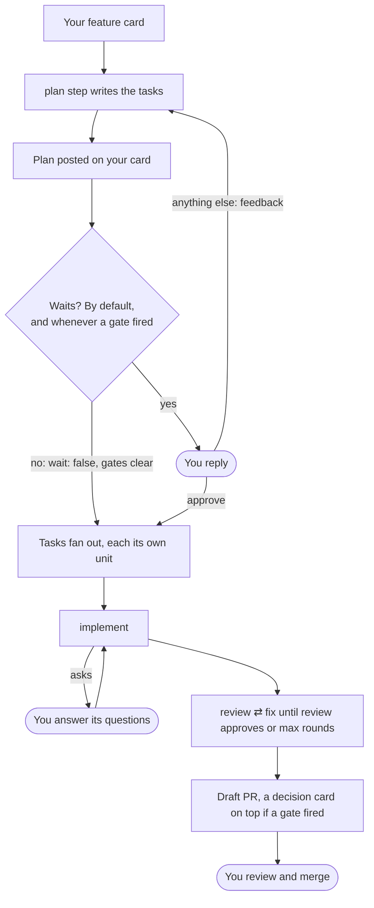

# Workflows

Where a run stops for a person, and how the work goes on from your answer:

- [Questions](./questions.md#questions): a step needs your answer, so it asks on your item.
- [Continue](./questions.md#continue): work too big for one run goes on in the next, on the same draft.
- [Gates](./gates.md): a change that needs a human (a migration, a new route, a bumped dependency) gets a decision card on the PR.
- [Plans](./plans.md): a feature across a few PRs or repos is split into tasks you approve first.
- [Posts that wait](./posts.md#posts-that-wait): a report you read before the next stage starts.
- [Threads](./posts.md#threads): the card can't take awaywork's posts, so they go to a GitHub issue.
- [Store](./store.md): big plans, contracts and screenshots live outside the post and [come back](./store.md#files-that-come-back) to the next step.
- [Proving a change](./proving.md): a skill of your own shows the change does what the card asks, and gates check what it left.

awaywork keeps none of this in its state dir: every wait is read off the item, its PR or its thread, so a fresh runner still waits and goes on.

A feature card under a `deliver: plan` rule, with an `implement` rule and a review-and-fix [loop](../config/chains.md#loops) taking its tasks, stops for you at the plan, at any questions, and at the PR. Your reply is what moves it on:

